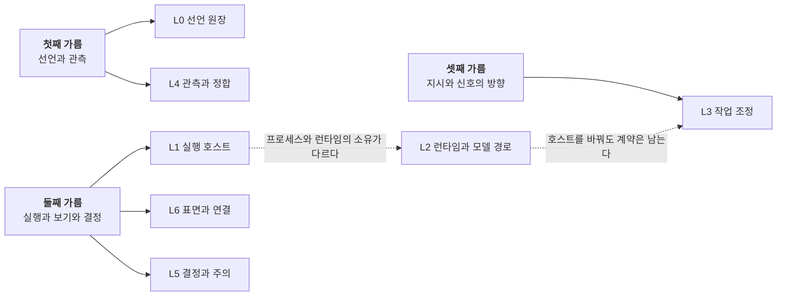
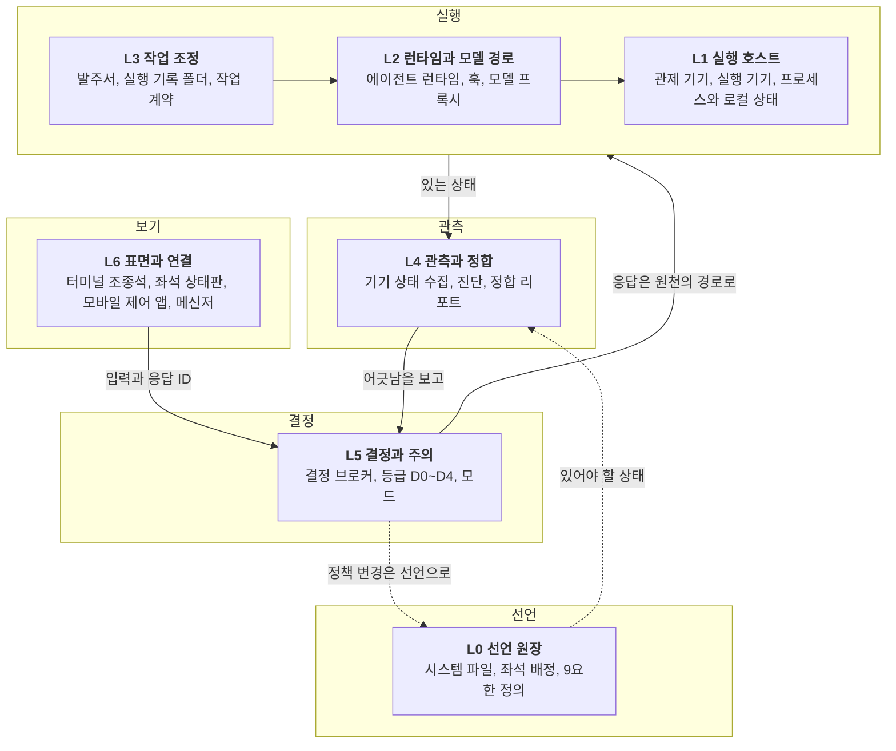
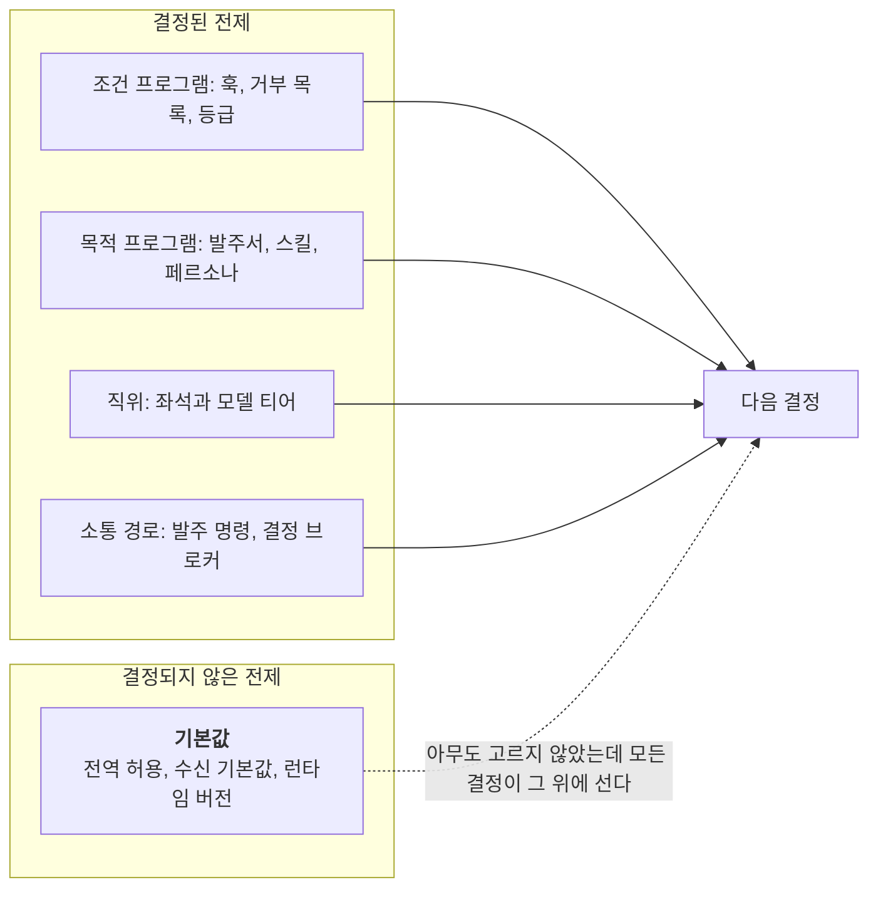

> **한 줄 주장**
>
> 층은 소유에서 나온다. 선언과 관측, 실행과 보기와 결정, 지시와 신호를 가르면 일곱 책임 영역이 남는다. 가장 아래 층인 선언 원장은 조직의 기억, 곧 결정 전제의 저장소다. 그리고 하네스에서 사고가 나는 자리는 대개 결정된 전제가 아니라 결정되지 않은 전제다.

왜 일곱이냐는 질문을 자주 받는다. 다섯이면 안 되는가, 아홉이면 더 좋지 않은가. 답은 수에 있지 않다. 일곱은 세 번 가른 결과이고, 가르는 기준은 하나다. 소유. 이 글은 1편이 미뤄 둔 받는 쪽의 구조를 세운다. 루만의 조직 이론을 빌리기 전에 하네스 쪽 근거를 먼저 세우고, 그 다음에 루만이 그 구조를 무엇이라 부를지 본다.

## 1. 소유가 먼저다
기획서는 뼈대를 한 단어로 적었다. 소유. 모든 일은 실행 소유자 하나와 쓰기 소유자 하나를 갖는다. 한 세션, 한 터미널, 한 작업 폴더의 실행 소유자는 정확히 하나이고, 정본 위치마다 동시에 쓰는 자도 하나다. 뷰를 닫거나 기기를 옮겨도 소유는 바뀌지 않는다. 좌석의 주인은 각 기기의 좌석 관리자이고, 좌석을 보여 주는 창들은 버려도 되는 보기 창이다(문서상).

이 원칙이 서면 층은 그 원칙에서 따라 나온다. 소유가 다른 것은 같은 층에 둘 수 없기 때문이다. 같은 사물을 두고 실행 소유, 쓰기 소유, 보기를 나눠 적으면 경계가 보인다.

| 대상 | 실행 소유자 | 쓰기 소유와 방식 | 소유가 아닌 뷰 |
|---|---|---|---|
| 실행 기기의 9요한 좌석 | 실행 기기의 좌석 관리자와 터미널 세션 | 자기 실행 기록 폴더의 출력, 자기 스크래치 노트 | 좌석 입력 타일, 좌석 상태판 |
| 관제 기기의 대화형 세션 | 터미널 조종석 | 그 세션이 맡은 작업 폴더. 정본 수정은 사람 확인 뒤 | 모바일 세션 목록, 메신저 카드 |
| 정기 잡 | 운영체제 스케줄러 | 잡마다 자기 레인 하나 | 스케줄 조회 명령 |
| 실행 결과의 볼트 반영 | 실행 기기의 감시 잡 | 지정 레인에 새 파일만 넣는다. 같은 이름이면 쓰지 않는다 | 관제 기기의 노트 앱 |
| 기존 볼트 노트 수정 | 관제 기기의 사람이나 9요한 prime | 패치 제안을 관제 기기에서 반영한다(결정 등급 D2) | 없음 |
| 사람의 결정 응답 | 결정 브로커 | 원천의 장부. 응답 기록은 제안 | 응답 런처, 모바일 수신함 |
| 9요한 결재 | 결재 명령 | 산출물 메타데이터의 상태 전이와 원장 한 줄. 실행은 없다 | 운영 진단 화면 |

표에서 보이는 것은 소유가 기기 이름을 따라가지 않는다는 점이다. 같은 기기 안에서도 좌석과 정기 잡과 대화형 세션은 소유자가 다르고, 같은 볼트를 두고도 새 파일을 넣는 쪽과 기존 노트를 고치는 쪽은 다르다.

## 2. 세 가름이 일곱 층을 만든다
세 가름이 있다. 첫째, **선언과 관측을 가른다.** 있어야 할 상태(L0)와 있는 상태를 관측한 것(L4)은 서로 다른 저장소에 둔다. 선택이 되었다는 것(resolved), 살아 있다는 것(observed), 맞다는 것(validated)은 서로 다른 기준과 증거로 판정한다. 둘째, **실행과 보기와 결정을 가른다.** 실행은 각 호스트가 소유하고(L1), 보기는 표면이 맡고(L6), 사람에게 묻는 모든 것은 한 곳(L5)으로 모인다. 보는 창은 좌석의 주인이 아니다. 셋째, **지시와 신호의 방향을 가른다.** 발주는 위에서 아래로만 가고, 옆에서 오는 메시지는 데이터일 뿐 발주나 승인의 근거가 아니다.

*코드로 렌더링한 도식. 일곱은 세 번 가른 결과다. 첫째 가름이 두 층, 둘째 가름이 세 층을 내고, 실행 안쪽이 다시 둘로 갈려 일곱이 된다.*

실행 안쪽이 다시 셋으로 나뉘는 것도 소유 때문이다. 프로세스와 로컬 상태를 가진 호스트(L1), 트랜스크립트와 권한 평가와 모델 호출을 가진 런타임(L2), 호스트와 런타임을 바꿔도 살아남는 작업 계약(L3)은 각각 다른 것을 소유한다. 두 기기가 모델 사용 한도를 공유하면서 프로세스는 공유하지 않는다는 사실 하나가 L1과 L2를 가른다. 발주서가 어느 기기의 어느 런타임에서 실행되든 같은 계약을 요구한다는 사실이 L3를 가른다.

*코드로 렌더링한 도식. 일곱 층은 다섯 책임 묶음으로 쌓인다. 선언, 실행, 관측, 결정, 보기. 화살표는 허용된 경로이고 관찰된 사건이 아니다.*

층마다 소유하는 것과 소유하지 않는 것을 적으면 이렇다. 구성 요소의 이름은 일반화했고, 정확한 이름과 버전은 기획서에 있다.

| 층 | 소유한다 | 소유하지 않는다 |
|---|---|---|
| L0 선언 원장 | 기기 역할, 실행 대상, 쓰기 레인, 라우트, 모드, 위험 등급, 상시 승인 예외. 있어야 할 상태 | 런타임 상태, 프로세스의 기동과 종료, 결정 응답, 주소와 키 |
| L1 실행 호스트 | 프로세스, 터미널, 좌석 수명, 자기 작업 장부와 로컬 상태 | 다른 호스트의 상태, 볼트 기존 노트의 수정, 사람의 결정, 역방향 발주 |
| L2 런타임과 모델 경로 | 트랜스크립트, 권한 평가와 훅 파이프라인, 모델 호출과 영수증 | 좌석 배치, 라우팅 판정, 알림 경로, 사용 한도의 배분 |
| L3 작업 조정 | 작업 계약(입력 버전, 출력 위치, 완료 판정, 중단과 재개), 한 작업 한 발주자, 결과 회수와 승격 제안 | 실행 프로세스, 결정의 최종 판단, 정본 직접 수정 |
| L4 관측과 정합 | 관측값과 관측 시각, 신선도 판정, 세션 별칭 지도, 정합 리포트 | 상태 수정, 재시작, 라우팅 강제. 관측 불가는 실패가 아니다 |
| L5 결정과 주의 | 결정의 상태 기계와 개정 번호, 첫 유효 응답 채택, 응답 기록, 등급과 응답 위치 계산, 사건당 한 번 알림 | 실행, 작업 상태의 정본, 결정 내용의 대리 판단 |
| L6 표면과 연결 | 보기와 입력, 원문과 모델 요약의 구분 표시, 응답 ID 발급, 회선 선택과 도달성 | 세션 소유, 결정 유효성 판단, 키 주입 승인, 다른 표면의 응답 대행 |

## 3. 층 번호는 의존의 순서가 아니다
층 번호는 선언에서 표면 쪽으로 커지지만, 그것은 책임의 배열이고 의존의 순서가 아니다. 관측(L4)은 결정(L5)에만 쓰이지 않고 발주(L3)가 대상을 고를 때도 쓰인다. 결정은 런타임과 발주로 되돌아간다. 사람이 표면(L6)에서 바로 작업을 시키는 것도 그 자체로 오류가 아니다. 문제는 그 작업이 작업 계약으로 등록되고 검증을 거치는지다. 그래서 일곱 층은 계층이라기보다 일곱 책임 영역과 그 사이의 허용된 교차 경로라고 읽는 것이 맞다.

이 구별이 중요한 이유는 층 그림이 자주 명령 계통도로 오독되기 때문이다. 위가 아래를 시키고 아래가 위에 보고하는 그림. 그 그림에서는 L6이 가장 높고 L0이 가장 낮다. 실제로는 반대에 가깝다. L0은 모든 층이 참조하는 기준이고 L6은 가장 바꾸기 쉬운 껍질이다. 번호를 뒤집어 읽어도 의미가 통해야 한다. 통하지 않으면 그 자리에 의존이 숨어 있다는 뜻이고, 그것이 다음 절에서 다룰 어긋남이다.

## 4. 열세 원칙은 세 가름의 전개다
기획서의 설계 원칙 열세 개는 따로 외울 것이 아니라 세 가름의 전개로 읽으면 네 묶음이 된다.

| 묶음 | 원칙 | 지위 |
|---|---|---|
| 소유를 정한다 | 실행은 분산, 보기는 통합, 결정은 한 곳(1). 실행 소유자 하나, 쓰기 소유자 하나(2). 환경은 소유를 바꾸지 않는다(9) | 1의 앞 두 마디와 2는 정본. 1의 셋째 마디와 9는 제안 |
| 선언과 관측을 가른다 | 선언과 관측을 섞지 않는다(3). 기존 원장을 잇고 새 저장소는 최소로(13) | 문서상 |
| 방향과 경로를 정한다 | 지시는 아래로, 신호는 위로(4). 한 요청은 한 봉투 한 경로(5). 답은 원천의 네이티브 경로로만(6) | 4의 전단은 문서상, 후단과 5는 제안. 6은 코드로 확인 |
| 위험과 상황을 다룬다 | 위험은 영향으로 정한다(7). 엄격해지는 전환은 자동, 느슨해지는 전환은 수동(8). 무인 실행은 깨어 있음이 보장된 곳에(10). 사람 없는 외부 효과는 등록된 예외뿐(11). 밖으로 나가는 알림에는 최소 식별자만(12) | 7, 8, 11은 제안. 10과 12는 문서상 |

원칙 열세 개가 서로 독립적이지는 않다. 한 요청 한 봉투 규칙과 네이티브 경로 규칙은 결정이 한 곳이라는 원칙의 귀결이다. 그래도 따로 적어 둔 이유는 깨지는 자리가 다르기 때문이다. 하나는 결정의 집결, 하나는 중복 제거, 하나는 응답의 검증을 맡는다. 어느 원칙이 깨졌는지 알아야 어느 층을 고칠지 안다.

## 5. L0은 조직의 기억이다
여기서 루만을 부른다. 루만은 조직을 사람의 집합이 아니라 결정의 체계로 봤다(Luhmann, 2000/2018). 결정은 다음 결정의 전제가 된다. 그는 결정할 수 있는 전제를 세 종류로 나눴다. **프로그램**, **인사**, **소통 경로**. 프로그램은 다시 둘이다. 어떤 조건이 충족되면 이 결정을 한다는 **조건 프로그램**, 이 목적을 이루라는 **목적 프로그램**. 셋을 하나로 묶는 단위가 **직위**(Stelle)다. 그리고 결정할 수 없는 전제가 하나 더 있다. 누구도 결정한 적 없는데 모든 결정이 그 위에 서는 것, 조직 문화(Luhmann, 2000/2018). 이 넷을 하네스에 올리면 L0 선언 원장이 무엇인지 분명해진다.

| 루만의 결정 전제    | 하네스의 자리                                                               | 층      |
| ------------ | --------------------------------------------------------------------- | ------ |
| 조건 프로그램      | 훅과 차단 장치. 도구 호출 전 검사, 거부 목록, 중단 조건, 결정 등급 산정. 허용과 차단과 승격으로 분기한다       | L2, L5 |
| 목적 프로그램      | 발주서와 작업 계약, 스킬, 9요한 페르소나의 "언제 쓰는가" 줄. 계약에는 완료 판정 같은 조건 프로그램도 함께 들어 있다 | L3, L0 |
| 직위와 거기 놓인 자원 | 좌석과 모델 티어. 비대화형 호출의 모델 고정                                             | L2, L1 |
| 소통 경로        | 발주 명령과 실행 기록 폴더, 결정 브로커. 측면 메시지는 권한 없는 전달 경로                          | L3, L5 |
| 결정할 수 없는 전제  | 아무도 정하지 않은 기본값. 전역 허용, 측면 메시지의 수신 기본값, 원격 명령이 집어 드는 런타임 버전            | 모든 층   |

*코드로 렌더링한 도식. 결정된 전제는 선언 원장에 적혀 있다. 사고는 적혀 있지 않은 전제, 곧 기본값에서 난다.*

조건 프로그램과 목적 프로그램은 섞이지 않는 것이 좋다. 훅은 발주서를 대신하지 않고, 발주서는 훅을 풀지 못한다. 라우팅 판정 규칙이 비어 있어 늘 한 기기만 고르던 상태는, 루만식으로 말하면 조건 프로그램이 비어 기본값이 결정하던 것이다.

인사를 모델 티어에 대응시키는 데는 조심이 필요하다. 루만의 인사가 결정 전제인 이유는 구성원에게 결정을 귀속시킬 수 있기 때문이다. 모델은 책임 귀속의 대상이 아니다. 그러니 모델과 좌석은 직위에 배치된 자원이라고 약하게 써야 한다. 그래도 비대화형 호출에 모델 티어를 고정하라는 내 규칙은 같은 자리를 가리킨다. 직위에 놓인 것이 암묵적으로 바뀌면 그 뒤의 모든 결정이 다른 전제 위에 선다.

이 절에서 가장 쓸모 있는 발견은 마지막 행이다. 같은 기기에 같은 런타임이 여러 벌 깔려 있고 원격 명령이 가장 낡은 것을 먼저 잡더라는 발견은 인사의 변경이 아니라 결정할 수 없는 전제의 사례다. 아무도 그 버전을 고르지 않았다. 전역 허용 기본값과 측면 메시지의 수신 기본값도 같은 범주다. 하네스에서 사고가 나는 자리는 대개 결정된 전제가 아니라 결정되지 않은 전제다. 그래서 하네스 점검의 첫 질문은 "무엇을 결정했나"가 아니라 "무엇을 결정하지 않았나"여야 한다. 기본값 목록을 적는 일이 원칙 목록을 적는 일보다 먼저다.

## 6. 불확실성은 흡수되어야 한다, 어디서가 문제다
루만이 마치와 사이먼에게서 받아 온 개념이 있다. **불확실성 흡수**(March & Simon, 1958; Luhmann, 2000/2018). 결정의 결과만 전달되고 전제가 전달되지 않으면, 받는 쪽은 그 결과를 사실처럼 쓴다. 불확실성이 흡수된 것이다. 서브에이전트의 보고가 그렇다. 틀린 것도 맞은 것과 같은 확신의 어조로 온다.

처음에는 영수증과 보고서 형식과 생성자와 검증자를 가르는 규칙이 흡수를 늦추는 장치라고 쓰려 했다. 방향이 틀렸다. 루만에게 흡수는 막거나 늦출 대상이 아니라 조직이 하는 일 그 자체다. 흡수 없는 조직은 없다. 모든 결정의 전제를 매번 다시 따지는 조직은 결정하지 못한다. 설계가 정하는 것은 흡수할지 말지가 아니라 어디서 흡수할지다. 모델이 결정 내용을 대리 판단하지 못하게 한 L5의 조항은 흡수를 막지 않는다. 흡수 지점을 사람의 결정으로 지정한다. 사람이 승인하면 그 결과는 이후 결정들이 근거를 다시 따지지 않고 전제로 쓴다. 그것이 흡수다. 영수증은 흡수를 늦추는 장치가 아니라, 흡수된 전제를 나중에 다시 열 수 있게 남기는 주소다.

이 교정은 설계의 어조를 바꾼다. "모델을 믿지 말라"가 아니라 "어디서 믿기로 할지 정하라"다. 전자는 끝없는 검증을 낳고 후자는 흡수 지점 하나와 재개 주소 여럿을 낳는다.

## 7. 정직하게 적을 셋과 빈칸 넷
정직하게 적을 것이 셋 있다. 첫째, 일곱이라는 수는 정리의 결과다. 선언과 관측과 결정을 가르는 것은 양보할 수 없지만, 실행을 셋으로 나눈 것은 지금 두 기기와 두 런타임이라는 조건에서 소유가 그렇게 갈리기 때문이다. 조건이 바뀌면 층의 수도 바뀔 수 있다. 둘째, 열세 원칙 가운데 다섯은 통째로 제안이고 둘은 절반이 제안이다. 결정은 한 곳이라는 첫 원칙의 셋째 마디조차 기획서 자신이 사용자 미결정 권고라고 적어 두었다. 이 시리즈가 하네스를 루만으로 읽을 때 밑에 깔린 것은 완성된 건물이 아니라 자기 어긋남을 기록하는 설계도다. 셋째, 설계도에도 빈칸이 있다.
- **양도 절차.** 실행 소유자가 바뀌어야 할 때 소유를 넘기는 절차가 없다. 소유자 하나라는 원칙은 소유자가 바뀌지 않을 때만 완전하다.
- **관측의 정본과 복제본.** 관측값은 그것을 만든 기기에 있고 관제 기기는 그것을 당겨 온다. 둘이 어긋날 때 어느 쪽이 정본인지 적혀 있지 않다.
- **응답 위치의 계산 규칙.** 등급과 모드와 기기 상한과 관측된 연결 중 가장 엄격한 값을 고른다는 원칙은 있지만, 네 입력이 충돌할 때의 계산 규칙은 없다.
- **깨어 있음의 판정 기준.** 무인 실행은 깨어 있음이 보장된 곳에 둔다는 원칙은 있지만, 보장되었다는 판정의 관측 기준은 없다.
넷 다 루만으로 읽기 전에 하네스 쪽에서 먼저 메워야 할 자리다. 루만의 말로 하면 기획서는 체계의 자기 기술(Selbstbeschreibung)이고(Luhmann, 1997), 자기 기술이 어디까지 믿을 만한지는 6편에서 라투르가 다시 묻는다. 기획서 자신이 층 경계가 새는 곳 일곱을 적어 두었다는 사실은 그때 다룬다. 다음 편은 이 구조의 선례로 돌아간다. 명령 없이 30년을 간 하네스, 루만의 카드 상자다.

---

## 검증 경계
> **인용과 수치의 경계**
>
> - 하네스 서술의 근거는 AI 하네스 총정리와 구조 스키마 기획서(2026-10-23, 볼트 내부)의 2.1~2.4절이다. 원칙의 지위(정본, 문서상, 제안)는 기획서의 표기를 그대로 옮겼다. 기기와 도구의 이름은 일반화했고, 실측 수치는 기획서에 있다.
> - 결정 전제의 하네스 대응과 "결정되지 않은 전제" 읽기는 내 해석이다. 루만의 조직 이론 인용은 저작 단위이며 쪽수는 적지 않았다.
> - 빈칸 넷은 기획서가 스스로 적은 것이 아니라 이 시리즈를 쓰면서 찾은 것이다. 기획서에 반영할지는 아직 정하지 않았다.

## 참고문헌
- Luhmann, N. (1997). *Die Gesellschaft der Gesellschaft*. Suhrkamp.
- Luhmann, N. (2018). *Organization and decision* (R. Barrett, Trans.; D. Baecker, Ed.). Cambridge University Press. (Original work *Organisation und Entscheidung* published 2000)
- March, J. G., & Simon, H. A. (1958). *Organizations*. Wiley.
