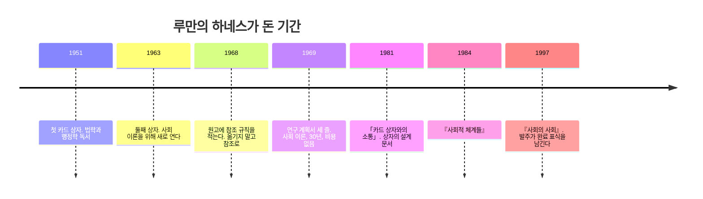
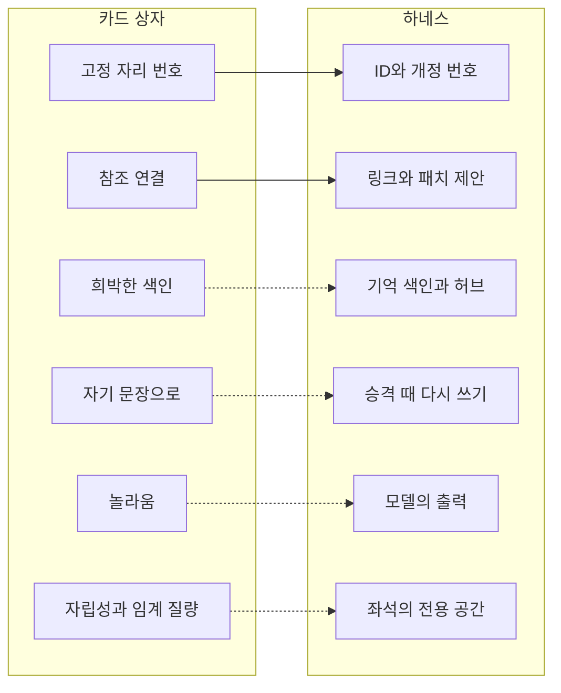

> **한 줄 주장**
>
> 루만은 하네스라는 말을 쓴 적이 없지만 하나를 지었다. 자리를 바꾸지 않는 주소, 옮기지 않고 참조로 하는 교정, 소수의 진입점, 자기 문장으로 다시 쓰기. 이 네 규칙과 몇 년의 기다림이 그의 세팅이다. 지금의 하네스에 거의 그대로 있는 것은 둘이고, 넷은 유비다.

1969년 새로 문을 연 사회학부에 들어가며 루만이 낸 연구 계획서는 세 줄이었다. 사회 이론, 기간 30년, 비용 없음(Luhmann, 1997, p. 11). 내 작업 계약 기준으로는 입력 버전도 출력 위치도 완료 판정도 없어서 반려다. 그런데 그 발주는 1997년에 완료 표식을 남겼다. 『사회의 사회』라는 이름으로. 그 사이에 그가 쓴 것은 책만이 아니다. 책을 쓰게 한 장치가 있었다. 빌레펠트의 책상 위에 약 9만 장의 카드가 두 상자에 나뉘어 있었고(Schmidt, 2018), 그는 그 상자를 반쯤 농담으로 소통 파트너라고 불렀다(Luhmann, 1981b).

*코드로 렌더링한 도식. 명령 없이 30년을 간 하네스. 설계 문서는 상자를 연 지 30년 뒤에 나왔고, 완료 표식은 그로부터 16년 뒤에 나왔다.*

1편과 2편의 개념은 모두 루만이 책으로 쓴 것이다. 이 글은 그가 손으로 지은 것을 다룬다. 1981년의 짧은 글은 그 상자가 어떻게 소통 파트너가 되는지를 설계 문서처럼 적었고(Luhmann, 1981b), 빌레펠트의 아카이브 연구는 그 상자가 실제로 어떻게 돌아갔는지를 복원했다(Schmidt, 2016, 2018). 상자는 그의 책을 대신 쓰지 않았다. 그래도 그는 상자가 자기를 놀라게 한다고 했고, 상자 없이는 쓸 수 없다고 했다. 상자를 파트너로 만든 규칙을 넷으로 정리하고, 하네스의 어디에 대응하는지와 그 대응이 어디까지 정당한지를 함께 적는다.

## 1. 첫째 규칙, 자리를 바꾸지 않는 주소
상자의 정신적 삶에 결정적인 것은 주제와 하위 주제에 따른 체계적 질서를 거부하고 **고정된 자리 질서**(feste Stellordnung)를 택하는 일이라고 루만은 썼다(Luhmann, 1981b, p. 224). 카드는 한 번 받은 번호를 바꾸지 않는다. 새 카드는 주제가 가까운 곳에 끼워 넣되 기존 번호를 밀어내지 않고 가지를 친다. 1번 뒤에 1a, 1a 뒤에 1a1. 그래서 번호는 주제를 뜻하지 않고 자리만 뜻한다.

하네스에서 이 규칙에 가장 가까운 것은 식별자다. 세션 ID, 실행 기록의 ID, 결정 봉투의 개정 번호, 노트에 적어 두는 세션 링크. 자리가 바뀌지 않는 주소가 있어야 참조가 산다. 이것은 부분 묘사다. 주소가 안정적이라는 점은 같다. 다른 점은 루만의 번호가 끼워 넣기와 가지치기를 번호 자체에 담는다는 것이다. 1a1은 1a에서 갈라졌다는 사실을 번호가 말한다. 실행 기록의 ID는 그런 가지를 치지 않는다. 어느 실행이 어느 실행에서 갈라졌는지는 ID가 아니라 보고서 본문이 말해야 한다. 그 자리가 비어 있다.

## 2. 둘째 규칙, 옮기지 말고 참조로 고친다
1968년 원고의 문장은 이렇다. *Fehlplacierungen müssen durch Verweisung korrigiert werden, nicht durch Umstellen.* 잘못 놓인 것은 옮겨서가 아니라 참조로 고쳐야 한다. 카드가 엉뚱한 자리에 들어갔으면 빼서 옮기지 않는다. 맞는 자리에서 그쪽으로 가는 참조를 하나 더 낸다. 자리는 그대로이고 길이 늘어난다.

이 규칙이 하네스 안에서 가장 정확하게 살아 있는 곳이 실행 결과를 볼트에 반영하는 길이다.

*코드로 렌더링한 도식. 잘못 놓인 카드는 옮기지 않고 참조로 고친다. 좌석은 기존 노트를 고치지 않고 새 파일을 더하며, 정본 수정은 관제 기기의 결정을 거친다(문서상 규칙).*

좌석은 기존 노트를 고치지 않는다. 새 파일만 레인에 넣고, 이미 있는 이름이면 쓰지 않는다. 기존 정본을 바꾸려면 패치 제안을 만들어 관제 기기의 결정을 거친다. 볼트 안의 파일 이동 규칙도 같은 뿌리다. 파일을 옮기면 같은 턴에 참조를 갱신하고, 과거 기록의 옛 경로는 역사라 고치지 않는다. 그 규칙은 정본 폴더를 옮긴 뒤 시스템 파일의 포인터가 넉 달 동안 조용히 죽어 있던 사고에서 나왔다. 루만은 같은 사고를 1968년에 미리 막았다.

루만의 옮기기 금지와 같은 것은 아니다. 하나는 자리의 안정성에 관한 규칙이고 하나는 수정 권한의 분리에 관한 규칙이다. 닮은 점은 수정 권한을 나눔으로써 자리의 안정성을 지킨다는 결과다. 결정 브로커의 응답도 덮어쓰지 않고 개정 번호로 쌓인다. 묘사라고 부를 수 있는 것은 볼트 안의 링크와 이 반영 경로까지다. 실행과 실행 사이의 참조 장치는 아직 없다.

## 3. 셋째 규칙, 소수의 진입점
체계적인 자리 질서가 없으니 다시 찾는 절차를 규칙으로 정해야 한다고 루만은 적었다(Luhmann, 1981b, p. 225). 그 절차가 키워드 색인(Register)이다. 아카이브가 보여 준 것은 그 색인이 희박했다는 사실이다. 키워드마다 한두 카드만 가리킨다(Schmidt, 2018). 전수 목록이 아니라 진입점이다. 들어가서 참조를 따라가면 나머지가 나온다.

하네스에서 색인에 해당하는 것은 에이전트 기억의 색인 파일, 허브 노트, 시스템 파일의 "필요할 때 읽기" 규칙이다. 기억 색인은 한 줄짜리 포인터의 목록이고 내용은 각 파일에 둔다. 시스템 파일은 세션 시작 때 전부 싣지 않고 트리거가 오면 읽는다. 이것은 유비다. 루만의 색인은 필요할 때 당겨 오는 진입점이고, 세션 시작에 미리 실리는 색인은 밀어 넣는 목록이다. 방향이 반대다. 세션 시작 컨텍스트를 다섯에 하나로 줄인 결정은 밀어 넣기를 당겨 오기 쪽으로 옮긴 것이고, 그 점에서만 루만과 같은 방향이다.

색인 규칙은 기억의 문제다. 루만은 기억의 주 기능이 망각이라고 썼다. 앞선 관찰의 결과가 굳어 체계가 스스로 막히는 것을 막는 일이 기억의 일이다(Luhmann, 1997, p. 579). 그의 망각은 삭제가 아니다. 반복 사용 속에서 응축되고 확인되는 것만 남고 나머지가 떨어지는 선택이다. 그래서 색인 파일을 한 줄짜리로 두는 것, 발주서 크기에 경고선과 정지선을 둔 게이트는 엄밀히는 망각의 설계가 아니라 용량 관리다. 다만 하는 일은 같다. 굳은 결과가 다음 작동의 자리를 막지 않게 한다. 희박한 색인이 소통 파트너의 조건이라는 말은 1981년 글에 그대로 있는 문장이 아니라 내 해석이다.

## 4. 넷째 규칙, 자기 문장으로 다시 쓴다
카드는 발췌가 아니다. 읽은 것을 자기 사고의 언어로 다시 적는다. 직접 인용과 남의 생각은 따로 표시한다(Schmidt, 2016). 이 규칙 덕에 상자 안의 카드들은 같은 사람의 언어로 쓰여 있고, 그래서 서로 참조될 수 있다.

하네스에서 이 규칙은 조건부로만 성립한다. 실행 기기의 산출물을 관제 기기에서 정본으로 승격할 때 사람이 다시 쓰면 그것이 자기 문장이다. 모델이 요약하면 그것은 재서술이 아니라 2편에서 말한 불확실성 흡수가 일어나는 자리다. 요약은 전제를 떼어 내고 결과만 넘긴다. 그래서 승격 규칙에 "사람이 다시 쓴다"가 들어가야 넷째 규칙이 산다. 들어가지 않으면 볼트는 발췌 상자가 된다. 발췌 상자는 찾는 데는 쓸모 있지만 놀라게 하지는 못한다.

## 5. 그리고 기다린다, 자립성과 임계 질량
루만은 1981년 글의 셋째 절을 이렇게 열었다. *Will man einen Kommunikationspartner aufziehen, ist es gut, ihn von vornherein mit Selbständigkeit auszustatten.* 소통 파트너를 키우려면 처음부터 자립성을 갖추어 주는 것이 좋다(Luhmann, 1981b, p. 226). 몇 줄 뒤에는, 상자가 임계 질량을 얻기까지 몇 년이 걸리며 그때까지는 넣은 것을 꺼내는 그릇일 뿐이라고 했다.

좌석에 자기 실행 기록 폴더와 자기 스크래치를 주고 관제 기기가 그 안에 들어가지 않는 것은 실행의 분리다. 자립성이라 부르려면 좌석이 받은 것을 자기 참조망으로 되돌려 주어야 한다. 그리고 임계 질량은 돌아가는 좌석의 수가 아니라 내부 참조의 밀도다. 그러니 지금의 하네스가 그릇인지 파트너인지는 좌석이 몇 개 도는지로 판정할 수 없다. 판정하려면 지표가 있어야 한다. 한 실행이 이전 실행을 참조한 횟수, 보고서가 볼트의 기존 노트를 끌어온 횟수, 승격된 노트가 다음 발주서에 인용된 횟수. 그 지표는 아직 없다. 지금 말할 수 있는 것은 하나다. 하네스도 몇 년은 그릇이다.

## 6. 놀라움, 파트너의 조건
소통의 기본 전제 하나는 파트너가 서로를 놀라게 할 수 있어야 한다는 것이다(Luhmann, 1981b, p. 222). 루만은 예측 가능한 파트너를 원한 게 아니다. 주소가 안정된 비자명한 파트너를 원했다. 상자의 놀라움은 오래 쌓인 내부 참조망에서 나온다(Schmidt, 2018). 모델의 놀라움은 확률적 출력에서 나온다. 원천이 다르니 유비다. 그래도 설계에 주는 교훈은 같다. 어디서는 놀라게 해도 되고 어디서는 절대 놀라면 안 되는지를 가르는 것이 하네스다. 작업 내용(L3)에서는 놀라움을 허용하고, 결정(L5)과 선언(L0)에서는 금한다. 놀라움을 전부 없애면 파트너가 아니라 그릇이고, 전부 허용하면 파트너가 아니라 소음이다.

## 7. 여섯 메커니즘과 대응의 밀도
네 규칙과 기다림과 놀라움을 한 표로 모으면 여섯 메커니즘이다.

| 카드 상자의 메커니즘 | 루만의 말 | 하네스의 자리 | 대응의 밀도 |
|---|---|---|---|
| 고정 자리 번호 | 한 번 받은 번호를 바꾸지 않는다(Luhmann, 1981b, p. 224) | 세션 ID, 실행 ID, 개정 번호, 세션 링크 | 부분 묘사. 가지치기는 없다 |
| 참조 연결 | 옮기지 않고 참조로 고친다(1968년 원고) | 볼트 링크, 파일 이동 규칙, 패치 제안 | 볼트에 한해 묘사. 실행 사이의 참조는 없다 |
| 희박한 색인 | 다시 찾는 절차를 규칙으로(Luhmann, 1981b, p. 225). 키워드마다 한두 장(Schmidt, 2018) | 기억 색인, 허브 노트, 필요할 때 읽기 | 유비. 당겨 오기와 밀어 넣기의 방향이 다르다 |
| 자기 문장으로 | 발췌가 아니라 자기 사고의 언어로(Schmidt, 2016) | 승격 때 사람이 다시 쓰기 | 조건부. 모델 요약은 흡수 지점이다 |
| 놀라움 | 파트너는 서로를 놀라게 한다(Luhmann, 1981b, p. 222) | 모델의 출력, L3에서만 허용 | 유비. 원천이 다르다 |
| 자립성과 임계 질량 | 처음부터 자립성을, 그리고 몇 년(Luhmann, 1981b, p. 226) | 좌석의 전용 공간, 볼트와 코퍼스의 규모 | 유비. 전용 공간은 자립성이 아니고 규모는 밀도가 아니다 |

*코드로 렌더링한 도식. 여섯 메커니즘 가운데 둘은 하네스에 거의 그대로 있고, 넷은 유비다. 실선은 묘사, 점선은 해석.*

## 8. 루만이 반대할 자리
정직하게 적어야 할 것이 있다. 100번대에서 900번대까지의 아홉 범주는 미리 정한 질서다. 루만이 카드에 *Vorbedingung: Verzicht auf festgelegte Ordnung*이라고 적은 바로 그것이다. 전제 조건은 확정된 질서의 포기. 1981년 글은 더 길게 말한다. 책의 목차 같은 내용 체계는 수십 년을 앞당겨 하나의 순서에 자기를 묶는 짓이라는 것이다. 그리고 바로 이 구조 결정이 가능한 배치의 복잡성을 줄이는 감축이고, 그 감축이 있어야 상자 안에 높은 복잡성을 쌓을 수 있다고 썼다(Luhmann, 1981b, p. 224). 줄여야 쌓인다.

내 위키의 쿼리는 이미 이 모순을 기록해 뒀다. 이 볼트의 분류 체계는 다산형 분류와 루만형 연결의 혼합이고, 루만이 강한 곳은 분류가 아니라 운영 규칙 쪽이다. 하네스도 같다. L0의 선언은 분류이고, L3의 실행 기록 폴더와 결정 봉투의 개정 번호는 연결이다. 둘을 섞어 쓰되 어느 쪽이 어느 쪽인지 알고 있으면 된다. 분류를 버리라는 것이 루만의 교훈이 아니다. 분류가 연결을 대신한다고 믿지 말라는 것이다.

## 9. 루만의 세팅을 지금 말로 옮기면
루만은 자기 상자의 규칙을 한 장에 적어 두지 않았다. 1981년 글이 가장 가깝지만 그것은 경험 보고다. 아래는 내가 그 글과 아카이브 발췌에서 뽑아 적은 목록이다. 그가 이렇게 쓴 적은 없고, 순서와 표현은 내 것이다.
1. 자리 번호는 한 번 받으면 바꾸지 않는다. 새 것은 끼워 넣고 가지를 친다.
2. 잘못 놓였으면 옮기지 않는다. 맞는 자리에서 그쪽으로 참조를 하나 더 낸다.
3. 색인은 키워드마다 한두 장만 가리킨다. 나머지는 참조를 따라가서 찾는다.
4. 발췌하지 않는다. 자기 문장으로 다시 쓰고, 남의 말은 남의 말로 표시한다.
5. 처음부터 자립성을 준다. 그리고 임계 질량이 생길 때까지 몇 년을 기다린다.
다섯 줄 가운데 첫 둘은 주소의 규칙이고, 셋째는 진입의 규칙이고, 넷째는 작성의 규칙이고, 다섯째는 시간의 규칙이다. 지금 하네스의 시스템 파일은 이 가운데 첫 둘과 셋째를 갖고 있다. 넷째는 승격 규칙에 절반만 들어 있고, 다섯째는 어디에도 없다. 기다린다는 규칙은 적을 수 없는 종류의 규칙처럼 보이지만, 사실은 지표의 문제다. 무엇이 쌓이는지를 재지 않으면 기다리는지 방치하는지 구별할 수 없다. 다음 편은 그 지표가 살 자리, 스키마를 다룬다.

---

## 검증 경계
> **인용과 수치의 경계**
>
> - 1981년 「Kommunikation mit Zettelkästen」의 인용(고정 자리 질서, 색인, 놀라움, 자립성과 임계 질량, 감축)은 Westdeutscher Verlag 1981년판 스캔(222~228쪽)의 독일어 원문과 대조했다. 쪽수는 그 판본 기준이다. 1968년 원고의 "Fehlplacierungen..."과 카드 ZK II 9/8의 "Vorbedingung..."은 아카이브 원문 발췌다. 대조 기록은 독일어 원문 대조 노트(2026-10-24, 볼트 내부).
> - 두 상자의 기간과 카드 수 약 9만 장은 Schmidt(2016, 2018)의 집계다. 연표의 연도는 그 집계와 루만 자신의 기록(Luhmann, 1997, p. 11)에 따랐다.
> - 하네스 쪽 대응 가운데 유비로 표시한 넷과 9절의 규칙 목록은 내 해석이다. 파일 이동 규칙의 배경 사고는 볼트 규칙 문서에 기록되어 있다.

## 참고문헌
- Luhmann, N. (1981b). Kommunikation mit Zettelkästen: Ein Erfahrungsbericht. In H. Baier, H. M. Kepplinger, & K. Reumann (Hrsg.), *Öffentliche Meinung und sozialer Wandel* (S. 222–228). Westdeutscher Verlag.
- Luhmann, N. (1997). *Die Gesellschaft der Gesellschaft*. Suhrkamp.
- Schmidt, J. F. K. (2016). Niklas Luhmann's card index: Thinking tool, communication partner, publication machine. In A. Cevolini (Ed.), *Forgetting machines: Knowledge management evolution in early modern Europe* (pp. 289–311). Brill. https://doi.org/10.1163/9789004325258_014
- Schmidt, J. F. K. (2018). Niklas Luhmann's card index: The fabrication of serendipity. *Sociologica, 12*(1), 53–60. https://doi.org/10.6092/issn.1971-8853/8350
