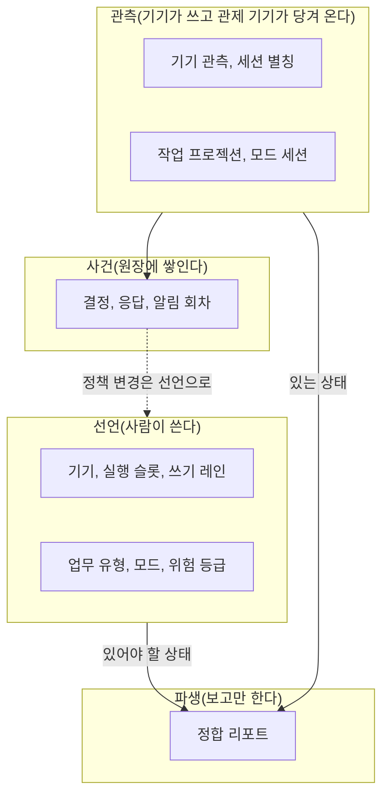
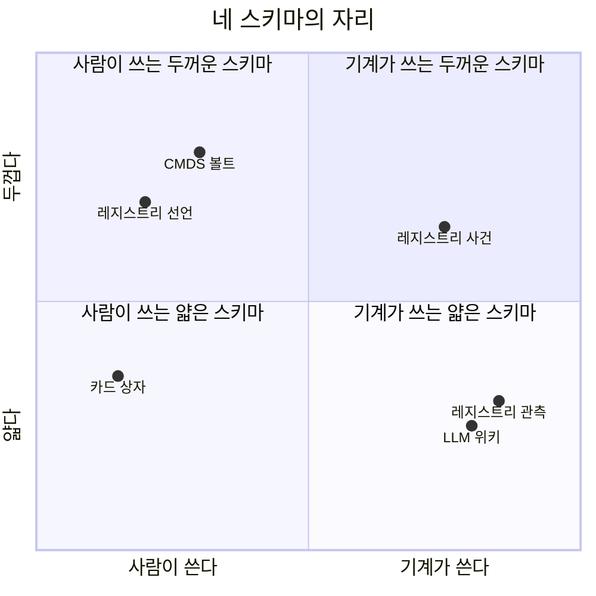
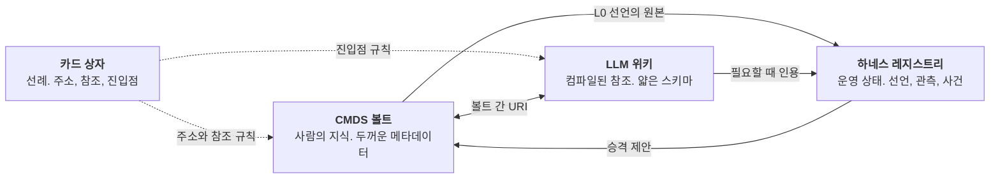

*시리즈 「소통으로 읽는 에이전트 하네스」 4편. 용어는 [시리즈 지도](/posts/agent-harness-communication-0/)에 모아 두었다.*

> **한 줄 주장**
>
> 스키마는 들어오는 것을 정보로 만드는 비교 장치다. 카드 상자, LLM 위키, CMDS 볼트, 하네스 레지스트리는 모두 스키마를 갖지만 무엇을 선언하고 무엇을 관측하고 누가 쓰는지가 다르다. 두께는 생산자를 따라가고, 선언과 관측의 분리는 생산 속도가 읽는 속도를 넘을 때 생긴다. 넷이 공유하는 것은 하나, 스키마의 항상성이다.

「Schema는 Harness다」에서 나는 카르파티의 LLM 위키와 내 볼트가 같은 구조라고 썼다. 원본 층, 컴파일된 층, 그리고 컴파일 규칙을 적은 스키마 층. 그 글의 결론은 두 체계가 모두 하네스 공학의 사례라는 것이었다. 그 뒤로 스키마가 둘 더 생겼다. 루만의 카드 상자를 설계 문서로 다시 읽으면서 그 상자에도 스키마가 있었다는 것을 보았고, 하네스 기획서를 쓰면서 열여섯 종의 엔티티로 된 레지스트리를 제안했다. 넷을 나란히 놓으면 스키마가 하나의 사물이 아니라는 것이 보인다. 이 글은 그 비교다.

## 1. 스키마는 비교 장치다
루만의 정의부터 다시 적는다. 정보는 비교 스키마를 가진 체계 안에서만 생기고, 그 스키마의 항상성만이 뒤따르는 정보 처리의 결속을 보장한다(Luhmann, 1981b, p. 222). 두 문장에 스키마의 두 기능이 있다. 첫째, 들어오는 것을 "이것인가 다른 것인가"로 가른다. 둘째, 그 가름이 어제와 오늘 같아서 어제의 정보와 오늘의 정보가 이어진다. 가르는 기능이 없으면 소음이고, 항상성이 없으면 단절이다.

이 정의로 보면 스키마는 데이터베이스의 테이블 정의보다 넓고 분류 체계보다 좁다. 분류 체계는 사물을 어디에 둘지 정하고, 스키마는 들어온 것을 무엇과 비교할지 정한다. 3편에서 루만이 분류를 거부하고 자리 번호와 참조와 색인을 택했다고 적었다. 그 셋이 그의 스키마다. 분류를 거부한 사람이 스키마를 거부한 것은 아니다. 오히려 분류를 버렸기 때문에 스키마가 더 엄격해야 했다.

## 2. 네 스키마
비교할 넷을 먼저 각각 적는다.

**카드 상자.** 단위는 카드 한 장. 주소는 가지를 치는 자리 번호. 연결은 카드에 적은 참조 번호. 진입은 키워드마다 한두 장만 가리키는 색인. 교정은 옮기지 않고 참조를 더하는 것. 작성자는 한 사람. 스키마는 어디에도 파일로 적혀 있지 않았고 실천 속에 있었다. 1981년 글이 가장 가까운 문서다(Luhmann, 1981b; Schmidt, 2016).

**LLM 위키.** 카르파티가 제안한 세 층이다. 원본 층은 불변이고, 위키 층은 모델이 원본을 컴파일해 유지하며, 스키마 층은 그 컴파일 규칙을 적은 파일 하나다. 단위는 위키 페이지. 주소는 페이지 이름. 연결은 위키 링크. 교정은 다시 컴파일하는 것. 작성자는 모델이고 사람은 질문하고 검토한다. 「Schema는 Harness다」가 정리한 바로는 필수 필드가 거의 없는 얇은 스키마다.

**CMDS 볼트.** 내 볼트의 메타데이터 규약이다. 단위는 노트. 주소는 파일 이름과 별칭. 연결은 위키 링크와 볼트 사이의 URI. 모든 노트가 필수 필드 일곱을 갖고, 분류는 폴더가 아니라 메타데이터 필드로 한다. 교정은 파일 이동 규칙을 따른다. 옮기면 같은 턴에 참조를 갱신하고 역사 기록은 보존한다. 작성자는 사람이 주이고 에이전트는 작성 모델 필드를 남긴다. 두꺼운 스키마다.

**하네스 레지스트리.** 기획서가 제안한 열여섯 종의 엔티티다. 전부 미구현 제안이다. 종류가 넷으로 갈린다. 사람이 쓰는 **선언**(기기, 실행 슬롯, 쓰기 레인, 업무 유형, 모드, 위험 등급, 연속성 계획, 거점), 각 기기가 이미 쓰는 기록을 관제 기기가 당겨 와 만드는 **관측**(기기 관측, 모드 세션, 세션 별칭, 작업 프로젝션), 결정 원장에 쌓이는 **사건**(결정, 응답, 알림 회차), 그리고 선언과 관측의 차이를 보고만 하는 **파생**(정합 리포트). 단위는 엔티티 인스턴스. 주소는 ID와 개정 번호. 교정은 덮어쓰지 않고 개정 번호를 올리는 것. 작성자는 종류마다 다르다.

*코드로 렌더링한 도식. 하네스 레지스트리는 네 종류의 엔티티를 가른다. 선언과 관측이 다른 저장소에 있고, 둘의 차이를 적는 파생 엔티티가 따로 있다(제안).*

## 3. 축을 세워 비교한다
넷을 같은 축 위에 올린다. 축은 루만의 두 기능에서 뽑았다. 무엇을 비교하는가(단위, 주소, 연결, 진입), 어떻게 항상성을 지키는가(교정, 망각), 그리고 누가 쓰는가.

| 축 | 카드 상자 | LLM 위키 | CMDS 볼트 | 하네스 레지스트리 |
|---|---|---|---|---|
| 단위 | 카드 | 위키 페이지 | 노트 | 엔티티 인스턴스 |
| 주소 | 가지 치는 자리 번호 | 페이지 이름 | 파일 이름과 별칭 | ID와 개정 번호 |
| 연결 | 참조 번호 | 위키 링크 | 위키 링크, 볼트 간 URI | 참조 필드(declRef) |
| 진입점 | 희박한 키워드 색인 | 색인 페이지 | 허브 노트, 색인 노트 | 정합 리포트 |
| 교정 | 옮기지 않고 참조 추가 | 다시 컴파일 | 이동하면 같은 턴에 참조 갱신 | 덮어쓰지 않고 개정 번호 |
| 망각 | 색인에 오르지 않으면 묻힌다 | 재컴파일에서 빠진다 | 아카이브 상태 | 유효 기한 뒤 expired로 보존 |
| 작성자 | 사람 한 명 | 모델이 쓰고 사람이 묻는다 | 사람이 주, 에이전트는 모델 필드 | 종류마다 다르다 |
| 필수 필드 | 번호와 참조 | 거의 없음 | 일곱 | 종류별로 다름 |
| 선언과 관측 | 구분 없음 | 구분 없음 | 구분 없음 | 구분 있음 |
| 사건 기록 | 없음 | 로그 파일 | 변경 이력 | 결정 원장 |

표에서 두 줄이 눈에 띈다. 선언과 관측의 구분이 레지스트리에만 있고, 사건 기록이 레지스트리에서만 일급 엔티티라는 것이다. 나머지 셋은 모두 "지금 적혀 있는 것이 곧 상태"인 스키마다. 카드에 적힌 것이 카드의 상태이고, 노트에 적힌 것이 노트의 상태다. 레지스트리는 그렇게 할 수 없다. 기술하는 대상이 돌아가는 프로세스와 살아 있는 세션이라서, 스키마의 허락 없이 상태가 바뀐다. 그래서 있어야 할 상태와 있는 상태를 따로 적고, 둘의 차이를 세 번째 문서가 적는다.

## 4. 두께는 생산자를 따라간다
「Schema는 Harness다」의 후속 절은 구글의 지식 프레임워크가 필수 필드를 하나만 요구하고 깨진 링크도 관용한다는 점을 들어, 얇은 하네스와 두꺼운 하네스가 양 극단이며 둘 다 옳다고 적었다. 생산자가 다르기 때문이다. 에이전트가 대량으로 만드는 페이지에 일곱 필드를 요구하면 생산이 멈추고, 사람이 하나씩 다듬는 노트에 필드 하나만 요구하면 비교가 막힌다.

이 관찰을 넷에 적용하면 사분면이 나온다. 가로축은 누가 쓰는가, 세로축은 얼마나 두꺼운가.

*코드로 렌더링한 도식. 두께는 생산자를 따라간다. 사람이 쓰는 스키마는 두껍고 기계가 쓰는 스키마는 얇다. 레지스트리는 한 체계 안에서 종류별로 두께가 다르다. 좌표는 판단이고 측정이 아니다.*

카드 상자가 얇은 쪽에 있는 것이 뜻밖일 수 있다. 필수 필드는 번호와 참조 둘뿐이다. 그러나 작성 규칙은 두껍다. 자기 문장으로, 남의 말은 표시해서, 한 장에 한 생각을. 필드가 아니라 실천에 두께가 있다. 그래서 상자의 스키마는 파일로 옮겨 쓸 수 없었고, 그를 떠나서는 작동하지 않았다. 레지스트리가 흥미로운 것은 한 체계 안에서 두께가 갈린다는 점이다. 사람이 쓰는 선언은 두껍다. 기기 하나에 역할과 배치 기간과 하지 않을 일과 응답 상한이 들어간다. 기계가 쓰는 관측은 얇다. 값과 시각과 출처면 된다. 사건은 그 사이에 있다. 결정 봉투에는 등급과 영향 범위와 개정 번호가 들어가지만 그것을 쓰는 것은 어댑터다. 두께를 체계 하나에 한 값으로 정하지 않고 종류마다 정한 것이 이 스키마의 설계 결정이다.

## 5. 선언과 관측이 갈리는 조건
왜 레지스트리에서만 선언과 관측이 갈리는가. 답은 속도다. 카드는 루만이 쓸 때만 바뀌었다. 노트는 사람이나 에이전트가 쓸 때만 바뀐다. 위키 페이지는 컴파일할 때만 바뀐다. 셋 모두 쓰는 행위와 상태 변화가 같은 사건이다. 좌석은 다르다. 발주서를 보낸 뒤에도 좌석은 계속 돌고, 멈추고, 다시 시작하고, 쓰는 사람이 없어도 상태가 바뀐다. 쓰는 속도가 읽는 속도를 넘는다. 그때 "적혀 있는 것"과 "있는 것"이 갈라지고, 둘을 한 문서에 두면 어느 쪽이 맞는지 알 수 없다.

루만의 말로 하면 이것은 스키마의 항상성을 지키는 방법의 차이다. 카드 상자는 자리 번호를 바꾸지 않음으로써 항상성을 지켰다. 레지스트리는 선언을 관측과 섞지 않음으로써 지킨다. 선언이 관측에 따라 자동으로 바뀌면 "있어야 할 상태"가 사라지고 비교할 기준이 없어진다. 관측이 선언에 따라 보고를 바꾸면 "있는 상태"가 사라지고 어긋남이 묻힌다. 둘을 떼어 두고 세 번째 문서가 차이를 적을 때 비로소 어긋남이 정보가 된다. 2편의 첫째 가름이 이것이고, 6편에서 라투르가 가장 좋아할 자리도 이것이다.

## 6. 세 스키마가 하나의 하네스에 산다
넷은 경쟁하지 않는다. 내 작업 환경에서는 셋이 동시에 돌고 하나는 선례다. 모선 볼트는 CMDS 스키마를 쓰고, 위성 볼트는 LLM 위키 스키마를 쓰고, 하네스는 레지스트리 스키마를 제안하고 있다. 셋은 역할이 다르다.

*코드로 렌더링한 도식. 세 스키마가 한 작업 환경에 함께 산다. 카드 상자는 셋 모두에 규칙을 물려준 선례다. 점선은 해석.*

세 스키마 사이의 경계가 바로 2편의 소유 경계다. 볼트의 노트는 사람이 쓰고, 위키 페이지는 모델이 쓰고, 레지스트리의 관측은 기기가 쓴다. 한 사물을 두 스키마가 동시에 쓰지 않는다. 좌석의 산출물이 볼트 노트가 되려면 레인에 새 파일로 들어가고 패치 제안을 거쳐 사람이 승격한다. 그 순간 레지스트리의 사건이 볼트의 노트로 스키마를 갈아탄다. 갈아타는 자리마다 변환 규칙이 있어야 하고, 그 규칙이 없는 곳이 1편에서 말한 스키마 없는 간선이다.

## 7. 넷이 공유하는 것
차이를 길게 적었으니 공통점을 짧게 적는다. 넷은 모두 스키마의 항상성을 다른 무엇보다 앞에 둔다. 루만은 자리 번호를 바꾸지 않았다. 카르파티의 위키는 원본 층을 불변으로 둔다. 내 볼트는 역사 기록의 옛 경로를 고치지 않는다. 레지스트리는 결정 봉투를 덮어쓰지 않고 개정 번호를 올리며, 만료된 결정도 지우지 않고 보이게 남긴다. 넷 모두 "바꾸지 않는 것"을 먼저 정하고 그 위에 바뀌는 것을 쌓는다. 루만이 1981년 글에서 적은 대로, 줄여야 쌓인다(Luhmann, 1981b, p. 224).

그리고 넷 가운데 셋은 파일로 적혀 있고 하나는 그렇지 않았다. 카드 상자의 스키마는 루만의 손에 있었다. 그가 떠나자 상자는 아카이브가 되었고, 아카이브 연구자들이 그 스키마를 사후에 복원해야 했다(Schmidt, 2016, 2018). 시스템 파일을 쓰는 이유가 여기 있다. 스키마가 사람의 손에만 있으면 그 사람이 자리를 비울 때 체계가 멈춘다. 파일로 적으면 다른 사람과 다른 모델이 같은 비교를 할 수 있다. 다만 파일로 적힌 스키마도 읽는 쪽이 있어야 작동한다. 그것이 1편의 첫 문장으로 돌아가는 길이고, 다음 편의 주제인 아홉 개의 읽는 쪽, 9요한으로 이어지는 길이다.

---

## 검증 경계
> **인용과 수치의 경계**
>
> - 루만 인용은 1981년판 스캔(222~228쪽)과 대조했다. 카드 상자의 운영 세부는 Schmidt(2016, 2018)에 따랐다.
> - LLM 위키의 세 층과 얇은 스키마 판정은 [Schema는 Harness다 - Karpathy LLM Wiki와 CMDS의 구조적 동치에 관한 보고서](/posts/schema-is-harness/)의 정리를 따랐다. 구글 지식 프레임워크의 필수 필드 하나와 깨진 링크 관용도 그 보고서의 후속 절에 적힌 내용이다.
> - 하네스 레지스트리의 열여섯 엔티티와 네 종류는 AI 하네스 총정리와 구조 스키마 기획서(2026-10-23, 볼트 내부) 3절의 제안이며 전부 미구현이다.
> - 사분면의 좌표는 판단이고 측정이 아니다. "속도가 선언과 관측을 가른다"는 설명은 내 해석이다.

## 참고문헌
- Luhmann, N. (1981b). Kommunikation mit Zettelkästen: Ein Erfahrungsbericht. In H. Baier, H. M. Kepplinger, & K. Reumann (Hrsg.), *Öffentliche Meinung und sozialer Wandel* (S. 222–228). Westdeutscher Verlag.
- Schmidt, J. F. K. (2016). Niklas Luhmann's card index: Thinking tool, communication partner, publication machine. In A. Cevolini (Ed.), *Forgetting machines: Knowledge management evolution in early modern Europe* (pp. 289–311). Brill. https://doi.org/10.1163/9789004325258_014
- Schmidt, J. F. K. (2018). Niklas Luhmann's card index: The fabrication of serendipity. *Sociologica, 12*(1), 53–60. https://doi.org/10.6092/issn.1971-8853/8350
