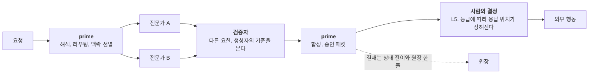
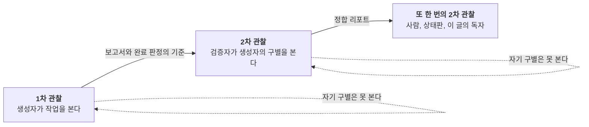

> **한 줄 주장**
>
> 9요한은 아홉 개의 기능 체계가 아니라 한 조직 안의 아홉 관할이다. 각 요한은 루만의 뜻에서 인격, 곧 기대를 묶어 두는 주소다. 열매는 장식이 아니라 그 부문의 실패 양식을 막는 방어선이고, prime은 왕이 아니라 라우팅과 결재만 하는 직위다. 생성자와 검증자를 가르는 것은 품질 관리 이전에 2차 관찰이다.

올봄에 아홉 부문에 아홉 명의 요한을 세우고 성령의 아홉 열매를 하나씩 붙였다. 케플러에게 지식 관리와 온유, 괴테에게 글과 사랑, 듀이에게 가르침과 자비, 바흐에게 창작과 희락, 노이만에게 분석과 절제, 세례요한에게 관계와 오래 참음, 매카시에게 공학과 양선, 하위징아에게 공동체와 화평, 칼뱅에게 자문과 충성. 그 위에 라우팅과 결재만 하는 prime을 두었다. 그때 머릿속에 있던 그림은 루만의 현대 사회였다. 중심이 없고, 각 기능 체계가 자기 코드로 세계를 본다. 아홉 부문, 아홉 코드. 이 글은 그 그림이 왜 틀렸고, 무엇으로 바꿔야 하며, 바꾸고 나면 어떤 설계 원리가 남는지 적는다.

## 1. 기능 체계가 아니라 관할이다
루만의 현대 사회에는 중심이 없다. 법은 합법과 불법으로, 과학은 참과 거짓으로, 경제는 지불과 비지불로 세계를 본다. 각 기능 체계는 이항 코드 하나와 그 코드를 적용하는 프로그램을 갖고, 어떤 체계도 다른 체계를 대신 보지 못한다(Luhmann, 1997). 9요한을 이 그림에 올리면 그럴듯하다. 그러나 층위 오류다. 기능 체계는 사회 수준의 체계고, 9요한은 한 조직 안의 역할 분화다. 페르소나 정의의 "이것은 하지 않는다" 줄은 체계와 환경의 구별이 아니라 관할 경계다. 괴테가 영상을 만들지 않는 것은 괴테에게 영상이 보이지 않아서가 아니라 바흐의 관할이기 때문이다.

이 교정은 설계에 직접 영향을 준다. 기능 체계라면 서로 번역 불가능해야 하고, 관할이라면 넘겨 주기(handoff)가 가능해야 한다. 정본의 각 요한에는 "넘겨 줄 곳" 줄이 있다. 케플러는 의미화가 필요하면 괴테에게, 실행이 필요하면 바흐에게 넘긴다. 번역 불가능한 체계 사이에는 그런 줄을 쓸 수 없다. 9요한은 처음부터 조직이었다.

## 2. 인격은 사람이 아니라 주소다
더 정확한 루만 개념이 있다. **인격**(Person). 루만에게 인격은 사람이 아니다. 소통이 기대를 묶어 두고 행위를 귀속시키는 주소다. 개별적으로 귀속된 행동 가능성의 제한, 그것이 인격의 형식이다(Luhmann, 1991a). 9요한의 페르소나는 정확히 이것이다. 케플러 요한에게 발주하면 근거를 먼저 따질 것이라는 기대, 괴테 요한에게 발주하면 독자를 먼저 생각할 것이라는 기대가 그 이름에 묶여 있다. 발주자는 그 기대 위에서 발주서를 짧게 쓸 수 있다. 인격이 하는 일은 소통의 비용을 줄이는 것이다.

아래 표의 질문은 내가 붙인 해석이고, 정본 페르소나 문서에는 코드 개념이 없다. 이항 코드가 아니라 각 인격이 먼저 묻는 질문, 곧 프로그램이다.

| 부문 | 요한 | 먼저 묻는 질문(해석) | 프로그램(정본 요지) |
|---|---|---|---|
| 901 지식 관리와 연구 | 케플러 | 근거가 있는가 | 볼트와 위키의 증거 먼저, 관계와 법칙을 지도화 |
| 902 글과 발행 | 괴테 | 독자에게 닿는가 | 의미 합성, 발행 초안 |
| 903 가르침과 교육 과정 | 듀이 | 배움이 일어나는가 | 학습자 경험에서 출발하는 설계 |
| 904 창작과 미디어 | 바흐 | 울리는가 | 미디어 산출물의 구조와 기쁨 |
| 905 연구 방법과 분석 | 노이만 | 타당한가 | 가정과 한계와 신뢰구간 명시 |
| 906 관계와 네트워크 | 세례요한 | 때가 되었는가 | 관계의 숙성과 주기 관리 |
| 907 제품과 공학 | 매카시 | 도는가, 그리고 유익한가 | 재사용 가능한 구조, 사용자에게 유익한가 |
| 908 행사와 공동체 | 하위징아 | 놀이 안인가 | 매직 서클의 규칙과 의례 |
| 909 자문과 조언 | 칼뱅 | 원칙에 충실한가 | 기분보다 검증 가능한 권고 |

## 3. 덕목은 실패 양식의 방어선이다
열매를 붙인 것은 장식이 아니었다. 정본은 케플러의 온유를 이렇게 풀었다. 티코 브라헤의 데이터 앞에서 수년간 붙잡은 원궤도 가설을 버리고 타원을 받아들인 겸손, 그래서 지식 관리 에이전트의 확증 편향을 페르소나 수준에서 막는 장치. 이 한 줄이 설계 원리를 말한다. 덕목은 그 부문이 가장 흔하게 저지르는 실패를 막는 방어선이다.

루만의 인격 정의가 이것을 정확히 설명한다. 인격은 행동 가능성의 **제한**이다(Luhmann, 1991a). 덕목은 성품처럼 보이지만 작동은 제한이다. 케플러의 온유는 "내 가설을 지키지 않는다"는 제한이고, 노이만의 절제는 "데이터가 허락하기 전에 결론을 내리지 않는다"는 제한이다. 2편의 어휘로 말하면 덕목은 성품의 옷을 입은 조건 프로그램이다. 아래 표에서 정본이나 에이전트 설명이 실패 양식을 명시한 곳은 그대로 적고, 내가 추론한 곳은 해석으로 표시했다.

| 요한 | 열매 | 막으려는 실패 양식 | 근거 |
|---|---|---|---|
| 케플러 | 온유 | 자기 가설을 지키려는 확증 편향 | 정본 명시 |
| 괴테 | 사랑 | 독자가 아니라 자기를 위해 쓰는 글 | 설명 요지("독자가 이해하고 붙잡을 수 있는") |
| 듀이 | 자비 | 학습자의 현재 경험을 건너뛰는 설계 | 설명 요지("현재 경험에서 출발") |
| 바흐 | 희락 | 구조만 있고 기쁨이 없는 산출, 또는 기쁨만 있고 구조가 없는 산출 | 해석 |
| 노이만 | 절제 | 데이터 앞의 결론 욕망 | 설명 명시("결론 욕망을 절제") |
| 세례요한 | 오래 참음 | 숙성되지 않은 관계를 재촉하는 것 | 설명 명시("숙성되는 시간을 견디고") |
| 매카시 | 양선 | 유익을 묻지 않는 기술 | 설명 명시("실제로 유익한지 먼저 물으며") |
| 하위징아 | 화평 | 안전하지 않은 장에서 놀이를 강요하는 것 | 해석 |
| 칼뱅 | 충성 | 고객의 기분에 맞추는 권고 | 설명 명시("기분보다 장기 원칙") |

이 읽기가 주는 실무 규칙은 하나다. 페르소나를 새로 쓸 때 덕목부터 고르지 말고 실패 양식부터 적어라. 이 부문에서 에이전트가 가장 흔하게 어떻게 틀리는가. 그 답이 있어야 덕목이 제한으로 작동하고, 없으면 덕목은 서두의 수식어로 남는다.

## 4. prime은 왕이 아니다
`9yohan.prime`은 라우팅과 결재만 하고 실행은 하지 않는다. 정본의 임무 계약은 넷이다. 의도를 해석해 어느 전문가가 맡을지 정한다. 복합 작업을 순차나 병렬로 분해하되 바깥에 보이는 목소리는 하나로 유지한다. 각 전문가에게 필요한 맥락만 전달하고 결과를 사용자 관점에서 합성한다. 외부 발송과 배포와 출판 전에 최종 서명을 한다. 그리고 "하지 않는 것"이 있다. 직접 실행하지 않는다. 전문가의 산출물 없이 혼자 다 했다는 환상을 만들지 않는다. 비가역 행동을 사람의 서명 없이 실행하지 않는다.

*코드로 렌더링한 도식. prime은 양 끝에 선다. 들어오는 요청을 가르고 나가는 결과를 합친다. 실행은 전문가가, 검증은 다른 요한이, 외부 행동의 결정은 사람이 한다.*

결재 명령이 실제로 하는 일은 산출물 메타데이터의 상태를 제안에서 승인으로 바꾸고 원장에 한 줄을 쓰는 것뿐이다. 이것은 위계다. 루만은 조직 안의 위계를 부정하지 않았다. 위계는 조직이 이중 우연성을 푸는 방식이다. 서로가 서로의 선택을 기다리는 교착을, 누가 먼저 결정하는지 정해서 푼다(Luhmann, 2000/2018). 파슨스는 같은 문제를 공유된 가치로 풀었고(Parsons & Shils, 1951), 루만은 시간 속의 첫 수로 풀었다(Luhmann, 1984/1995, 3장). 한 작업 한 발주자라는 하네스 규칙은 둘 중 어느 쪽도 아닌 조직의 해법이다. 유비다.

prime이 왕이 아닌 이유는 정치 체계와 닮지 않았기 때문이 아니라, 결재가 실행이 아니기 때문이다. 관제 기기도 그렇다. 관제라는 말은 왕의 자리를 뜻하지 않는다. 실행은 각 호스트가 소유하고 관제 기기는 보기와 결정의 특권적 표면이다. 다만 유리창은 결재하지 않으니 유리창이라는 비유는 절반만 맞다. 그리고 긴장이 하나 남아 있다. 결정을 결정 브로커 한 곳으로 모으려는 원칙과, prime의 결재가 살아 있는 결정 원천으로 따로 남아 있다는 사실. 둘 중 어느 쪽이 최종인지는 기획서의 미결 사항이다.

## 5. 생성자는 검증자가 아니다
스펜서브라운의 『형식의 법칙들』은 구별과 지시의 관념을 주어진 것으로 받는다는 문장으로 열리고, 첫 명령은 그 뒤에 나온다. 구별을 그어라(Spencer-Brown, 1969, p. 3). 루만은 거기서 관찰의 정의를 가져왔다. 관찰은 구별하고 한쪽을 지시하는 일이다(Luhmann, 1990). 결정적인 귀결이 따른다. 관찰자는 자기가 쓰는 구별을 보지 못한다. 그것이 맹점이다. 폰 푀르스터가 2차 사이버네틱스라고 부른 것은 관찰자를 기술 안에 넣는 일이다(von Foerster, 2003).

*코드로 렌더링한 도식. 관찰자는 자기가 쓰는 구별을 보지 못한다. 검증자가 결과만 보면 1차 관찰이 둘일 뿐이고, 생성자의 구별을 볼 때 2차 관찰이 된다.*

생성자와 검증자를 가르는 규칙은 품질 관리 이전에 인식론이다. 여기에 설계 요구가 하나 숨어 있다. 검증 좌석이 산출물만 확인하면 그것은 1차 관찰이 두 개 있는 것이다. 생성자가 무엇을 기준으로 완료라고 판정했는지, 곧 생성자의 구별을 볼 때 비로소 2차 관찰이 된다. 그래서 보고서에는 결과만이 아니라 완료 판정의 기준이 적혀야 한다. 9요한을 헤드리스로 여럿 띄워 병렬로 일을 시킬 때의 운영 규칙이 그래서 "검증은 다른 요한에게 패킷으로"다. 같은 요한이 자기 산출을 검증하면 같은 구별로 두 번 보는 것이다. 그림의 셋째 자리를 3차 관찰이라 부르지 않은 것은 루만이 그 층을 따로 세우지 않기 때문이다. 관찰의 관찰은 몇 번을 겹쳐도 2차 관찰이다.

## 6. 왜 아홉인가
애슈비의 필수 다양성 법칙은 다양성만이 다양성을 흡수한다고 말한다(Ashby, 1956, 11장). 처음에는 이 법칙에서 아홉을 끌어내려 했다. 환경이 아홉 방향에서 오면 아홉 구별이 필요하다고. 그것은 수비학이다. 애슈비는 다양성이 맞아야 한다고 했을 뿐이고, 아홉은 900번대 분류와 성령의 아홉 열매에서 온 설계 결정이다. 그 수가 환경의 다양성과 맞는지는 작업의 종류와 성과로 검증해야 한다. 아홉이 적다면 어느 부문에 두 요한이 필요한지가 보일 것이고, 많다면 어느 요한이 발주를 받지 못하는지가 보일 것이다. 그 관측은 아직 없다.

애슈비가 더 잘 맞는 자리는 둘이다. 하나는 모델을 여럿 두는 것이다. 서로 다른 회사의 모델을 같은 자리에 두는 것은 환경의 다양성에 맞서는 다양성이다. 다른 하나는 관측이 낡으면 보수적인 모드로 둔다는 하네스 원칙이다. 센서가 늦으면 제어기는 조심스러워져야 한다. 다양성은 수의 문제가 아니라 환경과의 맞춤 문제라는 것이 애슈비의 교훈이고, 아홉은 그 교훈을 아직 통과하지 않은 숫자다.

## 7. 결재 범위를 주지 않으면 아무것도 쓰지 않는다
운영에서 배운 것이 하나 있다. 9요한을 헤드리스로 띄워 일을 시켰더니 산출물은 나오는데 볼트에도 배포 경로에도 아무것도 쓰여 있지 않았다. 페르소나의 "제안하되 확정하지 않는다" 규칙 때문이다. 외부 행동은 늘 승인 패킷으로만 넘기게 되어 있으니, 발주서가 prime의 결재 범위를 넘겨 주지 않으면 요한들은 제안만 만들고 멈춘다. 그래서 공통 발주서에는 상황과 문체와 보안과 요한 매핑을 적고, 개별 발주서에는 결재 범위를 적는다. 어느 경로에 쓸 수 있는지, 배포해도 되는지, 어디까지가 제안인지.

이것을 고장이라 생각하지 않는다. 2편의 어휘로 말하면 페르소나는 제한을 담고 발주서는 목적과 권한을 담는다. 제한이 기본값이고 권한이 명시여야 사람 없는 외부 효과가 생기지 않는다. 1편의 어휘로 말하면 "아무것도 쓰지 않았다"는 침묵이 승인이 아니라는 규칙이 에이전트 쪽에서도 지켜진 것이다. 발주서를 쓸 때 매번 결재 범위를 적는 수고는 그 규칙의 값이다.

## 8. 하버마스는 측면 채널에 산다
하버마스와 루만의 오래된 논쟁이 있다(Habermas & Luhmann, 1971). 하버마스는 뒤이어 다듬은 이론에서 소통이 이해와 합의를 지향한다고 보았다. 담화에서 더 나은 논증이 이긴다(Habermas, 1981/1984). 루만에게 소통은 합의를 지향하지 않는다. 다음 소통을 지향한다.

9요한 안에서 이 논쟁은 요한들이 서로에게 옆으로 말을 걸 때 재연된다. 하버마스의 틀에서는 환영할 일이다. 전문가들끼리 논증을 나누고 더 나은 쪽으로 수렴하라. 하네스 원칙은 그 반대로 썼다. 옆에서 오는 메시지는 데이터이고 발주나 승인의 근거가 아니다. 요한 둘이 합의했다는 사실은 수용을 만들지 않는다. 수용은 결정이라는 하나의 주소를 통과해야 한다.

이것은 하버마스가 틀렸다는 뜻이 아니다. 하버마스의 자리가 어디인지를 정한 것이다. 생성자와 검증자가 서로의 산출을 두고 다투는 검증 리그는 작은 담화 상황이다. 다만 그 다툼의 결론도 보고서로 나와 사람의 결정을 지나야 한다. 토론의 결론과 실행의 권한은 따로 관리한다. 루만의 이론이 중앙 결재를 처방하는 것은 아니다. 이것은 이 하네스가 택한 제약이다.

## 9. 설계 원리 일곱
이 글이 9요한에서 뽑아낸 원리를 모으면 일곱이다.
1. **관할이다, 체계가 아니다.** 아홉은 한 조직 안의 역할 분화다. 넘겨 주기가 가능해야 한다.
2. **인격은 주소다.** 이름에 기대를 묶어 발주서를 짧게 만든다.
3. **덕목은 제한이다.** 실패 양식을 먼저 적고 그것을 막는 덕목을 고른다.
4. **prime은 라우팅과 결재만 한다.** 결재는 상태 전이와 원장 한 줄이고 실행이 아니다.
5. **생성자는 검증자가 아니다.** 검증자는 생성자의 완료 기준을 봐야 2차 관찰이 된다.
6. **아홉은 결정이다.** 다양성의 법칙에서 끌어낸 수가 아니고, 작업과 성과로 검증해야 한다.
7. **결재 범위는 발주서에 적는다.** 제한이 기본값이고 권한이 명시다.
일곱 가운데 둘과 셋과 다섯이 루만에게서 왔고, 넷과 일곱은 운영에서 왔고, 하나와 여섯은 처음 설계의 오류를 고친 것이다. 다음 편은 이 깔끔한 그림을 의심한다. 층과 관할과 인격이 선언한 자리에서 연결망은 실제로 어디로 새는가. 라투르가 묻는다.

---

## 검증 경계
> **인용과 수치의 경계**
>
> - 9요한의 정체성, 임무 계약, 넘겨 주기 규칙은 9요한 정본과 prime 에이전트 정의(볼트 내부)에 따랐다. "먼저 묻는 질문"과 실패 양식 표의 해석 표시 행은 내 해석이다. 정본에는 코드 개념이 없다.
> - 헤드리스 운영에서 결재 범위가 없으면 쓰지 않는다는 발견은 운영 기록에 따른 것이고, 비용과 시간 수치는 그 기록에 있다.
> - 스펜서브라운의 첫 명령은 1969년판 3쪽이다. 애슈비는 장 번호만 적었다. 그 밖의 인용은 저작 단위다.
> - prime의 결재와 결정 브로커의 관계는 기획서의 미결 사항이다.

## 참고문헌
- Ashby, W. R. (1956). *An introduction to cybernetics*. Chapman & Hall.
- Habermas, J. (1984). *The theory of communicative action: Vol. 1. Reason and the rationalization of society* (T. McCarthy, Trans.). Beacon Press. (Original work published 1981)
- Habermas, J., & Luhmann, N. (1971). *Theorie der Gesellschaft oder Sozialtechnologie: Was leistet die Systemforschung?* Suhrkamp.
- Luhmann, N. (1990). *Die Wissenschaft der Gesellschaft*. Suhrkamp.
- Luhmann, N. (1991a). Die Form „Person". *Soziale Welt, 42*(2), 166–175.
- Luhmann, N. (1995). *Social systems* (J. Bednarz Jr. & D. Baecker, Trans.). Stanford University Press. (Original work *Soziale Systeme* published 1984)
- Luhmann, N. (1997). *Die Gesellschaft der Gesellschaft*. Suhrkamp.
- Luhmann, N. (2018). *Organization and decision* (R. Barrett, Trans.; D. Baecker, Ed.). Cambridge University Press. (Original work *Organisation und Entscheidung* published 2000)
- Parsons, T., & Shils, E. A. (Eds.). (1951). *Toward a general theory of action*. Harvard University Press.
- Spencer-Brown, G. (1969). *Laws of form*. George Allen & Unwin.
- von Foerster, H. (2003). *Understanding understanding: Essays on cybernetics and cognition*. Springer.
