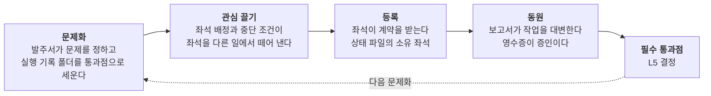
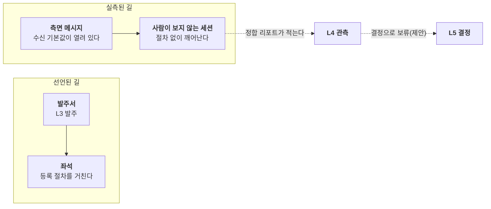

*시리즈 「소통으로 읽는 에이전트 하네스」 6편. 용어는 [시리즈 지도](/posts/agent-harness-communication-0/)에 모아 두었다.*

> **한 줄 주장**
>
> 루만의 하네스는 깔끔해서 의심스럽다. 라투르는 층 그림을 믿지 않고 흔적을 따라간다. 번역의 네 국면, 블랙박스, 위임된 스크립트, 불변의 이동물, 파노라마. 이 다섯 도구로 기획서가 적은 누수 일곱 곳을 읽으면, 누수는 어긋남이 아니라 연결망이 실제로 지나가는 자리다. 하네스가 라투르에게 배운 것은 새는 길을 없애는 법이 아니라 새는 길을 세는 법이다.

앞의 다섯 편은 루만의 하네스다. 층을 가르고 주소를 정하고 결정을 한 곳에 모으면 소통이 이어진다. 깔끔하다. 그래서 의심스럽다. 그 그림은 그림이 선언한 자리에서만 맞는다. 기획서 자신이 층 경계가 새는 곳 일곱 군데를 적어 두었다. 옆에서 온 메시지가 사람이 보지 않는 세션을 깨우고, 결정이 결정 층 밖에 쌓이고, 알림이 호스트에서 표면으로 바로 가고, 채팅 채널에서 사람이 에이전트를 불러 일을 시킨 기록이 발주 경로 밖에 남아 있다. 루만의 어휘로 이것은 체계의 자기 기술과 작동의 어긋남이다. 라투르는 다르게 읽는다. 어긋남이 아니라, 거기가 바로 연결망이 실제로 지나가는 자리라고.

## 1. 행위자를 따라가라, 그리고 대칭으로 적어라
행위자 연결망 이론(ANT)의 첫 규칙은 행위자를 따라가라는 것이다. 사회라는 설명 변수를 먼저 두지 말고, 무엇이 무엇을 움직이는지 흔적을 따라가라(Latour, 2005). 둘째 규칙은 대칭이다. 사람과 사물을 같은 어휘로 기술한다. 행위자(actor)가 아니라 행위소(actant)라고 부르는 이유는 행위가 사람의 전유물이 아니라 연결망의 효과이기 때문이다(Latour, 2005; Law, 1992). 이 두 규칙으로 하네스를 보면 층 그림은 뒤로 물러나고, 훅과 실행 기록 폴더와 메신저 카드와 동기화 지연이 앞으로 나온다.

루만에게 기술은 기능하는 단순화다(Luhmann, 1991b). 그는 기술이 어떻게 행위를 대신하는지는 묻지 않았다. 그 빈칸을 ANT가 채운다. 이 글은 ANT의 도구 다섯을 차례로 하네스에 대고, 마지막에 두 이론이 충돌하는 자리를 적는다.

## 2. 번역의 네 국면과 필수 통과점
가장 먼저 쓸 만한 것은 칼롱의 번역(translation) 모델이다. 그는 생브리외 만의 가리비와 어부와 과학자를 두고 네 국면을 적었다. 문제화, 관심 끌기, 등록, 동원(Callon, 1986). 발주서에서 보고서까지의 길은 이 네 국면과 겹쳐 읽을 수 있다. 해석이다.

*코드로 렌더링한 도식. 발주서에서 보고서까지는 칼롱의 네 국면으로 읽힌다. 루만이 수용의 주소라고 부른 L5는 라투르 쪽 말로 필수 통과점이다. 화살표는 해석이고 관찰된 사건이 아니다.*

문제화는 발주서가 한다. 무엇이 문제인지 정하고, 그 문제를 풀려면 반드시 지나야 하는 자리, 칼롱이 필수 통과점(obligatory passage point)이라 부른 것을 세운다(Callon, 1986). 관심 끌기는 좌석을 다른 가능한 연결에서 떼어 내는 일이다. 좌석 배정 파일이 좌석을 정하고 중단 조건이 좌석이 멈춰야 할 때를 정한다. 등록은 좌석이 역할을 받아들이는 순간이다. 상태 파일에 소유 좌석이 적히는 때. 동원은 보고서가 작업 전체를 대변하는 일이다. 칼롱의 과학자가 가리비의 대변인이 되듯, 보고서는 좌석이 한 수백 번의 도구 호출을 대신 말한다. 영수증은 그 대변이 믿을 만한지 따질 증인이다.

루만이 수용의 주소라고 부른 L5는 라투르 쪽 어휘로 필수 통과점이다. 두 이론은 같은 자리를 다른 이름으로 가리킨다. 그리고 칼롱은 번역이 늘 성공하지는 않는다는 것도 적었다. 등록된 행위자가 대변인을 거부하는 배반(dissidence)이 있다. 기획서의 새는 곳 일곱은 전부 이 배반의 목록이다. 통과점을 거치지 않은 다른 연결망이 만들어진 사례들.

## 3. 블랙박스는 실패할 때 열린다
라투르는 블랙박스화를 과학과 기술의 작업이 자기 성공으로 보이지 않게 되는 방식이라 정의했다(Latour, 1999, p. 304). 로는 같은 것을 점화(punctualization)라고 불렀다. 복잡한 연결망이 하나의 점으로 줄어들어 내부가 보이지 않게 되는 일이다(Law, 1992). 돌아가는 좌석은 블랙박스다. 발주자는 발주서와 보고서만 본다. 1편에서 세션 사이의 벽을 자기생산이 아니라 관찰 불투명성이라 적었는데, 라투르의 말이 그 불투명성의 이름이다.

블랙박스는 실패할 때 열린다(Latour, 1987). 같은 기기에 런타임이 여러 벌 깔린 것도, 색인 잡이 조용히 멈춘 것도 고장이 나서야 보였다. 하네스의 막힘 표식과 상신 표식은 상자를 여는 장치이고, 영수증은 열었을 때 안이 보이게 해 두는 장치다. 하네스가 설계하는 것은 상자를 닫는 일이 아니라 다시 열 수 있게 닫는 일이다. 2편에서 불확실성 흡수의 자리를 말하며 영수증을 "흡수된 전제를 다시 열 주소"라 적었다. 라투르의 어휘로는 상자 안에 남겨 둔 손잡이다.

## 4. 설정값 하나가 행위했다
셋째 도구는 스크립트와 위임이다. 아크리시는 기술 사물에 설계자가 써 넣은 사용 각본을 스크립트라 불렀고(Akrich, 1992), 라투르는 문 닫는 장치가 "문을 닫으라"는 규범을 사람 대신 집행한다는 것을 보여 주었다(Latour, 1992). 하네스의 차단 훅은 정확히 그 문 닫는 장치다. 도구 호출 전 검사, 거부 목록, 중단 조건은 사람이 매번 지켜야 할 규칙을 사물에 위임한 것이다. 이해되지 않아도 행위를 바꾼다. 라투르가 사회학의 "빠진 질량"이라 부른 것, 곧 규범을 떠받치고 있는데 사회학자가 세지 않는 사물들이 하네스에서는 L2 런타임 층에 모여 있다.

루만은 이것을 조건 프로그램이라 불렀고(2편), 라투르는 위임된 스크립트라 부른다. 다른 점은 라투르가 그 사물에게 행위를 돌려 준다는 것이다. 측면 메시지의 수신 기본값이 세션을 깨운 사건을 가장 정직하게 적는 문장은 이것이다. 설정값 하나가 행위했다. 아무도 그 값을 고르지 않았으니 2편의 어휘로는 결정되지 않은 전제이고, 라투르의 어휘로는 아무도 쓰지 않은 스크립트가 집행된 것이다. 두 어휘가 같은 자리를 가리키지만 처방이 다르다. 루만은 전제를 결정하라고 하고, 라투르는 그 사물을 연결망의 구성원으로 세어 넣으라고 한다. 하네스는 둘 다 한다. 기본값을 선언으로 올리고, 정합 리포트가 그 설정값을 관측 대상으로 센다.

## 5. 불변의 이동물
넷째 도구는 불변의 이동물(immutable mobile)이다. 라투르는 종이 위의 기록이 자리를 옮기면서도 모양을 유지하기 때문에 멀리 있는 것을 다스릴 수 있다고 했다(Latour, 1986). 보고서와 영수증과 완료 표식은 실행 기기에서 관제 기기로 동기화를 타고 옮겨 가면서 바이트가 바뀌지 않는다. 새 파일만 더하고 기존 파일을 고치지 않는 규칙은 이 불변성을 지키는 장치다. 그래서 관제 기기는 실행 기기에 들어가지 않고도 실행 기기를 다스린다.

3편에서 같은 규칙을 루만의 "옮기지 말고 참조로"에 대응시켰다. 두 대응은 경쟁하지 않는다. 루만은 그 기록이 어떻게 이해되는지를 묻고, 라투르는 어떻게 이동하는지를 묻는다. 기록이 이동 중에 바뀌면 이해할 것이 없고, 이해할 스키마가 없으면 이동한 기록은 소음이다. 1편의 세 비개연성으로 말하면 불변의 이동물은 도달의 장치고 비교 스키마는 이해의 장치다.

## 6. 층 그림은 파노라마다
라투르의 진짜 쓸모는 네 도구가 아니라 기술의 태도에 있다. 그는 체계와 환경, 안과 밖, 거시와 미시 같은 구별을 먼저 두는 것을 거부한다. 사회적인 것을 평평하게 유지하라, 그것이 그의 지침이다(Latour, 2005). 이 눈으로 보면 일곱 층은 하네스가 아니다. 하네스에 대한 하나의 그림이다. 라투르는 그런 그림을 파노라마라 불렀다. 모든 것을 한 화면에 보여 주지만, 그 화면 자체는 어느 방 한 구석에 걸려 있는 국지적 사물이라는 것이다(Latour, 2005).

좌석 상태판은 파노라마다. 기획서도 파노라마다. 이 시리즈도 파노라마다. 파노라마가 쓸모없다는 뜻이 아니다. 파노라마가 연결망을 대신하지 못한다는 뜻이다. 측면 메시지가 세션을 깨운 사건을 1편에서는 비개연성이 다른 층으로 숨었다고 읽었다. 라투르는 더 단순하게 읽는다. 그 메시지는 등록 절차 없이 좌석을 등록시켰다. 연결망은 층 그림이 허락하지 않은 곳에서 실제로 연결되었다.

*코드로 렌더링한 도식. 층은 선언이고 연결망은 실측이다. 하네스가 라투르에게 배운 것은 새는 길을 없애는 법이 아니라 새는 길을 세는 법이다.*

## 7. 일곱 누수를 다시 읽는다
기획서가 적은 일곱 누수를 라투르의 어휘로 다시 읽으면 이렇다. 선언된 길과 실측된 길을 나란히 적고, 어느 도구가 그 누수를 가장 잘 설명하는지와 기획서의 처리 제안을 붙였다. 처리는 전부 제안이다.

| 누수 | 선언된 길 | 실측된 길 | 라투르의 어휘 | 처리(제안) |
|---|---|---|---|---|
| 측면 경로 | 발주는 위에서 아래로만 | 옆에서 온 메시지가 사람이 보지 않는 세션을 깨운다 | 아무도 쓰지 않은 스크립트, 절차 없는 등록 | 측면 메시지를 결정으로 보류, 무인 잡은 측면 채널을 끄고 띄운다 |
| 결정 분절 | 사람에게 묻는 것은 한 곳으로 | 다른 도구의 승인 대기가 결정 층 밖에 쌓인다 | 통과점을 우회한 다른 연결망 | 원천 어댑터로 결정에 모은다 |
| 알림 우회 | 알림은 결정 브로커가 | 실행 기기의 봇이 메신저로 직접 보낸다 | 대변인이 둘 | 관제 기기 관측이 끊긴 동안만 폴백 |
| 응답 경로의 폴백 | 답은 원천의 네이티브 경로로만 | 전송 실패 때 활성 탭으로 한 번 더 보낸다. 키를 직접 넣는 명령이 있다 | 스크립트가 규범보다 너그럽다 | 폴백 제거, 키 명령은 결정 수단에서 제외 |
| 지휘 공백 | 단일 창구가 발주한다 | 창구가 서 있어 prime이 직접 발주한다. 라우팅 규칙이 비어 늘 한 기기를 고른다 | 번역의 등록 국면이 비어 있다 | 실행 대상의 불가용 규칙을 쓴다 |
| 관측 공백 | 관측이 응답 위치와 라우트를 정한다 | 색인 잡이 멈추고 한 기기는 미구성이다 | 블랙박스가 닫힌 채 실패했다 | 정합 리포트가 공백부터 드러낸다 |
| 채널 발주 | 발주는 발주 명령과 계약으로 | 채팅 채널에서 사람이 에이전트를 불러 일을 시켰다 | 문제화 없는 동원 | 채널 지시를 작업으로 등록, 승격은 레인 규칙 |

표를 세로로 읽으면 패턴이 보인다. 일곱 가운데 넷은 통과점을 우회한 연결(측면 경로, 결정 분절, 알림 우회, 채널 발주)이고, 둘은 번역이 중간에 멈춘 것(지휘 공백, 관측 공백)이고, 하나는 스크립트가 규범보다 너그러운 것(응답 경로의 폴백)이다. 처리 제안도 셋으로 묶인다. 우회한 연결은 통과점으로 되돌리고, 멈춘 번역은 빈 국면을 채우고, 너그러운 스크립트는 좁힌다. 누수를 하나씩 막는 것보다 세 종류로 가르는 것이 먼저다.

## 8. L4는 하네스 안의 민족지다
그래서 하네스 안에서 가장 라투르적인 자리는 L4다. 관측과 정합. 선언을 믿지 않고 흔적을 따라가 어긋남을 적는 층. 기획서의 "문서와 실측이 어긋나는 곳" 목록과 "층 경계가 새는 곳" 목록은 ANT의 현장 노트와 같은 종류의 글이다. 루만의 설계도 안에 라투르의 민족지 한 층이 들어 있는 셈이다. 4편에서 선언과 관측이 갈리는 조건을 속도라고 적었다. 라투르의 말로 하면 연결망이 파노라마보다 빨리 바뀌기 때문에 파노라마를 믿지 않고 세는 층이 필요한 것이다.

그리고 ANT의 눈에는 층 구분 자체가 연결망 작업의 산물이다. 라투르가 근대의 정화(purification)라고 부른 것, 사람과 사물을 두 집으로 갈라 두는 작업을 이 시리즈의 층 읽기도 하고 있다는 점은 인정해야 한다(Latour, 1991/1993). 선언과 관측을 가르는 것도 정화다. 다만 그 정화가 어긋남을 정보로 만든다는 점에서 쓸모가 있고, 쓸모가 있다는 것과 실재한다는 것은 다르다.

## 9. 두 이론이 충돌하는 자리와 토이브너의 다리
두 이론이 충돌하는 자리도 적어야 한다. 루만에게 행위는 소통이 자기에게 귀속시키는 것이고, 소통하는 것은 소통만이다. 사물은 자극할 뿐 행위하지 않는다(Luhmann, 1984/1995; 1992). 라투르에게 행위는 연결망에 분산되어 있고, 사람과 사물의 경계는 설명의 출발점이 아니라 설명해야 할 결과다(Latour, 2005). 에이전트를 두고 이 충돌은 날카롭다. 좌석은 행위자인가.

토이브너가 이 충돌을 정면으로 다뤘다. 비인간을 인격화하는 것은 상대의 정체가 불확실할 때 그 불확실성을 다루는 전략이고, 귀속의 틀을 인과에서 이중 우연성으로 옮기며, 상대에게 자기 준거를 전제할 공간을 연다. 행위의 귀속을 사람과 사회 체계에만 묶어 둘 이유는 없다. 그러나 라투르가 말하듯 하나의 집합체로 모두가 들어오는 것도 아니다(Teubner, 2006). 토이브너의 다리를 쓰면 5편의 인격 개념과 이 절이 이어진다. 비인간은 소통이 그에게 행위를 귀속시킬 때 행위자가 된다.

내 하네스는 이 논쟁을 이론으로 풀지 않고 설계로 푼다. 좌석에 행위를 귀속시킨다. 상태 파일의 소유 좌석, 작성 모델 필드, 영수증은 "이 작업은 이 좌석이 했다"고 적는 장치다. 그러나 결정은 귀속시키지 않는다. L5는 모델이 결정 내용을 대리 판단하는 것을 금한다. 행위는 좌석에, 결정은 사람에. 토이브너의 말로 하면 인격화를 불확실성이 줄어드는 곳까지만 한다. 라투르의 말로 하면 좌석은 행위소이되 필수 통과점은 아니다. 루만의 말로 하면 좌석의 출력은 소통의 기여가 될 수 있지만 수용은 다른 주소를 지난다. 세 어휘가 같은 설계를 승인한다. 합성 이론을 주장하는 것이 아니다. 세 관찰 언어를 나란히 두고, 셋이 같은 자리에서 같은 판정을 낸다는 것을 보이는 것이다.

## 10. 하나는 층을 세우고 하나는 층 사이를 센다
루만은 명령 없이도 소통이 이어지는 장치를 하나 지어 보인 사람이다. 자리를 바꾸지 않는 주소, 참조로 하는 교정, 소수의 진입점, 자기 문장으로 다시 쓰기. 그가 하네스의 왕이 아니라면 헌법 기초위원 정도는 될 것이다. 그리고 라투르는 그 헌법이 어디서 지켜지지 않는지 세러 다니는 현장 조사원이다. 둘은 서로를 좋아하지 않았겠지만, 하네스에는 둘 다 필요하다. 하나는 층을 세우고 하나는 층 사이를 센다.

마지막으로 자기 기술 하나. 이 시리즈는 하네스 안의 세션이 하네스에 대해 쓴 글이다. 그 세션은 자기가 어떤 구별로 이 글을 썼는지 보지 못한다. 그러니 이 글은 하네스에 대한 2차 관찰이고, 이 글의 구별을 검토하는 사람이 다음 2차 관찰자다. 라투르의 말로 하면 이 글도 파노라마다. 어디가 맹점인지는 당신이 보라. 시리즈의 결론은 [0편](/posts/agent-harness-communication-0/)의 마지막 절에 모아 두었다.

---

## 검증 경계
> **인용과 수치의 경계**
>
> - 라투르, 칼롱, 로, 아크리시, 토이브너의 인용은 저작 단위로 적었고 쪽수는 확인한 곳(Latour, 1999, p. 304)에만 붙였다. 토이브너는 요지의 재진술이다.
> - 일곱 누수의 선언된 길과 실측된 길은 AI 하네스 총정리와 구조 스키마 기획서(2026-10-23, 볼트 내부) 2.4절을 일반화한 것이다. 도구 이름과 수치는 기획서에 있고, 처리는 전부 제안이다.
> - 번역의 네 국면 대응, 누수의 라투르식 이름, 세 종류 묶음은 내 해석이다.

## 참고문헌
- Akrich, M. (1992). The de-scription of technical objects. In W. E. Bijker & J. Law (Eds.), *Shaping technology / building society: Studies in sociotechnical change* (pp. 205–224). MIT Press.
- Callon, M. (1986). Some elements of a sociology of translation: Domestication of the scallops and the fishermen of St Brieuc Bay. In J. Law (Ed.), *Power, action and belief: A new sociology of knowledge?* (pp. 196–233). Routledge & Kegan Paul.
- Latour, B. (1986). Visualization and cognition: Thinking with eyes and hands. *Knowledge and Society, 6*, 1–40.
- Latour, B. (1987). *Science in action: How to follow scientists and engineers through society*. Harvard University Press.
- Latour, B. (1992). Where are the missing masses? The sociology of a few mundane artifacts. In W. E. Bijker & J. Law (Eds.), *Shaping technology / building society: Studies in sociotechnical change* (pp. 225–258). MIT Press.
- Latour, B. (1993). *We have never been modern* (C. Porter, Trans.). Harvard University Press. (Original work published 1991)
- Latour, B. (1999). *Pandora's hope: Essays on the reality of science studies*. Harvard University Press.
- Latour, B. (2005). *Reassembling the social: An introduction to actor-network-theory*. Oxford University Press.
- Law, J. (1992). Notes on the theory of the actor-network: Ordering, strategy, and heterogeneity. *Systems Practice, 5*(4), 379–393. https://doi.org/10.1007/BF01059830
- Luhmann, N. (1991b). *Soziologie des Risikos*. Walter de Gruyter.
- Luhmann, N. (1992). What is communication? *Communication Theory, 2*(3), 251–259. https://doi.org/10.1111/j.1468-2885.1992.tb00042.x
- Luhmann, N. (1995). *Social systems* (J. Bednarz Jr. & D. Baecker, Trans.). Stanford University Press. (Original work *Soziale Systeme* published 1984)
- Teubner, G. (2006). Rights of non-humans? Electronic agents and animals as new actors in politics and law. *Journal of Law and Society, 33*(4), 497–521. https://doi.org/10.1111/j.1467-6478.2006.00368.x
