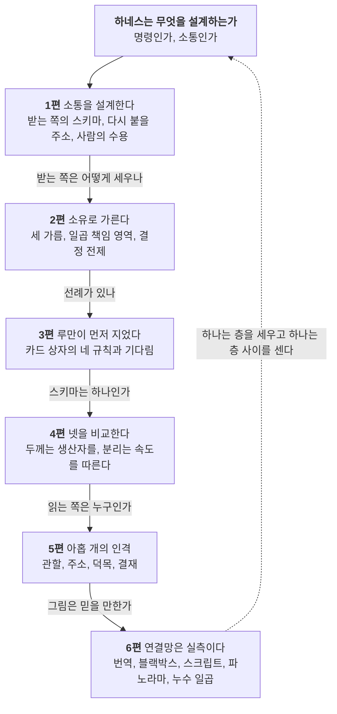

*부제. 루만은 에이전트 하네스의 왕이었을까*
> **시리즈의 한 줄 주장**
>
> 하네스는 에이전트에게 명령하는 장치가 아니다. 서로의 안을 볼 수 없는 체계들 사이에서, 있을 법하지 않은 소통이 다음 소통으로 이어지게 만드는 장치다. 루만은 그 장치를 카드 상자로 먼저 지었고 그 장치가 왜 필요한지 설명하는 이론을 함께 썼다. 라투르는 그 장치가 선언한 자리를 벗어나 어디로 새는지 세는 법을 가르쳐 준다.

## 왜 여섯 편으로 나눴나
처음에는 한 편이었다. 열한 절, 도식 열한 개, 4만 자. 다 쓰고 나서 내가 다시 읽어도 두세 번 읽어야 잡히는 자리가 있었다. 그 사실 자체가 1편의 주제다. 소통은 있을 법하지 않고, 이해의 비개연성은 보내는 쪽이 아니라 받는 쪽에서 해결된다. 한 편이 여섯 가지 질문에 한꺼번에 답하면 읽는 쪽은 비교할 스키마를 여섯 개 동시에 들고 있어야 한다. 그래서 질문 하나에 한 편을 두었다. 기기와 도구의 고유 이름은 일반 명사로 바꾸고, 어쩔 수 없이 남은 용어는 이 글의 사전에 모았다. 날짜와 수치는 본문에서 뺐다. 그것은 기획서에 있다.

통합판은 그대로 둔다. 한 번에 읽고 싶은 사람과 인용할 사람을 위한 판이다. 여섯 편은 같은 주장을 질문별로 다시 쓴 판이고, 통합판에 없는 절이 몇 있다. 2편의 결정되지 않은 전제, 3편의 규칙 목록, 4편 전체, 5편의 덕목과 실패 양식, 6편의 누수 분류.

## 논리 구조
여섯 편은 하나의 질문에서 갈라진다. 하네스는 무엇을 설계하는가.

*코드로 렌더링한 도식. 여섯 편은 하나의 질문에서 갈라져 마지막에 그 질문으로 돌아온다. 1편에서 5편까지가 루만의 하네스고, 6편이 그것을 의심한다.*

순서에는 이유가 있다. 1편이 먼저인 것은 나머지가 전부 "받는 쪽"이라는 자리를 전제하기 때문이다. 2편이 3편보다 먼저인 것은 선례를 보기 전에 지금 구조의 근거를 세워야 비교가 되기 때문이다. 4편이 가운데 있는 것은 2편의 구조와 3편의 선례를 같은 축 위에 올리는 편이기 때문이다. 5편은 읽는 쪽이 누구인지 묻는 편이라 스키마 뒤에 온다. 6편은 앞의 다섯을 의심하는 편이라 마지막이다.

## 읽는 순서 셋
- **이론 순서(기본).** 1, 2, 3, 4, 5, 6. 위 그림의 순서다.
- **설계자 순서.** 하네스를 지금 짜는 사람은 2편(구조)에서 시작해 4편(스키마), 5편(인격), 6편(누수)을 읽고, 이론이 궁금해지면 1편과 3편으로 돌아온다.
- **바쁜 사람 순서.** 이 글의 결론 절을 읽고, 2편 5절(결정되지 않은 전제)과 6편 7절(누수 일곱)만 읽는다. 하네스 점검에 바로 쓸 수 있는 두 절이다.

## 편별 요약

| 편 | 제목 | 묻는 질문 | 한 줄 답 | 도식 |
|---|---|---|---|---|
| 1 | [명령은 없다, 연결만 있다](/posts/agent-harness-communication-1/) | 워크플로우의 설계 단위는 무엇인가 | 호출이 아니라 연결이다. 간선마다 받는 쪽 스키마가 있어야 하고, 침묵은 승인이 아니다 | 4 |
| 2 | [층은 의존의 순서가 아니라 책임의 배열이다](/posts/agent-harness-communication-2/) | 왜 일곱 층인가 | 소유를 세 번 가른 결과다. L0은 결정 전제의 저장소고, 사고는 결정되지 않은 전제에서 난다 | 3 |
| 3 | [니클라스 루만의 하네스 세팅](/posts/agent-harness-communication-3/) | 명령 없이 돌아간 선례가 있나 | 카드 9만 장. 자리를 바꾸지 않는 주소, 참조로 하는 교정, 소수의 진입점, 자기 문장, 그리고 기다림 | 4 |
| 4 | [스키마는 하나가 아니다](/posts/agent-harness-communication-4/) | 스키마는 하나인가 | 카드 상자, LLM 위키, CMDS, 레지스트리 넷을 비교하면 두께는 생산자를, 선언과 관측의 분리는 속도를 따른다 | 4 |
| 5 | [아홉 개의 인격, 아홉 개의 관할](/posts/agent-harness-communication-5/) | 읽는 쪽은 누구인가 | 아홉 관할, 아홉 주소. 덕목은 실패 양식의 방어선이고 prime은 라우팅과 결재만 한다 | 2 |
| 6 | 층은 선언이고 연결망은 실측이다 | 층 그림은 믿을 만한가 | 그림은 파노라마다. 누수 일곱은 어긋남이 아니라 연결망이 지나가는 자리고, 세는 것이 먼저다 | 3 |

## 용어 사전
### 하네스 쪽 용어
시리즈 본문은 기기와 도구의 고유 이름을 아래 일반 명사로 바꿔 썼다. 고유 이름과 버전은 기획서에 있다.

| 용어 | 뜻 | 어느 층 |
|---|---|---|
| 하네스 | 에이전트가 일하는 조건을 정하는 장치 일체. 모델 하나나 도구 하나로 줄여 말하지 않는다 | 전체 |
| 관제 기기 | 모든 세션을 조망하고 사람의 결정을 받는 기기. 사용자의 노트북 | L1, L5, L6 |
| 실행 기기 | 몇 시간짜리 무인 작업과 상주 좌석을 맡는 기기. 사용자의 데스크톱 | L1 |
| 좌석 | 실행 기기에서 한 에이전트 페르소나가 상주하는 터미널 세션. 좌석 관리자(데몬)가 수명을 소유한다 | L1 |
| 런타임 | 에이전트를 실행하는 프로그램. 두 회사의 명령줄 도구를 함께 쓴다 | L2 |
| 훅 | 런타임이 정해진 시점(세션 시작, 도구 호출 전후)에 실행하는 스크립트. 안내 훅은 메시지를 띄우고 차단 훅은 호출을 막는다 | L2 |
| 발주서 | 좌석에 보내는 작업 지시 문서(brief). 입력 버전, 출력 위치, 완료 판정, 중단과 재개를 담은 작업 계약을 포함한다 | L3 |
| 실행 기록 폴더 | 한 발주의 발주서, 상태 파일, 영수증, 보고서, 표식이 모이는 폴더(run 폴더) | L3 |
| 보고서, 영수증, 표식 | 좌석이 남기는 결과 문서(REPORT), 모델 호출 기록(receipts), 완료와 막힘과 상신 표식(DONE, BLOCKED, ESCALATION) | L3 |
| 레인과 승격 | 실행 결과가 들어가는 볼트의 지정 폴더(lane)와, 그 결과를 사람이 정본으로 올리는 일(promote). 기존 노트의 수정은 패치 제안을 거친다 | L3, L5 |
| 결정 브로커 | 사람에게 묻는 모든 요청을 한 봉투(Decision)로 모으는 관제 기기의 데몬 | L5 |
| 결정 등급 | 영향으로 정하는 다섯 등급. D0 확인과 선택, D1 범위 안 쓰기, D2 정본과 비용, D3 외부 효과, D4 비가역과 자격증명. 등급이 높을수록 답할 수 있는 곳이 좁다 | L5 |
| 모드 | 장소와 상황별 응답 정책. 사무실, 집, 이동 중, 주행, 발표 현장 등. 엄격해지는 전환은 자동, 느슨해지는 전환은 수동(제안) | L5 |
| 측면 메시지 | 에이전트가 에이전트에게 옆으로 보내는 메시지. 데이터이고 발주나 승인의 근거가 아니다 | L6 |
| 누수 | 선언한 층 경계를 벗어나 실제로 일이 흐른 경로. 기획서가 일곱을 적었다 | 경계 |
| 볼트, 정본, 위키 | 마크다운 노트 저장소. 모선 볼트는 사람의 지식, 위성 위키는 모델이 컴파일한 참조. 두 볼트는 서로를 URI로만 가리킨다 | L0 |
| 동기화 | 볼트를 기기 사이에 복제하는 서비스. 한두 분의 지연이 있다 | L1, L6 |
| 9요한 | 아홉 부문에 아홉 역사적 요한과 아홉 열매를 붙인 에이전트 페르소나. prime은 라우팅과 결재만 한다 | L0, L3 |
| 시스템 파일, 메타데이터 일곱 필드 | 에이전트가 세션을 열 때 읽는 규칙 문서와, 모든 노트가 갖춰야 하는 필수 속성(종류, 별칭, 설명, 저자, 만든 날, 고친 날, 태그) | L0 |

### 이론 쪽 용어

| 개념 | 한 줄 뜻 | 편 |
|---|---|---|
| 세 선택 | 소통은 정보, 통지, 이해의 종합이고 받는 쪽에서 완성된다 | 1 |
| 비교 스키마 | 정보는 비교 스키마를 가진 체계 안에서만 생긴다. 스키마의 항상성이 정보의 결속을 보장한다 | 1, 4 |
| 연결 가능성 | 사건인 소통이 다음 소통으로 이어질 수 있는 성질. 주소가 이것을 보존한다 | 1 |
| 세 비개연성 | 소통은 이해될 법하지 않고, 도달할 법하지 않고, 수용될 법하지 않다. 매체가 셋을 개연적으로 만든다 | 1 |
| 확신과 신뢰 | 대안을 보지 않은 기대는 확신, 위험을 알고 하는 기대는 신뢰 | 1 |
| 자기생산과 구조적 결합 | 체계는 자기 작동으로 자기 요소를 만들고, 다른 체계와는 접점으로만 결합한다. 세션이 아니라 소통 연쇄에 적용한다 | 1 |
| 결정 전제 | 조직의 결정이 그 위에 서는 것. 조건 프로그램, 목적 프로그램, 인사, 소통 경로, 그리고 결정할 수 없는 전제 | 2 |
| 불확실성 흡수 | 결정의 결과만 전달되고 전제가 전달되지 않을 때 일어나는 일. 어디서 흡수할지가 설계 문제다 | 2 |
| 고정 자리 질서, 참조, 색인 | 카드 상자의 세 규칙. 번호를 바꾸지 않고, 옮기지 않고 참조하고, 색인은 희박하게 | 3, 4 |
| 인격 | 소통이 기대를 묶어 두고 행위를 귀속시키는 주소. 행동 가능성의 제한 | 5 |
| 2차 관찰 | 관찰자가 쓰는 구별을 관찰하는 일. 검증자가 생성자의 완료 기준을 볼 때 성립한다 | 5 |
| 번역과 필수 통과점 | 문제화, 관심 끌기, 등록, 동원의 네 국면으로 연결망이 만들어지고, 반드시 지나야 하는 자리가 통과점이다. 거부는 배반 | 6 |
| 블랙박스 | 성공해서 안이 보이지 않게 된 연결망. 실패할 때 열린다 | 6 |
| 스크립트와 위임 | 사물에 써 넣은 사용 각본. 규범을 사람 대신 집행한다 | 6 |
| 불변의 이동물 | 옮겨도 모양이 바뀌지 않아 멀리 있는 것을 다스리게 하는 기록 | 6 |
| 파노라마 | 모든 것을 한 화면에 보이지만 그 자체는 국지적 사물인 그림. 층 그림이 그것이다 | 6 |

## 표기 약속
- **밀도 표시.** 이론과 하네스의 대응을 말할 때마다 묘사, 유비, 해석 중 하나를 적는다. 묘사는 개념이 설계 규칙을 직접 설명하는 경우, 유비는 비교가 유용하지만 같은 것은 아닌 경우, 해석은 내가 붙인 읽기다.
- **지위 표시.** 하네스 서술은 기획서의 표기를 따라 실측, 문서상, 제안을 가른다. 결정 원장과 모드 해석기와 측면 메시지 보류와 상시 승인 예외는 제안이고 미구현이다.
- **복화술 금지.** 루만이나 라투르가 썼을 법한 말은 전부 내 주장으로 적는다.
- **일반화.** 기기와 도구의 고유 이름, 날짜, 수치는 본문에서 빼고 기획서로 넘겼다. 도식 안의 이름도 같다.

## 그래서 루만은 왕이었을까
세 사람을 불러 마무리한다. 엘레나 에스포지토는 똑똑한 기계를 인공 지능이 아니라 인공 소통으로 생각하자고 썼다. 기계가 사회의 지능에 기여한다면 그것은 기계가 우리처럼 생각하게 되어서가 아니라 우리가 기계와 소통하는 법을 배워서다(Esposito, 2022). 에이전트가 이해하는지를 묻는 대신 에이전트의 출력이 내 스키마 안에서 정보가 되는지를 묻는 것, 그것이 하네스 설계의 질문이다. 디르크 바에커는 새 확산 매체가 늘 소통 가능성의 잉여를 만들고 사회는 그 잉여를 고르는 새 형식을 만들어야 한다고 썼다(Baecker, 2007). 하네스는 그 잉여를 고르는 장치다. 모르너와 폰 크로그는 오픈소스 프로젝트가 왜 자주 무너지는지를 루만으로 물으며 안정화 조건 셋을 꼽았다. 지각 가능성, 체계의 기억, 모듈성(Morner & von Krogh, 2009). 하네스의 층 이름으로 바로 번역된다. 관측, 선언과 원장, 좌석과 실행 기록 폴더. 하네스의 지표도 그래야 한다. 좌석이 몇 개 돌았는가가 아니라 발주가 보고서로, 보고서가 결정으로, 결정이 다음 발주로 몇 번 이어졌는가. 연결 횟수만 세면 재작업도 점수가 되니 완료율과 재작업률과 대기 시간을 함께 재야 한다. 그 측정 설계는 아직 없다.

다시 처음 질문. 루만은 에이전트 하네스의 왕이었을까. 아니다. 그는 명령 없이도 소통이 이어지는 장치를 하나 지어 보인 사람이다(Luhmann, 1997). 자리를 바꾸지 않는 주소, 참조로 하는 교정, 소수의 진입점, 자기 문장으로 다시 쓰기. 그 규칙으로 카드 9만 장이 30년 동안 그와 소통했다. 그것이 중심 없는 거버넌스의 증명은 아니다. 중앙 명령 없이 연결을 돕는 규칙의 사례다. 그가 하네스의 왕이 아니라면 하네스의 헌법 기초위원 정도는 될 것이다. 비용 없음, 기간 30년. 그리고 라투르는 그 헌법이 어디서 지켜지지 않는지 세러 다니는 현장 조사원이다. 둘은 서로를 좋아하지 않았겠지만 하네스에는 둘 다 필요하다. 하나는 층을 세우고 하나는 층 사이를 센다.

## 자료
- 통합판 「소통으로 읽는 에이전트 하네스 - 루만의 세 선택과 카드 상자, 라투르의 행위자 연결망으로 본 일곱 층」(2026-10-24, 볼트 내부). 학자 열세 명의 개념 대응표와 참고문헌 38건은 이 판에 모두 있다.
- 하네스 정본 AI 하네스 총정리와 구조 스키마 기획서(2026-10-23, 볼트 내부). 층과 소유는 2절, 레지스트리는 3절, 실측 도구 지도는 1.8절.
- 1981년 원문 대조 독일어 원문 대조 노트(2026-10-24, 볼트 내부).
- 외부 모델 검토의 채택과 기각 멀티모델 고도화 채택 원장(2026-10-24, 볼트 내부).
- 루만 스터디 니클라스 루만 허브, 라투르 Actor-Network Theory.

## 검증 경계
> **시리즈 공통**
>
> - 루만 1981년 글의 인용은 원문 스캔과 대조했고, 그 밖의 인용은 저작 단위다. 쪽수는 확인한 곳에만 붙였다. 편마다 검증 경계 절이 따로 있다.
> - 하네스 서술은 기획서 v0.3의 1.8, 2.1~2.4, 3절을 근거로 하며 본문에서는 이름과 수치를 일반화했다. 제안과 미구현은 편마다 표시했다.
> - 통합판은 외부 모델 세 역할의 독립 검토를 거쳤고, 이 시리즈는 그 통합판을 질문별로 다시 쓴 것이다. 시리즈 자체의 독립 검토는 아직 받지 않았다.

## 참고문헌
- Baecker, D. (2007). *Studien zur nächsten Gesellschaft*. Suhrkamp.
- Esposito, E. (2022). *Artificial communication: How algorithms produce social intelligence*. MIT Press.
- Luhmann, N. (1997). *Die Gesellschaft der Gesellschaft*. Suhrkamp.
- Morner, M., & von Krogh, G. (2009). A note on knowledge creation in open-source software projects: What can we learn from Luhmann's theory of social systems? *Systemic Practice and Action Research, 22*(6), 431–443. https://doi.org/10.1007/s11213-009-9139-7

## 시리즈 전체 참고문헌
여섯 편의 참고문헌을 합쳐 중복을 지우면 37건이다. 편별 목록은 각 편 끝에 그대로 있고, 여기서는 어느 편이 인용했는지와 Zotero 인용 키를 함께 둔다. 전부 Zotero 컬렉션 Luhmann › 소통으로 읽는 에이전트 하네스에 들어 있다(2026-10-25 등록, 기존 항목 2건은 재사용). 인용 키는 Better BibTeX가 만든 값이다.

| 참고문헌 (APA 7) | 인용한 편 | 인용 키 |
|---|---|---|
| Akrich, M. (1992). The de-scription of technical objects. In W. E. Bijker & J. Law (Eds.), *Shaping technology / building society: Studies in sociotechnical change* (pp. 205–224). MIT Press. | 6편 | `akrichDescriptionTechnicalObjects1992` |
| Ashby, W. R. (1956). *An introduction to cybernetics*. Chapman & Hall. | 5편 | `ashbyIntroductionCybernetics1956` |
| Baecker, D. (2007). *Studien zur nächsten Gesellschaft*. Suhrkamp. | 0편 | `baeckerStudienZurNaechsten2007` |
| Callon, M. (1986). Some elements of a sociology of translation: Domestication of the scallops and the fishermen of St Brieuc Bay. In J. Law (Ed.), *Power, action and belief: A new sociology of knowledge?* (pp. 196–233). Routledge & Kegan Paul. | 6편 | `callonElementsSociologyTranslation1986` |
| Esposito, E. (2017). Artificial communication? The production of contingency by algorithms. *Zeitschrift für Soziologie, 46*(4), 249–265. https://doi.org/10.1515/zfsoz-2017-1014 | 1편 | `espositoArtificialCommunicationProduction2017` |
| Esposito, E. (2022). *Artificial communication: How algorithms produce social intelligence*. MIT Press. | 0편 | `espositoArtificialCommunicationHow2022` |
| Habermas, J. (1984). *The theory of communicative action: Vol. 1. Reason and the rationalization of society* (T. McCarthy, Trans.). Beacon Press. (Original work published 1981) | 5편 | `habermasTheoryCommunicativeAction1984` |
| Habermas, J., & Luhmann, N. (1971). *Theorie der Gesellschaft oder Sozialtechnologie: Was leistet die Systemforschung?* Suhrkamp. | 5편 | `habermasTheorieGesellschaftOder1971` |
| Latour, B. (1986). Visualization and cognition: Thinking with eyes and hands. *Knowledge and Society, 6*, 1–40. | 6편 | `latourVisualizationCognitionThinking1986` |
| Latour, B. (1987). *Science in action: How to follow scientists and engineers through society*. Harvard University Press. | 6편 | `latourScienceActionHow1987` |
| Latour, B. (1992). Where are the missing masses? The sociology of a few mundane artifacts. In W. E. Bijker & J. Law (Eds.), *Shaping technology / building society: Studies in sociotechnical change* (pp. 225–258). MIT Press. | 6편 | `latourWhereAreMissing1992` |
| Latour, B. (1993). *We have never been modern* (C. Porter, Trans.). Harvard University Press. (Original work published 1991) | 6편 | `latourWeHaveNever1993` |
| Latour, B. (1999). *Pandora's hope: Essays on the reality of science studies*. Harvard University Press. | 1편, 6편 | `latourPandorasHopeEssays1999` |
| Latour, B. (2005). *Reassembling the social: An introduction to actor-network-theory*. Oxford University Press. | 6편 | `latourReassemblingSocialIntroduction2005` |
| Law, J. (1992). Notes on the theory of the actor-network: Ordering, strategy, and heterogeneity. *Systems Practice, 5*(4), 379–393. https://doi.org/10.1007/BF01059830 | 6편 | `lawNotesTheoryActornetwork1992` |
| Luhmann, N. (1979). *Trust and power* (H. Davis, J. Raffan, & K. Rooney, Trans.). Wiley. (Original work *Vertrauen* published 1968) | 1편 | `luhmannTrustPower1979` |
| Luhmann, N. (1981a). Die Unwahrscheinlichkeit der Kommunikation. In *Soziologische Aufklärung 3: Soziales System, Gesellschaft, Organisation* (S. 25–34). Westdeutscher Verlag. | 1편 | `luhmannUnwahrscheinlichkeitKommunikation1981` |
| Luhmann, N. (1981b). Kommunikation mit Zettelkästen: Ein Erfahrungsbericht. In H. Baier, H. M. Kepplinger, & K. Reumann (Hrsg.), *Öffentliche Meinung und sozialer Wandel* (S. 222–228). Westdeutscher Verlag. | 1편, 3편, 4편 | `luhmannKommunikationMitZettelkaesten1981` |
| Luhmann, N. (1988a). Familiarity, confidence, trust: Problems and alternatives. In D. Gambetta (Ed.), *Trust: Making and breaking cooperative relations* (pp. 94–107). Basil Blackwell. | 1편 | `luhmannFamiliarityConfidenceTrust1988` |
| Luhmann, N. (1988b). Wie ist Bewußtsein an Kommunikation beteiligt? In H. U. Gumbrecht & K. L. Pfeiffer (Hrsg.), *Materialität der Kommunikation* (S. 884–905). Suhrkamp. | 1편 | `luhmannWieIstBewusstsein1988` |
| Luhmann, N. (1990). *Die Wissenschaft der Gesellschaft*. Suhrkamp. | 5편 | `luhmannWissenschaftGesellschaft1990` |
| Luhmann, N. (1991a). Die Form „Person“. *Soziale Welt, 42*(2), 166–175. | 5편 | `luhmannFormPerson1991` |
| Luhmann, N. (1991b). *Soziologie des Risikos*. Walter de Gruyter. | 1편, 6편 | `luhmannSoziologieRisikos1991` |
| Luhmann, N. (1992). What is communication? *Communication Theory, 2*(3), 251–259. https://doi.org/10.1111/j.1468-2885.1992.tb00042.x | 1편, 6편 | `luhmannWhatCommunication1992` |
| Luhmann, N. (1995). *Social systems* (J. Bednarz Jr. & D. Baecker, Trans.). Stanford University Press. (Original work *Soziale Systeme* published 1984) | 1편, 5편, 6편 | `luhmannSocialSystems1995` |
| Luhmann, N. (1997). *Die Gesellschaft der Gesellschaft*. Suhrkamp. | 0편, 1편, 2편, 3편, 5편 | `luhmannGesellschaftGesellschaft1997` |
| Luhmann, N. (2006). System as difference. *Organization, 13*(1), 37–57. https://doi.org/10.1177/1350508406059638 | 1편 | `luhmannSystemDifference2006` |
| Luhmann, N. (2018). *Organization and decision* (R. Barrett, Trans.; D. Baecker, Ed.). Cambridge University Press. (Original work *Organisation und Entscheidung* published 2000) | 2편, 5편 | `luhmannOrganizationDecision2018` |
| March, J. G., & Simon, H. A. (1958). *Organizations*. Wiley. | 2편 | `marchOrganizations1958` |
| Maturana, H. R., & Varela, F. J. (1980). *Autopoiesis and cognition: The realization of the living*. D. Reidel. | 1편 | `maturanaAutopoiesisCognitionRealization1980` |
| Morner, M., & von Krogh, G. (2009). A note on knowledge creation in open-source software projects: What can we learn from Luhmann's theory of social systems? *Systemic Practice and Action Research, 22*(6), 431–443. https://doi.org/10.1007/s11213-009-9139-7 | 0편 | `MornerEtAl2009` |
| Parsons, T., & Shils, E. A. (Eds.). (1951). *Toward a general theory of action*. Harvard University Press. | 5편 | `parsonsGeneralTheoryAction1951` |
| Schmidt, J. F. K. (2016). Niklas Luhmann's card index: Thinking tool, communication partner, publication machine. In A. Cevolini (Ed.), *Forgetting machines: Knowledge management evolution in early modern Europe* (pp. 289–311). Brill. https://doi.org/10.1163/9789004325258_014 | 3편, 4편 | `schmidtNiklasLuhmannsCard2016` |
| Schmidt, J. F. K. (2018). Niklas Luhmann's card index: The fabrication of serendipity. *Sociologica, 12*(1), 53–60. https://doi.org/10.6092/issn.1971-8853/8350 | 3편, 4편 | `schmidtNiklasLuhmannsCard2018` |
| Spencer-Brown, G. (1969). *Laws of form*. George Allen & Unwin. | 5편 | `spencer-brownLawsForm1969` |
| Teubner, G. (2006). Rights of non-humans? Electronic agents and animals as new actors in politics and law. *Journal of Law and Society, 33*(4), 497–521. https://doi.org/10.1111/j.1467-6478.2006.00368.x | 6편 | `teubnerRightsNonhumansElectronic2006` |
| von Foerster, H. (2003). *Understanding understanding: Essays on cybernetics and cognition*. Springer. | 1편, 5편 | `vonfoersterUnderstandingUnderstandingEssays2003` |
