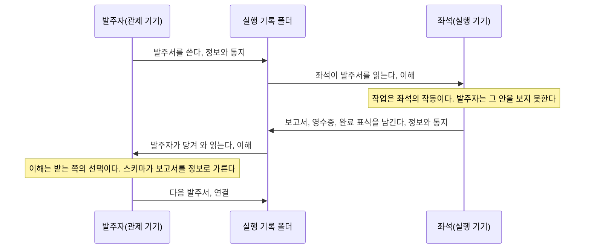
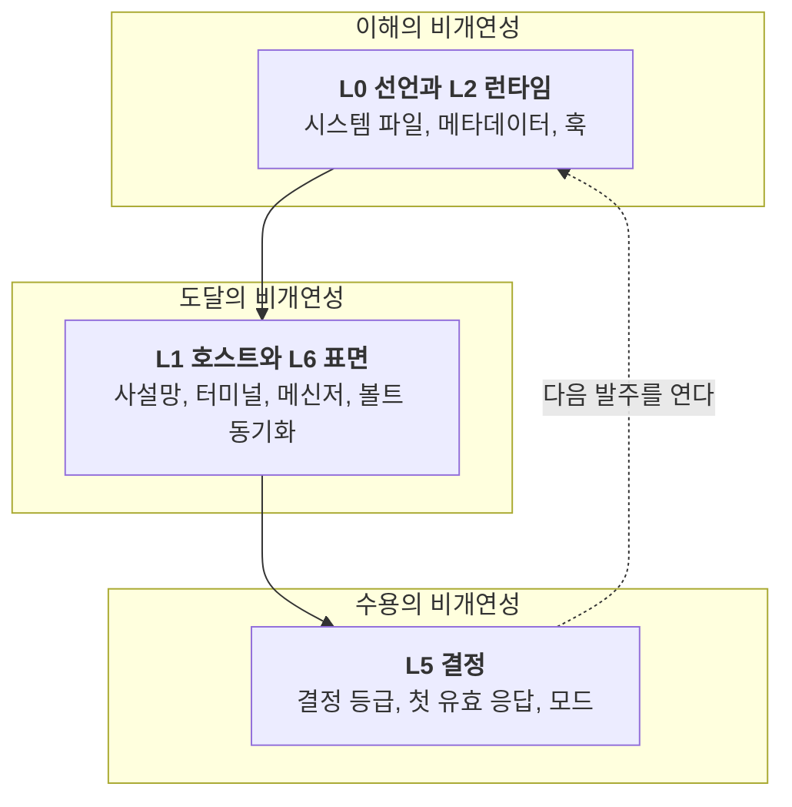
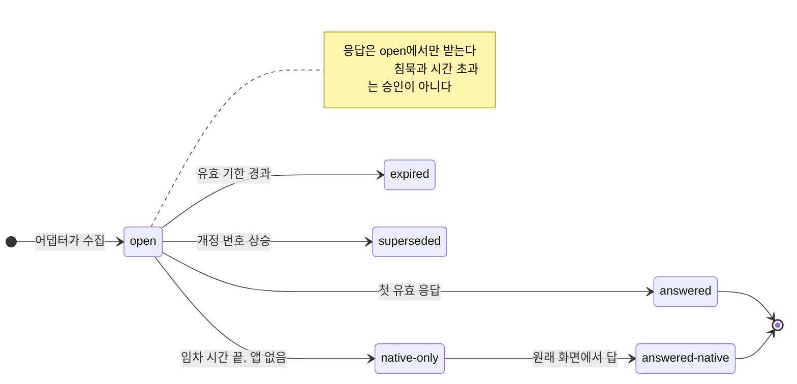
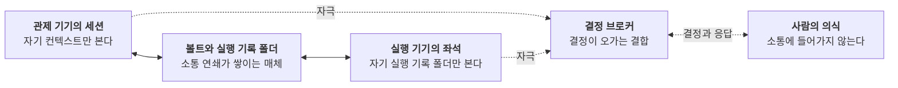

> **한 줄 주장**
>
> 에이전틱 워크플로우의 설계 단위는 호출이 아니라 연결이다. 보고서가 정보가 되는 것은 받는 쪽의 스키마에서고, 다음 발주가 열리는 것은 사람의 선택에서다. 그 두 자리를 설계하는 일이 하네스다.

아침에 발주서 한 장을 실행 기기의 좌석에 보낸다. 좌석은 몇 시간을 돌고 보고서와 영수증과 완료 표식을 남긴다. 저녁에 그것을 관제 기기로 당겨 와 읽는다. 오랫동안 나는 이 일을 명령과 복종으로 생각했다. 내가 시키고 기계가 한다. 그런데 보고서가 돌아왔는데 읽히지 않는 날이 있었고, 읽혔는데 다음 일이 이어지지 않는 날이 있었다. 명령 모형은 그런 날을 설명하지 못한다. 명령은 내려졌고 수행되었으니까. 루만의 소통 개념은 설명한다. 소통은 보낸 쪽에서 끝나지 않기 때문이다.

이 글은 그 개념 하나로 에이전틱 워크플로우를 다시 읽는다. 대응을 말할 때마다 그것이 묘사인지 유비인지 해석인지 적고, 하네스 서술은 실측과 문서상 규칙과 제안을 가른다. 루만이 썼을 법한 말은 전부 내 주장이다.

## 1. 소통은 받는 쪽에서 완성된다
루만에게 소통은 정보를 보내는 일이 아니다. 세 선택의 종합이다. 무엇을 말할지 고르는 **정보**, 그것을 지금 알린다는 행위 자체를 고르는 **통지**, 받는 쪽이 정보와 통지의 차이를 관찰하는 **이해**(Luhmann, 1984/1995, 4장). 소통은 셋째 선택에서 완성된다. 보내는 쪽이 아니라 받는 쪽에서. 수용과 거부는 소통의 구성 요소가 아니라 그다음 소통이 이어지는 방식의 문제다. 루만이 한 문장으로 줄인 대로, 소통하는 것은 사람이 아니라 소통이다(Luhmann, 1988b; 1992).

*코드로 렌더링한 도식. 소통은 보내는 쪽이 아니라 받는 쪽에서 완성된다. 발주서와 보고서 양쪽에 세 선택이 다 있고, 하네스는 그중 이해와 연결을 설계한다.*

이 한 문장이 하네스 공학의 무게 중심을 옮긴다. 프롬프트를 잘 쓰는 일은 정보와 통지를 함께 조직하는 기술이다. 보내는 쪽의 두 선택이다. 그런데 내 하네스에서 설계의 품이 실제로 들어간 자리는 프롬프트가 아니라 받는 쪽이다. 에이전트가 세션을 열 때 읽는 시스템 파일, 모든 노트가 갖춰야 하는 필수 메타데이터 일곱 필드, 실행 기록 폴더에 들어가는 작업 계약은 전부 들어온 것을 정보로 가르는 장치다. 보내는 쪽을 다듬는 일에는 끝이 없고, 받는 쪽을 세우는 일에는 구조가 있다.

## 2. 비교 스키마가 없으면 보고서는 소음이다
루만은 카드 상자에 대해 쓴 1981년 글에서 이렇게 적었다. *Information entsteht also nur in Systemen, die ein Vergleichsschema besitzen.* 정보는 비교 스키마를 가진 체계 안에서만 생긴다(Luhmann, 1981b, p. 222). 괄호 안에 덧붙이기를, 그 스키마가 "이것 아니면 다른 것"이라는 가장 단순한 것이어도 된다고 했다. 같은 쪽에 더 센 문장이 있다. 그렇게 확보된 스키마의 항상성만이 뒤따르는 정보 처리의 결속을 보장한다. 스키마가 없으면 들어오는 것은 정보가 아니라 소음이고, 스키마가 흔들리면 어제의 정보와 오늘의 정보가 이어지지 않는다.

이 인용은 정보가 체계 상대적이라는 명제를 뒷받침할 뿐 내 스키마의 설계가 옳다는 것까지 보증하지는 않는다. 그래도 설계의 자리를 정확히 가리킨다. 보고서가 돌아왔는데 읽히지 않던 날, 문제는 좌석의 산출이 아니라 받는 쪽에 비교할 틀이 없었다는 것이다. 작업 계약이 완료 판정을 미리 적어 두지 않으면 보고서의 "끝냈다"는 문장은 비교할 대상이 없는 통지다.

비교 스키마가 무엇으로 이루어지는지도 루만이 알려 준다. 의미는 세 차원에서 움직인다. 사실 차원, 시간 차원, 사회 차원(Luhmann, 1984/1995, 2장). 필수 메타데이터 일곱 필드를 이 셋 위에 올려 보면 각 차원에 적어도 하나씩 자리를 잡는다.

| 루만의 의미 차원 | 묻는 것 | 메타데이터의 자리 |
|---|---|---|
| 사실 차원 | 이것인가, 다른 것인가 | 노트의 종류, 태그, 분류, 설명 |
| 시간 차원 | 전인가, 후인가 | 만든 날, 고친 날, 작업 상태와 개정 번호 |
| 사회 차원 | 누구에게 귀속되는가 | 저자, 작성 모델, 실행 소유자와 쓰기 소유자 |

이 정렬은 가능한 정렬 하나다. 사회 차원은 본래 자아와 타자의 관점 차이를 다루는 차원이고, 저자와 모델 필드가 하는 일은 그보다 좁은 귀속(Zurechnung)이다. 그래서 작성 모델 필드가 빠진 에이전트 노트가 사람 작성으로 오분류되는 사고는 단순 누락이 아니라 귀속 주소의 소실이라고 적는 것이 정확하다. 세 차원이 모두 있어야 노트가 정보가 되는 것은 아니다. 다만 어느 차원이 비면 그 차원의 비교가 막힌다.

## 3. 워크플로우의 단위는 호출이 아니라 다음 발주다
소통은 사건이다. 생기는 즉시 사라진다. 그러므로 체계가 살아 있으려면 다음 소통이 이어져야 한다(Luhmann, 1984/1995). 루만은 이것을 연결 가능성(Anschlussfähigkeit)이라 불렀고, 1981년 글의 첫 쪽에서 이 말은 글쓰기에 붙어 나온다. 쓰지 않고는 생각할 수 없다, 적어도 까다롭고 연결 가능한(anschlußfähig) 방식으로는(Luhmann, 1981b, p. 222). 그가 카드 상자를 만든 첫째 이유는 기억이 아니라 연결이었다.

하네스에서 연결을 맡는 장치는 전부 주소다. 노트에 적어 두는 세션 링크는 그 노트를 만든 세션으로 돌아가는 주소다. 재개 명령은 끊어진 세션에 다시 붙는 주소다. 과거 세션 전문 검색은 잊힌 소통을 다시 찾는 주소다. 완료 표식과 막힘 표식은 다음 발주가 어디서 시작해야 하는지 적은 주소다. 주소를 남기는 것과 실제로 다음 소통이 이어지는 것은 다르다. 이 장치들은 후속 소통의 가능성을 보존할 뿐이다.

여기서 워크플로우 도구들이 그리는 그림을 다시 보게 된다. 노드와 간선. 노드는 호출이고 간선은 "앞의 출력이 뒤의 입력이 된다"는 약속이다. 루만을 받아들이면 그 간선은 비어 있다. 출력이 입력이 되는 일은 자동이 아니다. 받는 노드에 비교 스키마가 있어야 출력이 정보가 되고, 정보가 되어야 다음 호출이 그 위에 선다. 내 주장으로는, 에이전틱 워크플로우의 가장 흔한 고장은 모델의 오답이 아니라 스키마 없는 간선이다. 앞 단계의 "완료"가 뒤 단계에 소음으로 도착하는 것. 그래서 설계는 노드 수가 아니라 간선마다 무엇을 비교할지 적는 일에서 시작한다. 발주서에 완료 판정이 들어가고 보고서에 그 판정의 근거가 들어가는 이유가 그것이다.

## 4. 세 비개연성, 세 예산
루만은 소통이 성립하는 것 자체가 있을 법하지 않은 일이라고 썼다. 상대에게 **이해**될 법하지 않고, 상대에게 **도달**할 법하지 않고, 도달해 이해돼도 **수용**될 법하지 않다(Luhmann, 1981a). 사회는 이 세 비개연성을 개연성으로 바꾸는 매체를 발명하며 진화했다. 언어는 이해를, 문자와 인쇄 같은 확산 매체는 도달을, 돈과 권력과 진리 같은 상징적으로 일반화된 매체는 수용을 있을 법하게 만든다(Luhmann, 1981a; 1984/1995, 4장).

세 비개연성을 하네스의 층 위에 올려 읽을 수 있다. 사후 배치이고 해석이다.

*코드로 렌더링한 도식. 세 비개연성은 층 위에 겹쳐 읽을 수 있다. 이해는 선언과 런타임이, 도달은 호스트와 표면이, 수용은 결정 층이 맡는다. L3은 셋을 묶는 봉투이고 L4는 이 삼분법 밖에 있다.*

이해는 L0 선언 원장과 L2 런타임이 맡는다. 시스템 파일, 메타데이터, 좌석 배정 파일, 훅 파이프라인. 도달은 L1 실행 호스트와 L6 표면이 맡는다. 두 기기를 잇는 사설망, 터미널, 메신저, 그리고 실행 기기에서 관제 기기까지 한두 분 걸리는 볼트 동기화. 수용은 L5 결정이 맡는다. 결정 등급, 첫 유효 응답만 채택하는 규칙, 장소와 상황별 모드. L3 작업 조정은 셋을 한 봉투에 담는 작업 계약이다. L4 관측은 이 삼분법에 자리가 없다. 관측은 소통의 성립 조건이 아니라 소통에 대한 관찰이기 때문이다.

이 배치에서 실무적으로 쓸 만한 것은 예산의 분리다. 이해 예산은 스키마에 쓰고, 도달 예산은 전송과 지연에 쓰고, 수용 예산은 결정에 쓴다. 한 예산으로 다른 비개연성을 사지 못한다. 프롬프트를 아무리 다듬어도 동기화 지연은 줄지 않고, 메신저 채널을 아무리 늘려도 수용은 생기지 않는다. 하네스가 느리다고 느껴질 때 어느 비개연성이 막혀 있는지 먼저 가르면 고칠 자리가 보인다.

매체의 대응에는 조심할 것이 있다. 마크다운은 언어적 소통을 기록하는 형식이다. 동기화와 버전 관리와 원격 셸과 실행 기록 폴더는 기록을 저장하고 전달하는 확산 매체다. 그러면 수용을 있을 법하게 만드는 상징적으로 일반화된 매체는 무엇인가. 처음에는 결정 등급이라고 쓰고 싶었다. 가장 낮은 등급은 묻지 않고 받고, 가장 높은 등급은 사람이 원래 화면으로 돌아올 때만 받으니까. 그러나 그것은 범주 오류다. 돈과 권력과 진리는 사회 전체에서 이항 코드로 일반화되어 낯선 상대의 수용 동기를 만든다(Luhmann, 1997). 결정 등급은 한 조직 안의 조건 프로그램이자 권한 배정이다. 동기를 바꾸지 않고 호출을 막는다. 등급이 매체와 같은 자리에 서는 것은 수용을 사람의 결정으로 되돌리는 국소 관문이라는 점에서만 그렇다.

## 5. 수용은 선택이다, 그래서 침묵은 승인이 아니다
수용이 선택이라는 것은 침묵이 수용이 아니라는 뜻이다. 기획서의 결정 상태 전이는 이 한 문장을 기계로 옮겼다. 제안 단계의 설계다.

*코드로 렌더링한 도식. 수용은 선택이다. 시간이 지나면 승인되는 대신, 원래 화면에서만 답할 수 있는 상태로 넘어간다(제안).*

동기 원천의 임차 시간은 5분 안팎이다. 그 안에 사람이 답하지 않으면 요청은 사라지지도 승인되지도 않고, 원래 화면에서만 답할 수 있는 상태로 남는다. 질문의 내용이나 영향 범위가 바뀌어 개정 번호가 오르면 이전 봉투는 폐기되고 이전 응답은 무효다. 어느 경로로도 자동 승인은 없다.

등급이 위험을 영향으로 정한다는 점은 루만의 위험 개념과 맞는다. 위험은 자기 결정에 귀속되는 손실이고, 위해는 환경에 귀속되는 손실이다(Luhmann, 1991b). 결정 등급은 결정에 귀속될 손실의 크기로 응답 위치를 정한다. 환경이 얼마나 위험한가가 아니라 이 결정이 무엇을 바꾸는가를 묻는다.

신뢰도 여기 들어온다. 루만은 『신뢰』에서 신뢰를 복잡성을 줄이는 위험한 선지급이라 불렀다(Luhmann, 1968/1979). 20년 뒤에는 한 구별을 더했다. 대안을 고려하지 않은 채 당연하게 기대하는 것은 확신(confidence)이고, 위험을 자기 선택으로 알면서 기대하는 것이 신뢰(trust)다(Luhmann, 1988a). 이 구별이 하네스의 한 조항을 정확히 비춘다. 런타임의 권한 확인을 전역으로 꺼 두는 설정은 신뢰가 아니라 확신 상태다. 누가 언제 무엇을 허용했는지 아무도 고르지 않았다. 사람 없는 외부 효과는 이름으로 등록한 예외뿐이라는 원칙은 확신을 신뢰로 바꾸는 일이다. 범위와 전제와 만료와 중단 스위치를 가진 선언으로만. 위험을 아는 선택이 되는 순간 그것은 신뢰가 된다. 이 원칙은 아직 제안이다.

가장 루만적인 사고도 여기서 났다. 최근 점검에서 에이전트 사이의 측면 메시지 수신 기본값이 두 기기에서 모두 열려 있었고, 사람이 보지 않는 세션이 옆 에이전트의 메시지 한 통으로 깨어날 수 있었다. 메시지의 도달이 실행의 승인으로 바뀐 경계 누수다. 내 주장으로는, 매체가 섞이면 비개연성 하나가 사라진 것처럼 보이지만 실제로는 그 비개연성이 다른 층으로 숨어 들어갔을 뿐이다. 도달이 쉬워진 만큼 수용의 문턱이 사라졌고, 그 문턱을 되돌리는 것이 측면 메시지를 결정으로 보류한다는 제안이다. 같은 사건을 6편에서 라투르는 다른 말로 읽는다.

## 6. 에이전트는 서로의 안을 보지 못한다
루만은 마투라나와 바렐라에게서 자기생산(Autopoiesis)이라는 말을 빌려 왔다(Maturana & Varela, 1980). 체계는 자기 요소를 자기 작동으로 만든다. 그래서 작동상 닫혀 있다. 다른 체계의 작동은 내 안으로 들어오지 못하고, 환경은 오직 내 구별을 통해서만 보인다. 두 체계는 서로의 작동에 들어가지 못한 채 구조적 결합을 통해 서로를 자극할 뿐이다(Luhmann, 1984/1995; 2006).

이 개념을 어디에 적용하는지가 이 시리즈에서 가장 조심할 자리다. 에이전트 세션은 자기생산 체계가 아니다. 세션의 다음 상태는 런타임과 시스템 프롬프트와 훅과 도구 결과가 입력으로 적어 넣는다. 그것은 자극이 아니라 입력이고, 호출이 끝나면 세션은 사라진다. 볼트도 자기생산 체계가 아니다. 페이지를 쓰는 것은 바깥의 에이전트와 사람이다. 그러면 자기생산의 후보는 어디인가. 루만의 구도에 가장 충실한 답은 발주서에서 보고서로, 보고서에서 결정으로, 결정에서 다음 발주서로 이어지는 **소통 연쇄**다. 소통이 소통을 낳는 그 연쇄가 조직과 닮은 체계이고, 세션과 좌석과 사람은 그 연쇄의 환경이다. 에스포지토가 알고리즘을 두고 한 말이 정확히 이것이다. 물을 것은 기계가 생각하는가가 아니라 그 출력이 소통에 기여하는가다(Esposito, 2017).

*코드로 렌더링한 도식. 세션은 서로의 안을 보지 못한다. 자기생산적인 것은 세션이 아니라 볼트와 실행 기록 폴더에 쌓이는 소통 연쇄이고, 세션과 사람은 그 연쇄의 환경이다.*

그래도 세션 사이의 벽은 실재한다. 한 세션은 자기 컨텍스트 창만 본다. 옆 탭의 세션은 보이지 않는다. 좌석의 안은 관제 기기에서 보이지 않고, 나는 둘 다의 안을 보지 못한다. 이것은 자기생산이 아니라 관찰 불투명성이다. 폰 푀르스터의 비자명 기계와 라투르의 블랙박스가 이 일을 설명하는 더 알맞은 어휘다(von Foerster, 2003; Latour, 1999). 그래서 기획서 첫 원칙이 **실행은 분산, 보기는 통합**인 것은 이 설계가 택한 제약이다. 관제 기기는 좌석의 작동 안으로 들어가지 않는다. 마커를 당겨 와 볼 뿐이다.

결합의 매체가 무엇인지가 하네스 설계의 핵심 하나다. 볼트와 실행 기록 폴더는 두 실행이 같은 글을 읽게 하는 접점이다. 그런데 훅을 전부 자극이라 부르면 틀린다. 세션 시작 때 띄우는 안내 메시지는 자극이다. 세션이 자기 구별로 처리하고, 무시할 수도 있다. 도구 호출을 막는 훅과 거부 목록은 자극이 아니라 강제다. 작동 중간에 끼어들어 호출을 멈춘다. 둘을 가르는 것이 중요하다. 전자는 루만의 어휘로 자극이고, 후자는 2편의 조건 프로그램이자 6편의 위임된 스크립트다. 같은 훅 메시지를 두 런타임이 다르게 처리하는 것도 폐쇄의 증거가 아니다. 최근 점검에서 드러난 것은 두 런타임의 수신 기본값과 승인 모드가 다르게 설정되어 있었다는 사실이다. 설정이 다르면 동작이 다르다. 해석의 차이는 따로 관찰해야 주장할 수 있다.

## 7. 설계자에게 남는 세 질문
이 글이 워크플로우 설계에 남기는 것은 세 질문이다. 간선 하나를 그릴 때마다 묻는다.
1. **이 간선의 받는 쪽 스키마는 무엇인가.** 앞 단계의 출력을 뒤 단계가 무엇과 비교해 정보로 만드는가. 비교할 것이 없으면 간선이 아니라 소음의 통로다.
2. **이 소통이 끊어지면 다시 붙을 주소는 어디인가.** 세션 링크, 재개 명령, 완료와 막힘 표식. 주소가 없으면 끊어진 자리에서 체계가 멈춘다.
3. **이 결과의 수용은 누가 어디서 선택하는가.** 사람이 선택하지 않은 수용은 침묵이고, 침묵을 승인으로 읽는 설계는 명령 모형으로 되돌아간다.
셋 중 하나라도 비면 그 자리에서 명령 모형이 되살아난다. 명령 모형은 편하다. 보내면 끝이니까. 그러나 보고서가 읽히지 않는 날과 다음 일이 이어지지 않는 날은 그 편안함의 청구서다. 다음 편은 받는 쪽을 세우는 일, 곧 층과 소유의 이야기다.

---

## 검증 경계
> **인용과 수치의 경계**
>
> - 1981년 「Kommunikation mit Zettelkästen」의 인용(비교 스키마, 스키마의 항상성, 연결 가능한 글쓰기)은 Westdeutscher Verlag 1981년판 스캔(222~228쪽)의 독일어 원문과 대조했다. 대조 기록은 독일어 원문 대조 노트(2026-10-24, 볼트 내부).
> - 그 밖의 인용은 저작 단위로 적었고 장 번호는 해당 판본의 장 구성이다. 쪽수가 불확실한 곳은 적지 않았다.
> - 하네스 서술의 근거는 AI 하네스 총정리와 구조 스키마 기획서(2026-10-23, 볼트 내부)의 2.1, 2.4, 3.7절이다. 결정 상태 전이와 측면 메시지 보류와 상시 승인 예외는 제안이고 미구현이다. 기기 이름과 도구 이름은 일반화해 적었고, 수치는 기획서에 있다.
> - 세 비개연성의 층 배치와 "스키마 없는 간선" 주장은 내 해석이다.

## 참고문헌
- Esposito, E. (2017). Artificial communication? The production of contingency by algorithms. *Zeitschrift für Soziologie, 46*(4), 249–265. https://doi.org/10.1515/zfsoz-2017-1014
- Latour, B. (1999). *Pandora's hope: Essays on the reality of science studies*. Harvard University Press.
- Luhmann, N. (1979). *Trust and power* (H. Davis, J. Raffan, & K. Rooney, Trans.). Wiley. (Original work *Vertrauen* published 1968)
- Luhmann, N. (1981a). Die Unwahrscheinlichkeit der Kommunikation. In *Soziologische Aufklärung 3: Soziales System, Gesellschaft, Organisation* (S. 25–34). Westdeutscher Verlag.
- Luhmann, N. (1981b). Kommunikation mit Zettelkästen: Ein Erfahrungsbericht. In H. Baier, H. M. Kepplinger, & K. Reumann (Hrsg.), *Öffentliche Meinung und sozialer Wandel* (S. 222–228). Westdeutscher Verlag.
- Luhmann, N. (1988a). Familiarity, confidence, trust: Problems and alternatives. In D. Gambetta (Ed.), *Trust: Making and breaking cooperative relations* (pp. 94–107). Basil Blackwell.
- Luhmann, N. (1988b). Wie ist Bewußtsein an Kommunikation beteiligt? In H. U. Gumbrecht & K. L. Pfeiffer (Hrsg.), *Materialität der Kommunikation* (S. 884–905). Suhrkamp.
- Luhmann, N. (1991b). *Soziologie des Risikos*. Walter de Gruyter.
- Luhmann, N. (1992). What is communication? *Communication Theory, 2*(3), 251–259. https://doi.org/10.1111/j.1468-2885.1992.tb00042.x
- Luhmann, N. (1995). *Social systems* (J. Bednarz Jr. & D. Baecker, Trans.). Stanford University Press. (Original work *Soziale Systeme* published 1984)
- Luhmann, N. (1997). *Die Gesellschaft der Gesellschaft*. Suhrkamp.
- Luhmann, N. (2006). System as difference. *Organization, 13*(1), 37–57. https://doi.org/10.1177/1350508406059638
- Maturana, H. R., & Varela, F. J. (1980). *Autopoiesis and cognition: The realization of the living*. D. Reidel.
- von Foerster, H. (2003). *Understanding understanding: Essays on cybernetics and cognition*. Springer.
