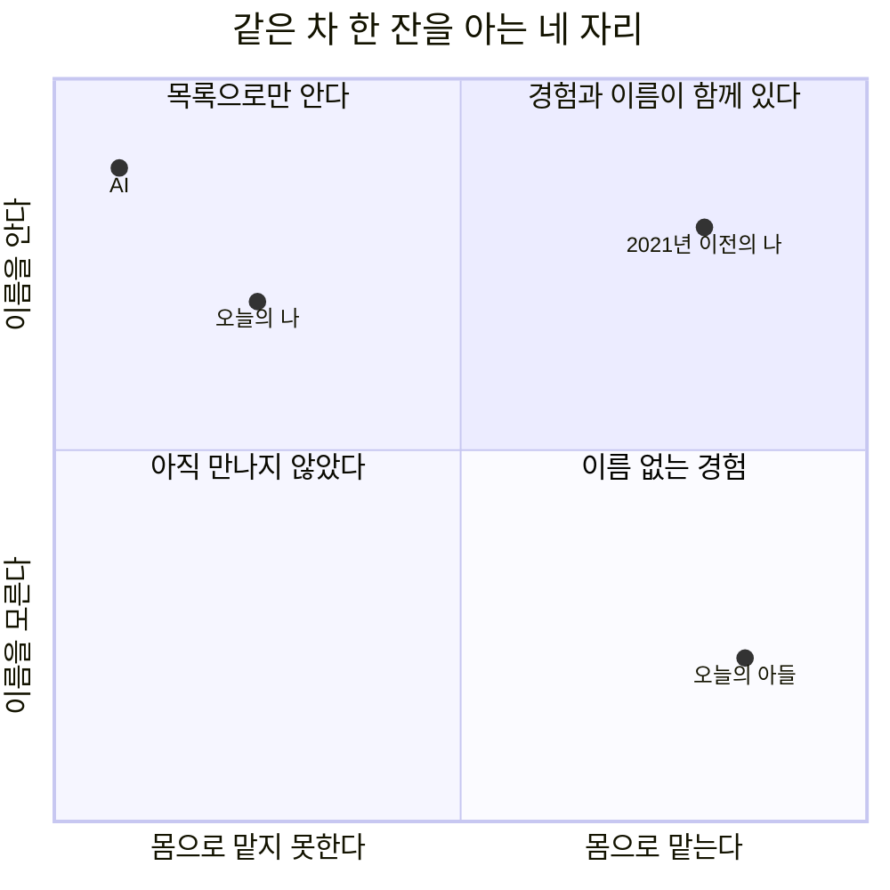
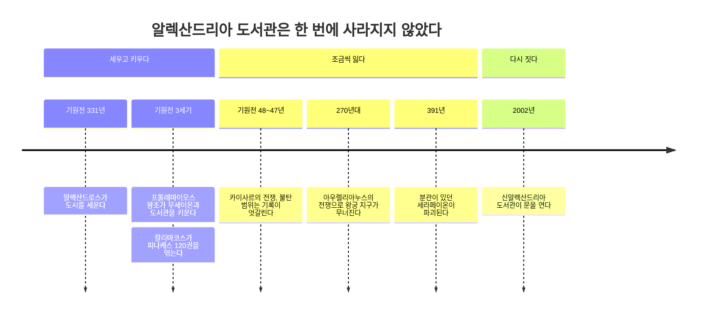
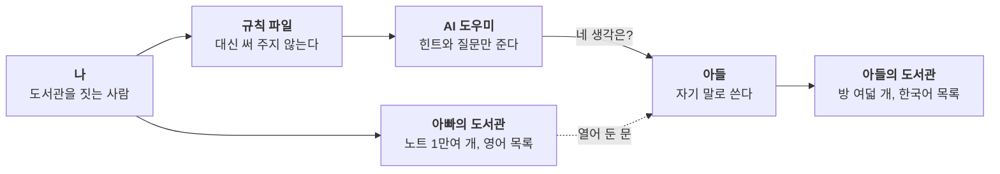
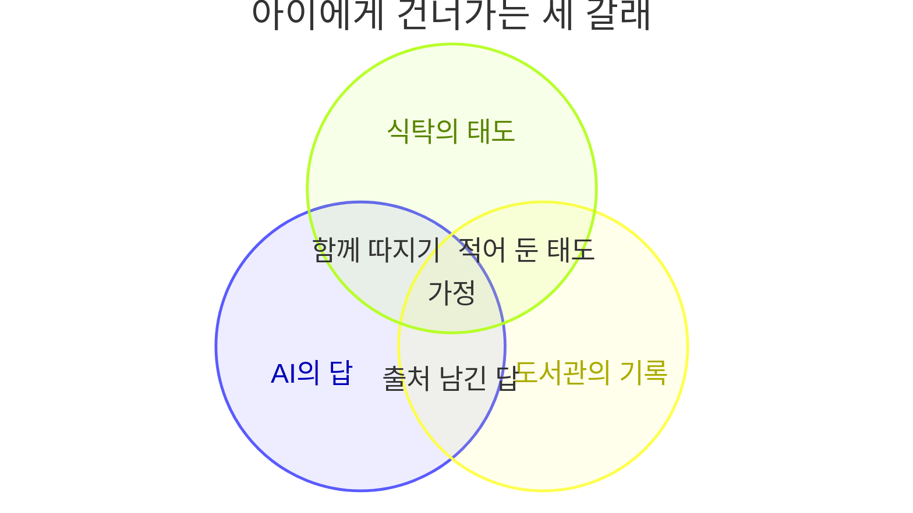

오랜만에 TWG의 알렉산드리아 티를 마셨다. 곁에 온 아들이 치약 향이 난다고 했다. 스피어민트 때문이었을 것이다. 아이는 자기에게 가장 익숙한 것으로 처음 맡는 향을 불렀다.

그 말이 오래 남았다. 나는 그 향을 확인할 수 없기 때문이다.

## 그 방에서 향을 맡은 사람은 아들뿐이었다
나는 차와 커피를 좋아했다. 스페셜티 원두를 사다가 더치커피를 내렸고, 홍차를 종류별로 사 두고 그날 기분에 맞는 향을 골랐다. TWG나 타발론은 비싸서 자주 마시지 못했지만 좋아했다. 어떤 향을 마실지 고르는 시간까지가 즐거움이었다.

2021년 사고 이후 후각을 잃었다. 영구적이다. 냄새도 향도 다시 느낄 수 없다. 세상을 다채롭게 받아들이던 채널 하나가 닫혔다. 좋아하던 향의 기억은 남아 있는데, 지금 내 앞에 놓인 잔의 향에는 닿지 못한다.

이 차가 어떤 향인지 AI에게 물어본 적이 있다. 답은 친절하고 정확했다. 녹차에 민트와 따뜻한 향신료와 꽃잎을 섞었고, 공식 향미 노트는 아니스, 스피어민트, 감초라고 했다. 끝에 각주가 하나 붙어 있었다. 직접 시음한 후기가 아니라 TWG의 공식 설명을 감각적으로 풀어 쓴 표현이라는 것이다.

정직한 각주였다. 그리고 그 각주가 내가 앉은 자리를 정확히 말해 주었다. AI는 이 차를 맡아 본 적이 없다. 나에게는 향을 맡던 시절의 기억만 있다. **그 방에서 향을 맡은 사람은 아들뿐이었다.**

*코드로 렌더링한 도식. 몸으로 맡는가와 이름을 아는가라는 두 기준에 나, AI, 아들의 자리를 놓은 해석이다. 점의 위치는 측정값이 아니다.*

같은 차 한 잔을 아는 방법이 넷으로 갈렸다. 2021년 이전의 나라면 향을 맡고 이름도 붙였을 것이다. 오늘의 나에게는 이름과 기억만 남았다. AI는 처음부터 이름의 세계에서만 이 차를 안다. 아들은 향을 맡았지만 아직 그 향의 이름을 모른다.

사고는 나를 오른쪽 위에서 왼쪽 위로 옮겨 놓았다. 그 칸에 먼저 앉아 있던 것이 AI다. **나는 이제 이 차를 AI와 같은 칸에서 안다. 목록으로 안다.**

그래서 반대편 칸에 앉은 아들이 새롭게 보였다. 이름은 몰라도 경험은 가진 사람. 내가 다시는 갖지 못할 것을 가진 사람이다.

## 치약은 틀린 답이 아니라 첫 번째 색인이다
아이에게 그 향은 치약이었다. 틀린 말이 아니다. 치약에 흔히 들어가는 향이 민트 계열이다. 아이는 모르는 향을 이미 아는 말에 걸어 두었다.

지식은 대개 이렇게 시작한다. 나는 지식이 흐르는 길을 포착(Connect), 통합(Merge), 발전(Develop), 공유(Share)의 네 단계로 정리하고 CMDS Process라고 부른다. 그 첫 단계가 포착이다. 처음 만난 것을 일단 내가 가진 말에 걸어 두는 일이다. 이름이 정확하지 않아도 된다. 걸어 두어야 나중에 다시 찾을 수 있다.

언젠가 아이는 민트라는 이름을 배울 것이다. 더 지나면 스피어민트와 페퍼민트를 구별할지도 모른다. 그때 오늘의 치약은 지워지지 않는다. 새 이름이 그 위에 덧붙는다. **치약은 틀린 답이 아니라 아이의 머릿속 도서관에 처음 꽂힌 색인 카드다.**

어른이 너무 일찍 고쳐 주면 그 카드는 아이의 것이 아니라 어른의 것이 된다. 이 생각은 뒤에서 내가 아들의 도서관에 적어 둔 규칙으로 다시 돌아온다.

## 도서관을 도서관으로 만든 것은 목록이었다
알렉산드리아라는 이름을 들으면 나는 도서관을 떠올린다. TWG가 도서관에서 이름을 따왔다는 공식 설명은 찾지 못했다. 브랜드가 내세우는 것은 아라비안나이트와 지중해의 분위기다. 도서관은 내 연상이다. 그래도 그 연상을 따라가 보기로 했다.

알렉산드리아는 기원전 331년 알렉산드로스 대왕이 이집트 지중해 연안에 세운 도시다. 도서관은 그 뒤 프톨레마이오스 왕조의 후원 아래 기원전 3세기 무렵 자랐다. 학문과 예술의 여신 뮤즈에게 바친 무세이온(Mouseion)과 이어져 있었고, 책을 모으는 곳이자 학자들이 함께 연구하는 곳이었다. 오늘로 치면 도서관과 연구소와 학술 공동체를 합친 기관에 가깝다.

장서가 몇십만 권이었다는 이야기는 유명하지만 확정하기 어렵다. 당시의 단위는 책이 아니라 두루마리였고, 사료마다 숫자가 다르다. 내가 오래 붙든 것은 숫자가 아니라 한 사람의 작업이다.

시인이자 학자인 칼리마코스는 『피나케스(Pinakes)』라는 목록을 120권 분량으로 엮었다. 저자를 분야별로 나누고, 항목마다 제목과 저자의 이름과 출신, 짧은 생애와 저작 목록을 적었다. 작품의 첫 줄과 내용 요약, 두루마리의 내력, 정말 그 저자의 글이 맞는지에 대한 의심까지 남겼다. 원문은 조각으로만 전한다. 이것이 도서관의 서가 목록이었는지, 그리스 문헌 전체를 정리한 비평적 목록이었는지는 학자들 사이에서도 의견이 갈린다. 어느 쪽이든 서지학과 목록 작성의 역사는 이 작업을 출발점으로 꼽는다.

**책을 많이 가진 곳은 창고다. 필요한 책을 찾아 쓸 수 있는 곳이 도서관이다.** 그 차이를 만든 것이 목록이었다.

내 볼트에도 피나케스가 있다. 1만 개가 넘는 노트마다 frontmatter라는 머리 칸이 붙어 있다. 노트를 펼치기 전에 그것이 무엇인지, 누가 썼는지, 어느 서가에 두었는지 알려 주는 칸이다.

| 피나케스의 항목 | 내 노트의 칸 | 하는 일 |
|---|---|---|
| 분야 분류 | `type`, `CMDS` | 어느 서가에 꽂을지 정한다 |
| 제목, 저자 이름과 출신 | 파일 이름, `aliases`, `author` | 무엇을 누가 썼는지 밝힌다 |
| 짧은 생애와 저작 목록 | 인물 노트와 위키링크 | 같은 사람의 다른 글로 길을 낸다 |
| 첫 줄과 내용 요약 | `description` | 펼치기 전에 무엇인지 알려 준다 |
| 두루마리의 내력, 저자에 대한 의심 | `model`, 출처 기록 | 사람이 썼는지 AI가 썼는지 남긴다 |

칼리마코스의 목록을 읽은 사람은 학자였다. 내 목록의 첫 독자는 조금 다르다. 나는 `description`을 영어 한두 문장으로 쓴다. 사람보다 AI 에이전트가 먼저 읽고 이 노트를 언제 꺼낼지 판단하라고 정한 규칙이다. **목록을 무슨 언어로 쓰느냐가 그 도서관의 첫 독자를 정한다.**

표의 마지막 줄도 중요하다. 칼리마코스는 그 글이 정말 그 저자의 것인지 의심을 적어 두었다. 나는 AI가 쓰거나 함께 쓴 노트에 어떤 모델이 썼는지 `model` 칸에 남기게 했다. 이 글도 AI와 대화하며 초안을 잡았으니 원고 노트에 그 칸이 채워져 있다. 언젠가 아들이 내 도서관을 열었을 때, 어느 문장이 아버지의 것이고 어느 문장이 기계와 함께 쓴 것인지 구별할 수 있어야 한다. **AI와 함께 쓴 도서관을 물려주려면, 누가 썼는지 적는 칸부터 있어야 한다.**

## 도서관은 한 번에 불타지 않는다
알렉산드리아 도서관은 하룻밤 불길에 사라졌다는 이미지로 기억된다. 실제 기록은 그렇게 단순하지 않다.

*코드로 렌더링한 도식. 알렉산드리아 도서관이 세워지고, 여러 사건을 거쳐 조금씩 사라지고, 2002년에 새로 지어지기까지를 연대순으로 놓았다.*

기원전 48년에서 47년 사이 카이사르의 알렉산드리아 전쟁 때 불이 났고 적지 않은 문헌이 탔을 것이다. 다만 본관이 사라졌는지, 항구 창고에 있던 두루마리가 탔는지는 기록이 엇갈린다. 270년대 아우렐리아누스의 전쟁은 도시의 많은 부분을 무너뜨렸는데, 그때 도서관이 파괴되었다는 당대 기록은 없다. 그즈음엔 이미 남은 것이 많지 않았을지도 모른다. 391년에는 분관이 있던 세라페이온이 파괴되었다. 그때 남아 있던 장서가 얼마였는지는 알 수 없다.

역사가 로저 배그널은 한 번의 파괴만큼이나 오랜 방치와 부식이 치명적이었을 것이라고 본다. 우리는 탓할 악당이 있는 이야기를 좋아한다. 그런데 사건과 사건 사이에는 몇백 년이 있다. 배그널이 보기에 그 긴 시간 동안 동서 어느 쪽의 권력에도 큰 도서관을 유지할 의지와 수단이 없었다. 그리고 그는 이렇게 덧붙인다. 불타지 않은 건물이 썩어 가는 책으로 가득 차 있었다 해도 티끌만큼의 차이도 없었을 것이라고.

도서관은 불에 타기 전부터 조금씩 사라지고 있었을지도 모른다.

이 이야기가 남의 일 같지 않다. 내 도서관에서도 같은 일이 일어났다.

올봄 9요한이라는 멀티 에이전트 체계의 정본 문서를 다른 폴더로 옮겼다. 그런데 시스템 파일 안에서 그 문서를 가리키던 길은 옛 주소 그대로 남았다. 아무도 몰랐다. 넉 달 뒤인 8월 23일, 에이전트 하나가 그 길을 따라 문서를 열려다 실패하고서야 드러났다. 악당은 없었다. 길이 조용히 끊겼을 뿐이다.

더 아픈 대목이 있다. 나는 7월 19일부터 볼트 전체를 매일 새벽 NAS로 백업한다. 길이 끊겨 있던 기간에도 백업은 스무 번 넘게 돌았다. 그때마다 끊긴 길을 그대로, 성실하게 복사했다. 내 백업이 바로 불타지 않은 건물이었다. **백업은 바이트를 지킨다. 길을 지키는 것은 돌봄이다.**

그 일 뒤로 파일을 옮기거나 이름을 바꿀 때 지키는 규칙을 새로 적었다. 옮기기 전에 그 파일을 가리키는 길을 모두 찾고, 옮긴 뒤 새 주소로 고치고, 지난 기록은 당시의 경로 그대로 둔다. **유산은 남기는 순간 완성되지 않는다. 누군가 돌보는 동안만 유산이다.**

오늘 세어 보니 내 볼트에는 아직 없는 노트가 6,878개 있고, 그 노트로 가는 링크가 1만 1천 개 넘게 걸려 있다. 아직 없는 방이 6,878개, 그 방으로 가는 문이 1만 1천 개쯤이다. 그중에는 이름을 바꾼 방을 아직 옛 이름으로 부르는 문도 섞여 있다. 이 글의 재료가 된 AI의 답변 끝에도 예전에 쓰던 부문 이름이 하나 붙어 있었다. 지금은 없는 방이다.

하지만 많은 문은 일부러 열어 둔 것이다. 언젠가 쓰려고 이름만 먼저 붙여 둔 개념들이다. 나는 그것을 씨앗이라고 부른다. 아직 짓지 않은 방으로 가는 문이다. 내가 끝내 들어가지 못할 방도 있을 것이다. 그 문을 여는 사람이 아들이라면 좋겠다.

## 물려줄 것은 도서관이 아니라 도서관을 짓는 법이다
처음에는 내 도서관이 그대로 아들의 지식 베이스가 되리라 생각했다. 내가 이름 붙이고 기둥을 세운 곳에 아이가 찾아와 필요한 것을 꺼내 쓰는 장면을 그렸다.

그런데 올여름 나는 다른 선택을 했다. 아들의 볼트를 따로 만들었다. 내 도서관 안에 아이의 방을 하나 내준 것이 아니라, 옆에 작은 도서관을 하나 새로 지었다.

방은 여덟 개다. 수집함, 일기, 공부, 독서, 탐구, 신앙, 만든 것들, 설정. 내 CMDS Process도 아이의 말로 옮겼다. 모으기, 엮기, 만들기, 나누기. 첫 화면에는 베껴 쓰면 남의 지식이고 내 말로 바꿔 쓰면 내 지식이 된다고 적었다.

목록 칸도 바꿨다. 내 도서관의 `description`은 영어지만, 아들의 도서관에서는 한국어로 쓴다. 아이가 읽을 수 있어야 하기 때문이다. 앞에서 말한 대로 목록의 언어가 첫 독자를 정한다. 아들의 도서관에서 첫 독자는 아들이다.

그 도서관을 함께 관리할 AI에게는 규칙을 따로 주었다. 규칙 파일 맨 앞에, 기술 규칙보다 먼저 교육 원칙을 적었다.

- 숙제, 독후감, 일기, 발표문을 대신 써 주지 않는다. 힌트와 질문과 예시 구조로 돕는다.
- 요약을 부탁받으면 요약과 함께 "네 생각은?" 하는 질문을 하나 남긴다.
- 아이가 쓴 본문은 고치지 않는다. 오탈자도 고치지 않는다. 제안만 한다.

오늘 치약 이야기를 들으며 마지막 규칙을 다시 떠올렸다. 아이가 처음 붙인 이름은 아이의 것이어야 한다. 맞춤법이 틀려도, 비유가 서툴러도 그 문장은 아이의 첫 색인이다. AI가 매끈하게 고쳐 놓으면 그 도서관은 아이의 도서관이 아니라 AI의 도서관이 된다.

*코드로 렌더링한 도식. 아빠의 도서관과 아들의 도서관을 따로 둔 실제 구성이다. 아들 곁의 AI는 규칙 파일에 묶여 대신 써 주지 않고 질문으로 돕는다. 점선은 앞으로 생길 길에 대한 해석이다.*

**AI 시대의 가정교육은 아이 곁에 앉을 AI에게 무엇을 하지 말라고 할지 정하는 데서 시작한다.** 아이는 앞으로 AI에게 수많은 것을 물을 것이다. 나는 그 질문을 막을 수 없고 막을 생각도 없다. 내가 정할 수 있는 것은 그 AI가 아이 대신 생각하지 않게 하는 일이다. 그 규칙에는 내 태도가 적혀 있다. 아이의 문장을 존중하는 태도, 답보다 질문을 남기는 태도.

솔직히 말하면 그 도서관은 아직 거의 비어 있다. 방 이름과 안내문만 있다. 그게 맞다고 생각한다. 그 서가는 내 책이 아니라 아이의 이야기로 채워져야 한다. 내가 할 일은 두 가지다. 아이가 필요할 때 찾아올 수 있게 내 도서관의 문을 열어 두는 것, 그리고 아이의 도서관이 아이의 손으로 차오를 때까지 기다리는 것.

## 아이는 기록보다 식탁에서 먼저 배운다
최근 친하게 지내는 가정들과 2박 3일을 함께 보냈다. 손님으로 온 한 집의 아들이 아빠의 말투를 그대로 따라 했다. 말투만이 아니었다. 태도와 가치관까지 건너가 있었다. 그 아이와 이야기하다 보면 그 아버지가 겹쳐 보이는 순간이 있었다.

그 모습을 보며 내가 아들에게 무엇을 남기고 있는지 다시 생각했다. 나는 글을 쓰고 자료를 정리하면서 무언가를 남긴다고 생각해 왔다. 그런데 아이는 내가 기록하지 않은 것까지 보고 있다. 사람을 대하는 말투, 낯선 질문을 받았을 때의 반응, 내 생각과 다른 말을 들을 때의 얼굴, 모르는 것을 만났을 때의 태도. 어떤 frontmatter에도 적히지 않는 것들이다.

노나카 이쿠지로는 함께 지내며 보고 따라 하는 사이에 말로 다 하지 못하는 앎이 옮겨 가는 일을 공동화(Socialization)라고 불렀다. 암묵지는 목록으로 건너가지 않는다. 같은 자리에 오래 있어야 건너간다.

알렉산드리아도 그랬다. 기원전 1세기 말 그 도시에 머물렀던 지리학자 스트라본은 무세이온을 이렇게 적었다. 산책로가 있고, 앉을 자리가 놓인 회랑이 있고, 큰 집이 있는데 그 안에 무세이온의 학자들이 함께 쓰는 식당이 있다고. 그 도서관의 지식은 서가에서만이 아니라 식탁에서도 만들어졌다. **목록은 서가에서 건너가고, 태도는 식탁에서 건너간다.**

2박 3일은 작은 무세이온이었다. 여러 가정이 한 식탁에 앉았고, 아이들은 자기 아버지가 아닌 어른들이 말하고 웃고 서로를 대하는 모습을 보았다. 내 아들도 그 식탁에서 나 아닌 어른에게 무언가를 배웠을 것이다. 다른 집 아이에게는 내가 그런 어른이었을 수도 있다.

*코드로 렌더링한 도식. 아이에게 앎이 건너가는 세 갈래와 그 겹침을 정리한 해석이다. 세 갈래가 날마다 한자리에서 겹치는 곳을 가정으로 보았다.*

AI는 아이에게 답을 줄 수 있다. 도서관은 기록을 줄 수 있다. 태도는 식탁에서 건너간다. 셋이 날마다 한자리에서 겹치는 곳은 가정이다. 아이와 함께 AI에게 묻고, 그 답이 어디서 왔는지 같이 따져 보고, 남길 만한 것은 출처와 함께 적어 두는 일. 아이가 자기 생각을 말하면 어른이 하던 말을 멈추고 듣는 일. **우리가 미래 인재라고 부르는 아이들이 뛰어놀 무대는 거창한 교육 과정보다 이런 식탁에서 먼저 만들어진다.**

그래서 질문이 하나 더 생겼다. 무엇을 기록으로 남길까 옆에, 오늘 아들 앞에서 어떤 사람으로 살까. 내가 소중하다고 말하는 가치가 일상의 태도에도 드러나는지. 모르는 것을 만났을 때 나는 어떤 얼굴인지. 아이의 질문을 얼마나 오래 들어 줄 수 있는지. **기록을 잘 남기는 일과 오늘을 잘 사는 일은 따로 있지 않다.** 아이는 내 글을 읽기 전부터 나와 함께 살고 있다.

## 치약 향 옆에 새 이름이 붙는 날
나는 이제 이 차의 향을 맡을 수 없다. 대신 아들이 맡은 향의 이름을 들을 수 있다. 같은 잔 앞에서 아들은 치약을 떠올렸고, 나는 스피어민트를 떠올렸고, 그 이름을 따라 먼 도시의 도서관까지 갔다. 서로 다른 앎이 한 잔 앞에서 만났다.

언젠가 아들이 이 차를 다시 마시면 오늘과 다른 말로 향을 설명할 것이다. 민트일 수도 있고, 내가 모르는 이름일 수도 있다. 그때 나는 그 이름을 듣고 싶다. 아들이 자기 도서관에 어떤 책을 들였는지, 내가 열어 둔 문을 지나 어디까지 다녀왔는지.

알렉산드리아의 두루마리는 거의 남지 않았다. 지금까지 건너온 것은 찾을 수 있게 목록을 만드는 방식, 그리고 학자들이 서가 곁에서 함께 밥을 먹으며 묻던 방식이다. 내가 아들에게 남기고 싶은 것도 그 둘이다.

**아들에게 남길 도서관에, 아들의 이야기가 쌓여 가기를 바란다.**

## 참고
- TWG Tea. Alexandria Tea (T6009) 상품 설명. 녹차 블렌드, 향미 노트 아니스, 스피어민트, 감초. https://twgtea.com/en/loose-tea/alexandria-tea-t6009
- TWG Tea. Alexandria Tea 티백 상품 설명. 지중해 수레국화 언급. https://twgtea.com/us/en/packaged-tea/teabags/alexandria-tea-packtb6009
- The Open University, OpenLearn. The Library of Alexandria. 도서관의 기원, 장서 규모를 둘러싼 사료 문제, 소멸에 관한 세 이야기와 로저 배그널의 점진적 쇠퇴론. https://www.open.edu/openlearn/history-the-arts/library-alexandria/content-section-3
- 📄 Roger S. Bagnall (2002). Alexandria: Library of Dreams. Proceedings of the American Philosophical Society, 146(4), 348-362. https://www.jstor.org/stable/1558311
- Pinakes. 항목 구성(제목, 저자 이름과 출신, 생애, 저작 목록, 첫 줄, 내용 요약, 두루마리의 내력, 저자 귀속에 대한 의심)과 120권 분량. https://en.wikipedia.org/wiki/Pinakes
- 📚 Strabo, Geography 17.1.8. H. L. Jones 영역, Loeb Classical Library. 무세이온의 산책로, 회랑, 학자들의 공동 식당. https://penelope.uchicago.edu/Thayer/E/Roman/Texts/Strabo/17A1*.html
- 📚 Ikujiro Nonaka & Hirotaka Takeuchi (1995). The Knowledge-Creating Company. Oxford University Press.
- Bibliotheca Alexandrina. 2002년 10월 개관. https://www.bibalex.org/en/news/details?documentid=220&page=936
