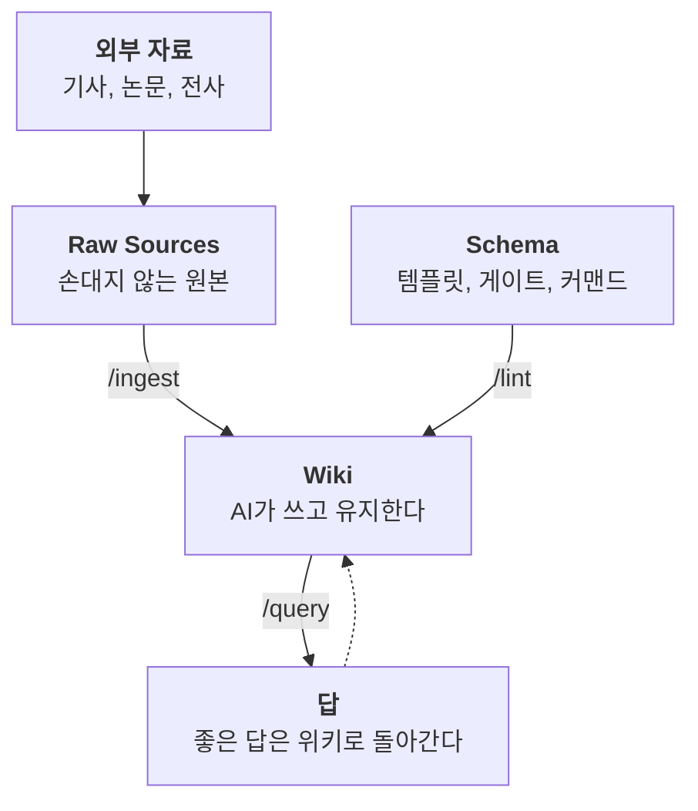
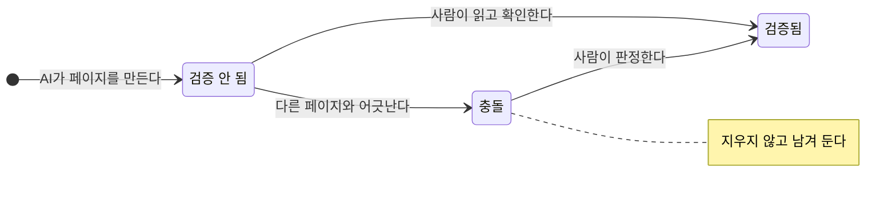

검색은 매번 새로 만들고 버린다. 위키는 쌓인다. 이 한 문장을 실제 시스템으로 만들면 어떤 모습이 되는가. 그 답이 [llm-wiki.cmdspace.work](https://llm-wiki.cmdspace.work) 에 있다.

## 사람은 판단하고, AI는 장부를 쓴다

CMDS LLM Wiki는 마더십 볼트에서 분기한 위성 볼트다. 역할은 하나, 학습과 연구다. 기사, 논문, 전사 같은 외부 자료가 들어오면 AI가 읽고 위키 페이지로 컴파일하고, 새 자료가 올 때마다 기존 페이지를 갱신한다.

역할 분담이 핵심이다. 자료를 고르고 의미를 판단하는 것은 나다. 참조 갱신과 요약 최신화 같은 유지 노동은 AI가 맡는다. 사람이 위키 운영을 포기하는 진짜 이유는 사고가 아니라 이 북키핑 노동이다. 그런데 AI에게는 이 비용이 거의 0이다. 위키가 죽지 않는 이유가 여기 있다.

## 세 개의 층

구조는 세 층이다. 손대지 않는 원본 층(Raw Sources), AI가 작성하고 유지하는 위키 층(Wiki), 그리고 템플릿과 게이트와 커맨드가 사는 규칙 층(Schema). 원본과 정리본 사이에서 무엇이 어디로 승격되는지는 [Raw와 Wiki 사이에서](/posts/between-raw-and-wiki/)에 길게 썼다.

## 패턴 제안이 아니라 운영 기록이다

이 글을 쓰는 2026년 8월 기준, 위키에는 마크다운 파일 1,417개, 위키 페이지 754개, 원본 248건이 돌아가고 있다. 운영은 커맨드 세 개로 압축된다. 새 자료를 흡수하는 /ingest, 질문에 답하고 좋은 답을 다시 저장하는 /query, 끊어진 링크와 모순을 점검하는 /lint. 이 세 동작이 반복될수록 위키는 복리처럼 풍부해진다. 자료를 넣어도 좋아지고, 질문을 해도 좋아진다.

*코드로 렌더링한 도식. 원본은 그대로 두고, 위키는 자료를 넣을 때도 질문할 때도 자란다.*

## 믿음은 절차다

AI가 만든 모든 페이지는 "검증 안 됨" 상태로 태어난다. 사람이 읽고 확인해야만 "검증됨"이 되고, AI는 이 표시를 절대 건드리지 못한다. 다른 페이지와 어긋나는 주장은 지우지 않고 충돌로 표시해 두고, 판정은 사람이 한다. 페이지마다 반대 논거를 강제로 적게 하는 편향 점검도 있다. AI가 쓴 지식을 믿는 방법은 약속이 아니라 절차다.

*코드로 렌더링한 도식. 모든 페이지는 검증 안 됨으로 태어나고, 사람의 확인만이 검증됨으로 넘긴다.*

## 오늘 시작할 수 있다

같은 구조를 빈 볼트로 배포하는 스타터킷이 있다. 템플릿 11종과 검증 스크립트, 논문 인제스트 가이드가 포함된 ZIP을 [GitHub Releases](https://github.com/johnfkoo951/cmds-llm-wiki/releases/latest)에서 받으면 된다. Obsidian과 Claude Code(또는 Codex)만 있으면 충분하다.

위키가 무엇이고 RAG와 어떻게 다른지 개념부터 필요하다면, [brain.cmdspace.work](https://brain.cmdspace.work)의 "LLM Wiki 패턴"과 "RAG vs 컴파일 위키" 카드를 먼저 읽으라.
