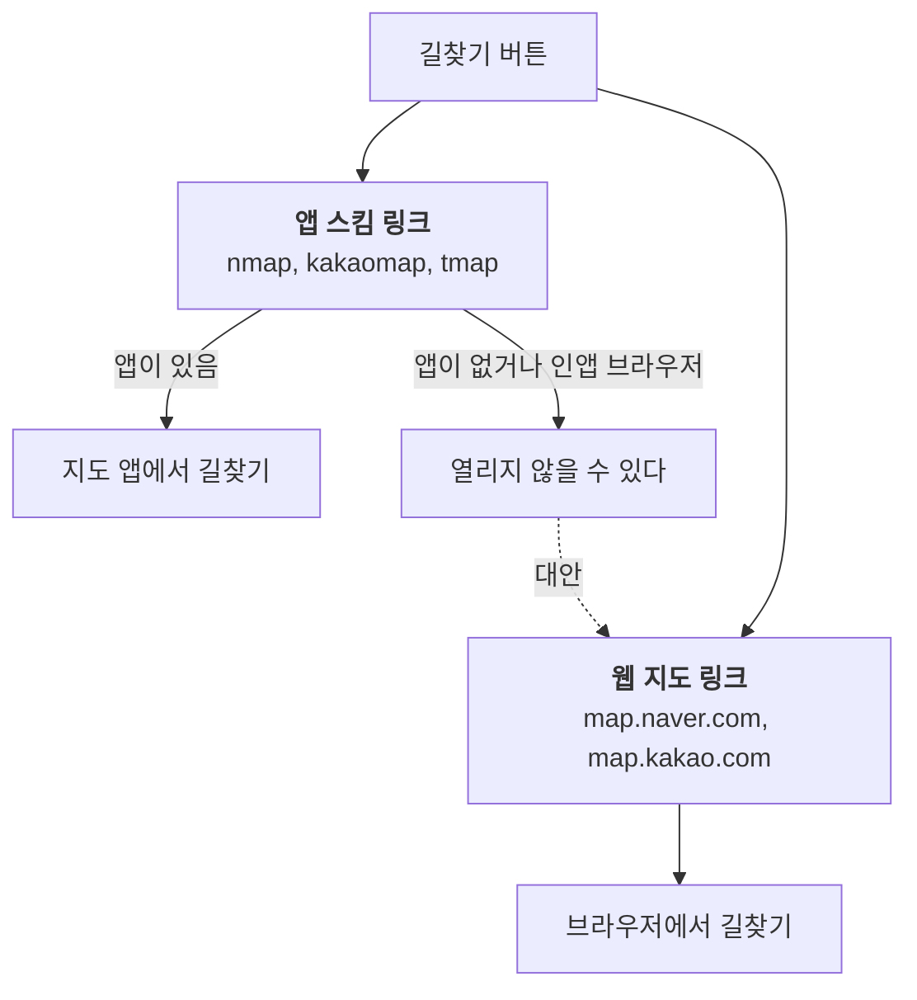
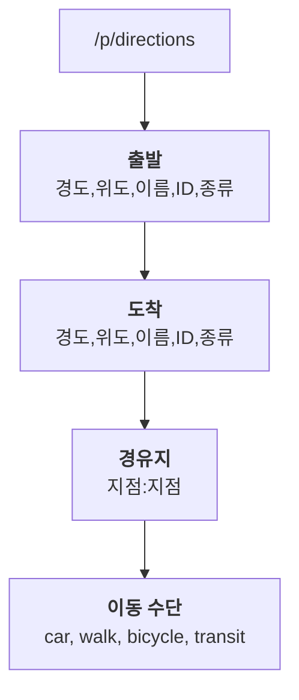
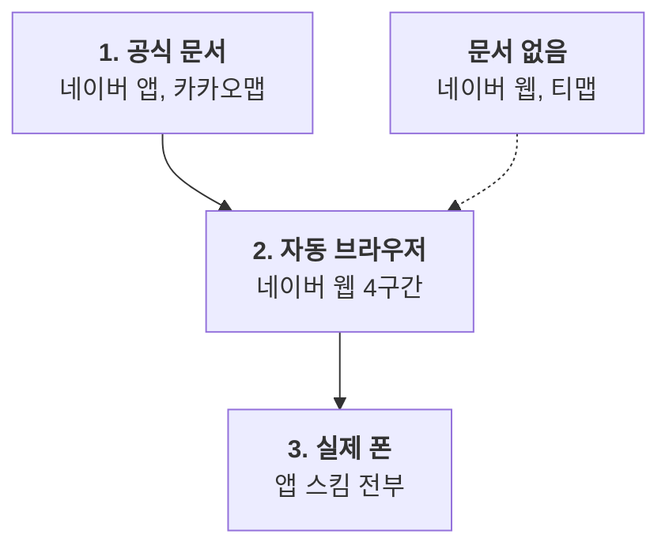

가족 행사에서 셔틀 두 대를 돌리게 되어 손님용 안내 웹을 만들었다. 손님이 주차장 옆의 길찾기 버튼을 누르면 자기 폰의 지도 앱에서 길찾기가 바로 열려야 했다. 버튼은 하나지만 그 뒤에 들어갈 주소는 앱마다 다르다. 네이버 지도, 카카오맵, 티맵은 좌표를 적는 순서도, 경유지를 받는 방식도, 문서가 남아 있는 정도도 다르다.

이 글은 그때 확인한 형식을 정리한 것이다. 한국에서 지도나 이동 서비스를 운영하면서 사용자를 지도 앱으로 넘겨야 하는 사람이 참고하도록 썼다. 공식 문서로 확인한 것, 자동 브라우저로 열어 본 것, 아직 폰에서 눌러 보지 않은 것을 나눠 적었다. 예시 좌표는 서울시청 앞(위도 37.5665350, 경도 126.9779692)이다.

## 요약
- 지도 앱으로 넘기는 링크는 두 갈래다. 앱을 바로 여는 앱 스킴(`nmap://`, `kakaomap://`, `tmap://`)과 브라우저에서 여는 웹 지도 주소다.
- 좌표 순서가 제각각이다. 카카오맵은 위도, 경도 순이고 네이버 지도 웹 주소는 경도, 위도 순이다. 티맵은 x가 경도, y가 위도다.
- 공식 문서가 있는 것은 네이버 지도 앱 스킴, 카카오맵 웹 링크와 앱 스킴이다. 네이버 지도 웹 주소와 티맵 앱 스킴은 공개 문서를 찾지 못했다.
- 경유지는 네이버 지도 앱(최대 5곳), 카카오맵 웹과 앱(최대 5곳, 대중교통 제외), 네이버 지도 웹(관찰)이 받는다. 티맵은 경유지 파라미터를 찾지 못했다.
- 네이버 지도 웹 길찾기 주소로 만든 구간 4개는 자동 브라우저에서 모두 경로가 계산됐다. 카카오맵 웹은 자동 브라우저를 막아 열어 보지 못했고, 앱 스킴은 전부 폰 확인이 남았다.

## 플랫폼별 현황
| 플랫폼 | 앱 스킴 | 웹 주소 | 좌표 순서 | 도착지 이름 | 경유지 | 확인 상태 |
|---|---|---|---|---|---|---|
| 네이버 지도 | `nmap://`, 공식 문서 | `map.naver.com/p/…`, 문서 없음(관찰) | 앱은 위도와 경도를 따로, 웹은 경도,위도 | 있음 | 앱 5곳, 웹 `:` 연결 | 웹 구간 4개 경로 계산, 앱은 폰 확인 필요 |
| 카카오맵 | `kakaomap://`, 공식 문서 | `map.kakao.com/link/…`, 공식 문서 | 위도,경도 | 웹 있음, 앱 없음 | 5곳, 대중교통 제외 | 웹은 자동 브라우저 차단, 앱은 폰 확인 필요 |
| 티맵 | `tmap://`, 공개 문서 못 찾음 | 키 없이 여는 웹 길찾기 없음 | x는 경도, y는 위도 | 있음 | 못 찾음 | 폰 확인 필요 |

## 앱 스킴과 웹 주소
앱 스킴은 폰에 그 앱이 깔려 있어야 열린다. 웹 페이지는 사용자의 폰에 어떤 지도 앱이 있는지 미리 알 수 없다. 그래서 셔틀 안내 화면에는 길찾기 버튼마다 앱 스킴 세 개와 웹 지도 링크 하나를 함께 두었다.

*길찾기 버튼에 앱 스킴과 웹 링크를 함께 두고, 앱이 열리지 않으면 웹 링크로 넘긴다.*

- 카카오톡 같은 메신저 안의 브라우저는 앱 스킴을 막거나 확인 창을 띄울 수 있다. 안내 화면에 "앱이 열리지 않으면 기본 브라우저로 열어 달라"는 한 줄을 넣었다.
- 네이버 지도 앱 스킴은 모든 링크에 `appname`이 필수다. 모바일 웹에서 부를 때는 페이지 주소를 넣는다.
- 웹 대체 링크는 공식 문서가 있는 카카오맵 `link/to` 형식을 골랐다.

## 좌표 순서와 이름
같은 지점이라도 플랫폼마다 좌표를 적는 순서가 다르다. 셔틀 앱은 지점을 위도, 경도로 저장하고 링크를 만들 때 플랫폼별로 순서를 바꿨다. 순서를 바꿔 넣으면 다른 곳을 가리키거나 링크가 열리지 않는다.

| 형식 | 서울시청 예시 |
|---|---|
| 네이버 지도 앱 | `dlat=37.5665350&dlng=126.9779692` |
| 네이버 지도 웹 | `126.9779692,37.5665350,서울시청,,` |
| 카카오맵 웹 | `서울시청,37.5665350,126.9779692` |
| 카카오맵 앱 | `ep=37.5665350,126.9779692` |
| 티맵 앱 | `goalx=126.9779692&goaly=37.5665350` |

- 지점 이름은 퍼센트 인코딩한다. `서울시청`은 `%EC%84%9C%EC%9A%B8%EC%8B%9C%EC%B2%AD`이 된다.
- 카카오맵 앱 스킴에는 이름 파라미터가 없어 좌표만 보낸다. 앱에서는 도착지가 좌표로 표시될 수 있다.

## 네이버 지도
### 앱 스킴 (공식 문서)
네이버 클라우드 플랫폼의 「지도 앱 연동 URL Scheme」 문서가 정본이다. 문서 두 곳 모두 오래된 문서라는 표시가 붙어 있다.

| 용도 | 형식 |
|---|---|
| 지도 | `nmap://map?lat=위도&lng=경도&zoom=4~20&appname=…` |
| 검색 | `nmap://search?query=검색어&appname=…` |
| 지점(마커) | `nmap://place?lat=위도&lng=경도&name=이름&appname=…` |
| 길찾기 | `nmap://route/{car,walk,bicycle,public}?slat&slng&sname&dlat&dlng&dname&appname=…` |
| 경유지 | `v1lat&v1lng&v1name`부터 `v5…`까지 |
| 내비게이션 | `nmap://navigation?dlat&dlng&dname&appname=…` |

- 출발지(`slat`, `slng`)를 빼면 현재 위치에서 출발한다. 도착지(`dlat`, `dlng`)는 필수다.
- 앱이 없으면 앱스토어나 플레이스토어로 보내라고 안내한다. 웹 대체 주소는 문서에 없다.
- 서울시청 길찾기는 `nmap://route/car?dlat=37.5665350&dlng=126.9779692&dname=%EC%84%9C%EC%9A%B8%EC%8B%9C%EC%B2%AD&appname=https%3A%2F%2Fexample.com`처럼 쓴다.
### 웹 주소 (공식 문서 없음, 관찰)
웹 길찾기 주소는 공식 문서를 찾지 못했다. 아래는 직접 열어 보며 확인한 형식이다.

*네이버 지도 웹 길찾기 주소는 출발, 도착, 경유지, 이동 수단을 경로 칸으로 나눠 담는다. 공식 문서가 없어 관찰한 형식이다.*

| 용도 | 형식 |
|---|---|
| 검색 | `https://map.naver.com/p/search/검색어` |
| 길찾기 | `https://map.naver.com/p/directions/{출발}/{도착}/{경유지}/{이동 수단}` |
| 지점 칸 하나 | `경도,위도,이름,장소ID,종류`, 빈 칸 허용, 지점이 없으면 `-` |
| 경유지 여러 곳 | 경유지 칸 안에서 `:`로 잇는다 |

- 소수 좌표를 경도, 위도 순으로 그대로 넣어도 열린다. 서울시청까지는 `https://map.naver.com/p/directions/-/126.9779692,37.5665350,%EC%84%9C%EC%9A%B8%EC%8B%9C%EC%B2%AD,,/-/car`이다.
- 출발지를 `-`로 비우면 현재 위치를 써야 한다. 위치 권한이 없는 자동 브라우저에서는 경로가 계산되지 않았다.
- 예전 형식 `https://map.naver.com/index.nhn?slng=&slat=&stext=&elng=&elat=&etext=&menu=route&pathType=1`은 새 주소로 바뀌어 열렸고, `pathType=1`은 대중교통으로 열렸다.
- 주소 끝의 `?c=15.00,0,0,0,dh`는 지도 화면 상태로 보인다. 첫 값이 확대 수준이라는 것 말고는 확인하지 않았다.
### 네이버가 만든 주소 속 압축 좌표
네이버 지도에서 길찾기를 하고 주소를 복사하면 좌표가 짧은 글자로 들어 있다. `map.naver.com/p/directions/3zhqfx,2AO3sO,…`처럼 생겼다. 좌표에 10,000,000을 곱하고 2,000,000,000을 더한 값을 62진수(`0-9a-zA-Z`)로 쓴 것이다. 셔틀 지점의 좌표 네 값을 예전 형식 주소로 넣었을 때 네이버가 돌려준 글자와 모두 정확히 맞았다.

| 좌표 | 계산 | 62진수 |
|---|---|---|
| 서울시청 경도 126.9779692 | 1,269,779,692 + 2,000,000,000 | `3zhF48` |
| 서울시청 위도 37.5665350 | 375,665,350 + 2,000,000,000 | `2AM354` |

- 공식 문서는 없다. 관찰한 규칙이라 바뀔 수 있다.
- 사용자가 복사해 준 길찾기 주소에서 출발지와 도착지 좌표를 되살릴 때 쓸 수 있다. 이름 뒤의 장소 ID와 종류 칸은 뜻을 확인하지 않았다.

## 카카오맵
### 웹 링크 (공식 문서)
카카오 지도 Web API 가이드의 「URL로 사용하기」가 정본이다. 좌표는 모두 위도, 경도 순이다.

| 용도 | 형식 |
|---|---|
| 지도(마커) | `https://map.kakao.com/link/map/이름,위도,경도` |
| 도착지 길찾기 | `https://map.kakao.com/link/to/이름,위도,경도` |
| 출발에서 도착 | `https://map.kakao.com/link/from/이름,위도,경도/to/이름,위도,경도` |
| 이동 수단 지정 | `https://map.kakao.com/link/by/{car,traffic,walk,bicycle}/A/B` |
| 경유지 | `link/by/…/A/경유1/…/B`, 경유지 최대 5곳, 대중교통(`traffic`)은 경유지 불가 |
| 로드뷰 | `https://map.kakao.com/link/roadview/위도,경도` |
| 검색 | `https://map.kakao.com/link/search/검색어` |
### 앱 스킴 (공식 문서)
카카오 지도 Android v2 「URL Scheme」 문서가 정본이다. 카카오맵 6.0.0 이상이 대상이고, 모바일 웹은 같은 경로를 `http://m.map.kakao.com/scheme/` 아래에 붙인다.

| 용도 | 형식 |
|---|---|
| 지점(마커) | `kakaomap://look?p=위도,경도` |
| 장소 | `kakaomap://place?id=장소ID` |
| 검색 | `kakaomap://search?q=검색어&p=위도,경도` |
| 길찾기 | `kakaomap://route?sp=위도,경도&ep=위도,경도&by={car,publictransit,foot,bicycle}` |
| 경유지 | `vp`, `vp2`부터 `vp5`까지, 대중교통 불가 |
| 로드뷰 | `kakaomap://roadView?p=위도,경도` |

- `sp`를 빼면 현재 위치에서 출발한다. 이름 파라미터는 없다.
- 카카오 데브톡에 iOS 6.31.1에서 경유지 주소가 빈칸으로 보인다는 보고가 있다. 경로 자체의 문제인지는 확인하지 않았다.

## 티맵
공개된 공식 앱 스킴 문서를 찾지 못했다. 아래는 개발자 커뮤니티에서 쓰는 형식이고, 폰에서 확인하기 전까지는 미확인으로 둔다.

- 도착지 길안내: `tmap://route?goalname=이름&goalx=경도&goaly=위도`. x가 경도, y가 위도다. 출발지는 현재 위치다.
- iOS에서는 `tmap://route?rGoName=이름&rGoX=경도&rGoY=위도` 변형도 쓰인다고 한다. Android에서는 이 변형이 도착지 없이 열렸다는 보고가 있다.
- 경유지 파라미터는 찾지 못했다. 경유지가 필요한 순환은 구간마다 링크를 나눠야 한다.
- SK 오픈API의 `https://apis.openapi.sk.com/tmap/app/routes?appKey=키&name=이름&lon=경도&lat=위도`는 웹에서 티맵을 여는 주소로 알려져 있다. 앱 키가 필요해 쓰지 않았다.

## 경로와 경유지
셔틀은 행사장에서 출발해 주차장 두 곳을 거쳐 행사장으로 돌아온다. 같은 곳으로 돌아오는 순환은 출발과 도착에 같은 지점을 넣고, 들르는 곳을 경유지로 넣으면 된다. A는 출발, B와 C는 경유지, D는 도착이다.

| 플랫폼 | 순환 링크의 뼈대 |
|---|---|
| 네이버 지도 앱 | `nmap://route/car?slat=A&slng=A&dlat=D&dlng=D&v1lat=B&v1lng=B&v2lat=C&v2lng=C&appname=…` |
| 네이버 지도 웹 | `/p/directions/{A}/{D}/{B}:{C}/car` |
| 카카오맵 웹 | `/link/by/car/A/B/C/D` |
| 카카오맵 앱 | `route?sp=A&vp=B&vp2=C&ep=D&by=car` |
| 티맵 | 경유지를 찾지 못해 구간별 링크로 나눈다 |

- 네이버 지도 웹으로 만든 순환 주소는 자동 브라우저에서 경로가 계산됐다.
- 같은 순환을 네이버 지도 앱에서 사람이 검색했을 때는 13분 4.2km, 웹 주소는 12분 3.7km였다. 회차 지점 근처의 경로 차이로 보이지만 확인하지 않았다.

## 확인한 방법과 결과
확인은 세 단계로 했다. 공식 문서로 형식을 확인하고, 자동 브라우저로 웹 주소를 열어 보고, 마지막으로 폰에서 앱 스킴을 눌러 본다.

*확인은 공식 문서, 자동 브라우저, 실제 폰 순서로 올라가고, 앱 스킴은 마지막 단계가 남았다.*

| 항목 | 근거 | 자동 브라우저 | 폰 |
|---|---|---|---|
| 네이버 지도 앱 스킴 | 공식 문서 | 열 수 없음 | 확인 필요 |
| 네이버 지도 웹 길찾기 | 관찰 | 구간 4개 모두 경로 계산 | 확인 필요 |
| 네이버 지도 웹, 도착지만 | 관찰 | 위치 권한이 없어 계산 안 됨 | 확인 필요 |
| 네이버 압축 좌표 규칙 | 관찰, 4개 값 일치 | 해당 없음 | 해당 없음 |
| 카카오맵 웹 링크 | 공식 문서 | 자동화 브라우저 차단, 우회하지 않음 | 확인 필요 |
| 카카오맵 앱 스킴 | 공식 문서 | 열 수 없음 | 확인 필요 |
| 티맵 앱 스킴 | 커뮤니티, 미확인 | 열 수 없음 | 확인 필요 |

- 자동 브라우저 검사는 2026년 11월 24일 새벽에 했다. 네이버 지도 웹 길찾기는 1km에서 4km 남짓한 구간 4개를 열어 모두 자동차 경로와 시간이 나왔다.
- 카카오맵 웹은 자동화 브라우저를 `Restricted User Agent`로 막았다. 사람이 쓰는 브라우저에서 다시 열어야 한다.
- 지점 좌표를 구하려고 네이버 지도 검색을 자동으로 불렀을 때는 캡차가 떴다. 우회하지 않고 카카오 지도 JavaScript SDK의 주소 검색을 썼다. 앱 키에 등록한 도메인에서 불러야 동작한다.

## 운영하면서 챙길 것
- 길찾기에 넣는 좌표는 건물 대표 좌표가 아니라 실제로 차를 대거나 타는 자리여야 한다. 같은 건물인데 카카오와 네이버의 좌표가 20m쯤 달랐다. 셔틀 승차 지점처럼 몇십 미터가 중요한 곳은 현장에서 한 번 더 확인한다.
- 사용자가 차로 오면 안 되는 곳은 길찾기 버튼을 빼고 주차장이나 승차 지점으로 안내한다. 행사장 앞에 주차할 곳이 없어 셔틀 안내 화면에서 행사장 길찾기를 손님에게만 숨겼다.
- 앱 스킴은 iOS와 Android에서 따로 눌러 본다. 같은 형식이 플랫폼에 따라 다르게 동작한다는 보고가 있다.
- 공식 문서가 없는 형식(네이버 지도 웹 주소, 압축 좌표, 티맵 앱 스킴)은 서비스에 넣기 전에 다시 확인한다. 언제든 바뀔 수 있다.
- 네이버 지도 앱 스킴의 `appname`, 카카오맵 앱 스킴의 이름 없음, 티맵의 x와 y처럼 플랫폼마다 다른 규칙은 한 곳에서 만드는 함수로 모아 두면 실수가 줄어든다.

## 정리
세 지도 앱으로 길찾기를 넘기는 일은 형식 자체보다 문서 상태와 확인 범위가 더 까다롭다. 카카오맵은 웹과 앱 모두 공식 문서가 있어 기준을 잡기 쉽다. 네이버 지도는 앱 스킴 문서가 있지만 오래된 문서로 표시되어 있고, 웹 주소는 관찰에 기대야 한다. 티맵은 공개 문서를 찾지 못했다. 그래서 셔틀 안내 화면은 앱 스킴 세 개에 공식 문서가 있는 카카오맵 웹 링크를 대안으로 붙였고, 앱 스킴은 행사 전에 실제 폰에서 눌러 보기로 했다.

## 참고 문서
- 네이버 클라우드 플랫폼, 「지도 앱 연동 URL Scheme」: https://guide.ncloud-docs.com/docs/maps-url-scheme
- 네이버 클라우드 플랫폼, 경로 상세: https://guide.ncloud-docs.com/docs/application-maps-url-scheme-vpc.md
- 카카오 지도 Web API 가이드, 「URL로 사용하기」: https://apis.map.kakao.com/web/guide/
- 카카오 지도 Android v2, 「URL Scheme」: https://apis.map.kakao.com/android_v2/docs/api-guide/urlscheme/
- 카카오 데브톡, iOS 경유지 표시 보고: https://devtalk.kakao.com/t/ios-url-scheme-kakaomap-route/152555
- 티맵 앱 스킴(커뮤니티 자료, 미확인): https://velog.io/@cm961115/iOS-URL-Scheme%EC%9C%BC%EB%A1%9C-%EC%A7%80%EB%8F%84-%EC%95%B1-%EC%97%B0%EB%8F%99%ED%95%98%EA%B8%B0-TMap-kakaoMap-naver%EC%A7%80%EB%8F%84
