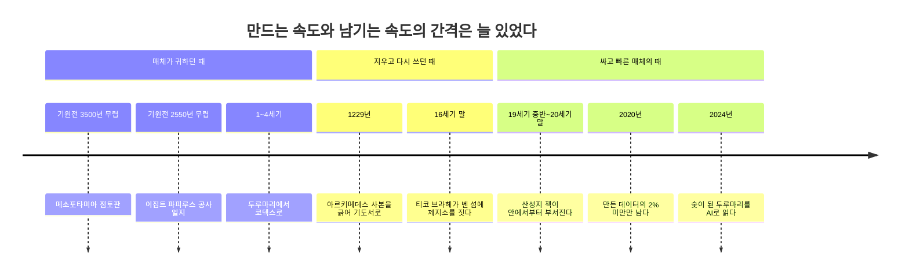
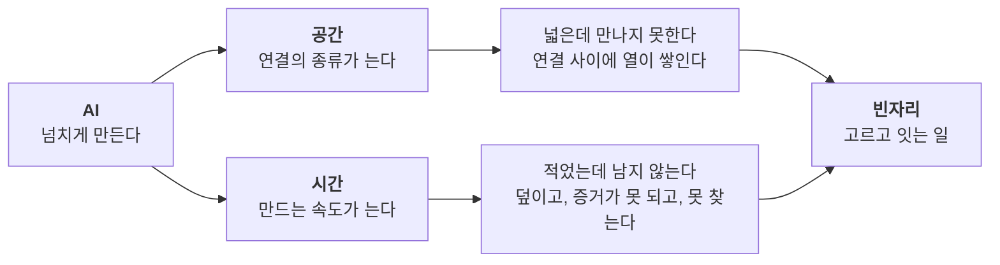

요즘 두 가지 생각을 붙들고 있다.

하나는 공간이다. 교통이 발달해 먼 곳이 가까워졌다. 건축이 발달해 땅 위의 공중을 쓸 수 있게 됐다. 통신이 발달해 몸이 가지 않아도 만날 수 있게 됐다. 그다음 갈래는 AI라고 나는 본다. 흔히 초연결(hyper-connected)이라고 부르는 일이다.

다른 하나는 시간이다. AI가 만드는 쓰레기도 물론 많다. 그래도 인류 전체로 보면 정보와 지식이 만들어지는 속도가 인류가 기록하는 속도를 넘어서고 있다.

두 생각은 같은 날 유튜브 채널 「보다」의 방송 두 편을 보며 굳었다. 하나는 건축가 유현준 교수가 초고층 빌딩을 이야기한 「과학을 보다」 216회이고, 다른 하나는 과학자 넷과 역사학자 넷이 한 탁자에 앉은 「과학을 보다 X 역사를 보다」 특별편이다. 앞의 방송에서 단층집뿐이던 한양, 지하철 없는 맨해튼, 열을 빼야 돌아가는 반도체, 공해에 띄운 요트라는 장면을 빌려 왔다. 뒤의 방송에서는 돌판 게임과 종이의 역사 몇 대목을 빌려 왔다. 장면은 빌렸고 생각은 내 것이다.

처음에는 두 생각이 따로 놀았다. 하나는 내 회사 이름에 닿는 공간 이야기였고, 다른 하나는 내 노트에 닿는 기록 이야기였다. 나란히 놓고 보니 같은 일의 두 얼굴이었다. **AI는 공간에서는 연결을, 시간에서는 생산을 넘치게 만든다. 그리고 넘침은 그대로 힘이 되지 않는다.** 공간은 넓어져도 사람이 만나지 못하고, 기록은 넘쳐도 남지 않는다. 이 글은 그 진단이다.

## 공간은 세 갈래로 넓어졌다
교통, 건축, 통신은 따로 오지 않았다. 엘리베이터는 건물의 부품이지만 세로로 다니는 교통수단이고, 지하철은 땅속에 낸 길이다. 곡식이 땅에서만 나던 농경 사회에서 땅 위의 공중은 쓸모가 없었다. 철근콘크리트와 엘리베이터가 그 공중을 쓸 수 있는 공간으로 바꿨다. 위로 더 올라가기 어려워지자 사람은 케이블을 깔아 가상공간을 열었다. 사람은 쓸모없던 공간을 쓸 수 있게 만들며 자라 왔다.

AI는 이 넓어진 공간에 무엇을 더하는가. 흔히 초연결을 연결이 많아지는 일로 이해한다. 내가 보기에 지금 일어나는 일은 연결의 수보다 연결의 종류가 늘어나는 것에 가깝다. 사람과 사람을 잇던 통신 위에 사람과 AI, AI와 AI, AI와 물리 공간의 연결이 겹친다. 운전하지 않아도 되는 차는 이동하는 공간이 아니라 머무는 공간이 된다. 공간이 또 한 번 넓어지는 셈이다.

## 넓다고 만나지 않는다
그런데 공간이 넓어진다고 곧 힘이 되지는 않는다. 한양이 그랬다. 모두 온돌방에 살아 단층집밖에 없었고, 밀도가 낮으니 상업이 자라지 못했다. 장이 사흘이나 닷새마다 서는 곳에서는 오늘 국밥을 판 사람이 내일 또 국밥으로 벌 수 없다. 농사를 지어야 먹고살았고, 땅 문서를 물려받은 사람만 돈을 벌었다. 보일러와 철근콘크리트가 2층 건물을, 엘리베이터가 12층 아파트를 만들어 밀도가 높아지자 상가가 생기고 자수성가하는 사람이 나왔다.

그렇다고 밀도만 높이면 되는 것도 아니다. 지하철도 전화도 없이 30층 건물만 빽빽한 맨해튼을 떠올려 보면 된다. 길은 주차장이 되고, 사람은 많아도 서로 만날 길이 막힌다. 반도체도 같다. 회로를 촘촘히 넣을수록 열과 간섭이 문제가 되고, 그 열을 빼면서 집적도를 높이는 것이 기술이다.

도시 연구도 같은 쪽을 가리킨다. 도시의 인구와 여러 사회경제 지표를 견준 연구에서, 특허처럼 혁신을 보여 주는 수치는 인구보다 빠르게 늘었다(Bettencourt 외, 2007). 포르투갈의 휴대전화 통화 기록과 영국의 유선전화 기록으로 사람 사이의 연결을 본 연구에서는, 큰 도시에 사는 사람일수록 연락하는 상대가 많았다(Schläpfer 외, 2014). 나는 이것을 사람이 많아서라기보다 서로 닿을 수 있어서 생기는 일로 읽는다.

내 식으로 정리하면 공간이 힘이 되는 조건은 셋이다.

- 가까이 있어야 한다. (밀도)
- 실제로 만나야 한다. (접점)
- 만남을 방해하는 열을 빼야 한다. (간섭)

AI가 연결의 종류를 늘리면 셋 가운데 마지막이 먼저 흔들린다. 반도체의 열에 해당하는 것이 지금은 쏟아지는 알림, 뒤섞인 맥락, 사람의 승인을 기다리며 멈춘 작업이다. 나는 매일 여러 에이전트와 함께 일한다. 에이전트가 늘수록 연결은 늘지만, 그만큼 내가 무엇을 판단해야 하는지는 흐려진다. **연결이 늘면 열도 는다.**

## 기록은 언제나 만드는 것보다 느렸다
시간 쪽에서는 내 생각부터 하나 고쳐야 한다. 생산이 기록을 앞지른 것은 맞다. 다만 처음 있는 일이 아니다.

메소포타미아는 기원전 3500년 무렵부터 점토판에 눌러 썼다. 이집트는 사초과 식물 줄기를 엮고 눌러 말린 파피루스에 썼고, 건조한 기후 덕에 기원전 2550년 무렵의 것이 지금도 남아 있다. 그 내용이 피라미드 외장석을 캐고 나른 작업 일지다. 4,500년을 버틴 기록이 공사 일지다.

*코드로 렌더링한 도식. 기록의 역사는 만드는 속도를 매체가 따라가지 못한 역사다. 달라진 것은 간격이 있다는 사실이 아니라 간격이 생기는 자리다.*

매체는 늘 귀했다. 양피지는 어린 양이나 송아지 가죽을 무두질해 얇게 편 것이라 버릴 수 없었다. 다 쓴 양피지는 긁어내고 그 위에 다시 썼다. 이렇게 지우고 덧쓴 사본을 팰림프세스트(palimpsest)라고 부른다. 가장 유명한 것이 아르키메데스다. 10세기에 베낀 아르키메데스의 저작은 1229년에 긁혀 기도서가 되었고, 1906년 한 문헌학자가 기도문 아래로 비치는 옛 글자를 알아보고서야 세상에 다시 나왔다.

16세기 덴마크의 천문학자 티코 브라헤는 왕에게 받은 벤 섬 전체를 천문대로 만들었다. 관측 기록이 쌓이자 섬에 인쇄소를 차렸고, 종이가 모자라자 아예 제지소를 지었다. **관측하는 속도가 적는 속도를 앞지르면, 사람은 매체를 만들러 간다.**

말은 언제나 글보다 많았고, 관측은 언제나 종이보다 많았다. 사람의 역사는 거의 전부가 기록되지 않은 채 지나갔다. 그러니 생산이 기록을 앞지른다는 것만으로는 새 소식이 아니다.

## 이번에는 기록된 채로 사라진다
달라진 것은 손실이 일어나는 자리다. 미국 시장조사기관 IDC는 2020년 한 해에 만들어지거나 복제된 데이터를 64.2제타바이트로 추정했다. 그중 이듬해까지 저장되어 남은 것은 2%가 안 된다고 했다. 나머지는 보고 소비하려고 만든 일회용이었거나, 잠깐 캐시에 담겼다가 새 데이터에 덮였다. 같은 해 세계에 깔린 저장 용량은 6.7제타바이트로, 만들어진 양의 10분의 1쯤이다.

옛날에 사라진 것은 처음부터 적히지 않은 것이었다. 지금 사라지는 것은 이미 적힌 것이다. 거의 모든 것이 디지털로 태어나니 태어날 때부터 기록이다. 그리고 그 대부분이 며칠, 몇 시간 만에 덮인다. **우리는 기록이 없어서 잃는 게 아니라 기록된 채로 잃는다.**

남긴다고 남는 것도 아니다. 그날 한 과학자는 대학 시절 플로피디스크에 담아 둔 프로그램을 이제 열 수 없는데, 형편없는 프린터로 뽑은 출력물은 지금도 읽힌다고 했다. 인터넷의 설계자 가운데 한 사람인 빈트 서프가 2015년에 경고한 디지털 암흑기와 같은 이야기다. 종이라고 안전하지도 않다. 19세기 중반부터 20세기 말까지 공장에서 찍은 책은 산성 종이라 안에서부터 바스러진다.

여기서 무늬 하나가 보인다. 점토판은 무겁고 느렸지만 오래갔다. 산성지는 싸고 빨랐지만 백 년을 못 버틴다. 디지털은 가장 빠르고 가장 싸지만 포맷과 장치와 서비스가 바뀌면 통째로 읽을 수 없게 된다. **매체가 빠르고 쌀수록 수명이 짧다.**

## 쓰는 값이 사라지자 적혔다는 사실이 증거이기를 멈췄다
조선의 과거 시험에서 떨어진 답안지를 낙폭지(落幅紙)라고 한다. 나라는 이 종이를 거둬 다시 썼다. 북쪽 변방 군사의 겨울옷에 솜 대신 넣었고, 책을 싸는 종이로 썼고, 병풍과 그림 뒤에 덧대는 배접지로 썼다. 창덕궁 인정전의 일월오봉도 병풍 뒤에서는 과거 답안지가 무더기로 나왔다. 메소포타미아 점토판에는 영수증이 많다. 그 점토판이 지금까지 남은 것은 적이 왕궁에 불을 질러 기록 보관소의 점토판을 구웠기 때문이다. 이집트 옥시링쿠스에서는 고대의 쓰레기 더미에서 파피루스가 쏟아져 나왔다.

**역사는 상당 부분 쓰레기로 쓰였다.** 그러니 AI가 만드는 쓰레기를 기록의 적으로만 볼 일은 아니다. 몇백 년 뒤의 역사가에게는 우리가 기계에게 무엇을 물었고 기계가 무엇을 답했는지가 이 시대를 가장 정직하게 보여 주는 사료가 될 수도 있다.

다만 결정적인 차이가 하나 있다. 옛 쓰레기는 사건을 가리킨다. 영수증은 거래가 있었다는 증거이고, 낙방 답안지는 누군가 그날 시험장에 앉아 있었다는 증거다. 양피지에 쓰려면 짐승을 잡아야 했으니, 적혔다는 사실 자체가 누군가 그만한 값을 치를 만하다고 판단했다는 증거였다. **쓰는 데 드는 값이 기록의 첫 번째 거름망이었다.**

생성형 AI는 이 값을 거의 0으로 만들었다. 그럴듯한 문장이 아무 사건도 가리키지 않은 채 끝없이 만들어진다. 누가, 언제, 무엇을 결정하려고 만들었는지가 함께 남지 않으면 그 문장은 사료가 되지 못한다. 출처 없는 쓰레기는 쓰레기 더미조차 되지 못한다. 나는 합성 페르소나 실험을 정리하며 합성 데이터에는 모집단이 없다고 썼다. 같은 이야기다. 생성물에는 그것이 대표하는 세계가 따로 없다.

## 두루마리의 시대가 돌아왔다
넘치는 기록의 마지막 얼굴은 다시 찾지 못하는 것이다. 파피루스는 가로세로로 엮은 것이라 접으면 부서진다. 그래서 두루마리였고, 긴 두루마리 안에서 원하는 대목을 찾기란 어려웠다. 양피지는 접을 수 있었다. 접으니 묶을 수 있었고, 묶으니 책장을 넘기며 이쪽과 저쪽을 오갈 수 있었다. 이것이 코덱스, 낱장을 묶은 책이다. **매체의 혁명은 저장이 아니라 다시 찾기에서 일어났다.**

지금 우리는 화면을 스크롤한다. 두루마리(scroll)의 말이다. 피드는 끝없는 두루마리고, AI와 나눈 대화 기록도 위에서 아래로만 흐르는 두루마리다. 나도 그 안에 산다. 석 달 동안 내 볼트에 새로 생긴 노트가 4,500개쯤이고, 하루 26.5건의 일 가운데 밖으로 나가는 것은 두 건 남짓이다(만들기와 발행의 간격). 만드는 속도는 이미 내가 다시 찾는 속도를 앞질렀다.

## 두 넘침에는 같은 자리가 비어 있다
나란히 놓으면 이렇다. 공간에서는 연결이 늘었는데 사람이 만나지 못한다. 연결 사이에 열이 쌓여서다. 시간에서는 기록이 늘었는데 남지 않는다. 적힌 채로 덮이고, 적혔다는 사실이 증거가 못 되고, 다시 찾을 길이 없어서다.

*코드로 렌더링한 도식. AI가 만든 두 넘침은 증상이 다르지만 같은 빈자리를 가리킨다. 그 자리를 채우는 일은 2편에서 다룬다.*

두 증상은 같은 자리를 가리킨다. 모자란 것은 양이 아니다. 넘치는 것 가운데 무엇이 중요한지 고르는 일, 고른 것을 서로 닿게 잇는 일이 비어 있다. 교통과 건축과 통신은 공간을 넓혔고, 점토판에서 클라우드까지 매체는 기록을 늘렸다. 그러나 넓힌 공간을 길로, 늘린 기록을 지식으로 바꾼 것은 언제나 다른 일이었다. 한양의 땅 문서를 푼 것은 땅이 아니라 사람이 오가는 장터였고, 두루마리를 지식으로 바꾼 것은 더 긴 두루마리가 아니라 접어서 다시 찾게 한 책이었다.

**넓다고 만나지 않고, 적었다고 남지 않는다.** 그렇다면 그 빈자리는 누가 채우는가. 「과학을 보다 X 역사를 보다」의 제작진이 낸 게임이 바로 이 질문이었다. 인류가 사라지고 돌판 하나만 남는다면 거기에 무엇을 새길 것인가. 인물 하나, 사건 하나, 경고 한 줄. 다 남길 수 없다면 무엇을 남기는가. 그날의 투표 결과와 내 답은 2편에 쓴다.

---

## 참고
- 보다 BODA. (2026, August 29). *이론상 건축이 불가능한 초고층 빌딩의 높이는 얼마나 될까? | 과학을 보다 EP.216* [Video]. YouTube. https://www.youtube.com/watch?v=AOaoELveR8s
- 보다 BODA. (2026, October 28). *서열 정리를 위해 과학자와 역사학자를 한자리에 모셨더니 진짜 싸움 ㅋㅋ* [Video]. YouTube. https://www.youtube.com/watch?v=cmGwTQYok5U
- Bettencourt, L. M. A., Lobo, J., Helbing, D., Kühnert, C., & West, G. B. (2007). Growth, innovation, scaling, and the pace of life in cities. *Proceedings of the National Academy of Sciences, 104*(17), 7301-7306. https://doi.org/10.1073/pnas.0610172104
- Schläpfer, M., Bettencourt, L. M. A., Grauwin, S., Raschke, M., Claxton, R., Smoreda, Z., West, G. B., & Ratti, C. (2014). The scaling of human interactions with city size. *Journal of the Royal Society Interface, 11*(98), 20130789. https://doi.org/10.1098/rsif.2013.0789
- IDC. (2021, March 24). *Data creation and replication will grow at a faster rate than installed storage capacity, according to the IDC Global DataSphere and StorageSphere forecasts* [Press release]. Business Wire. https://www.businesswire.com/news/home/20210324005175/en/Data-Creation-and-Replication-Will-Grow-at-a-Faster-Rate-Than-Installed-Storage-Capacity-According-to-the-IDC-Global-DataSphere-and-StorageSphere-Forecasts
- Whipple Museum of the History of Science, University of Cambridge. *Starry Messenger: Tycho Brahe's books.* http://www.sites.hps.cam.ac.uk/starry/tychobooks.html
- 윤선영. (2022). 조선시대 과거 낙폭지(落幅紙)의 재활용 문화. 『민족문화연구』, 97, 187-210. https://www.dbpia.co.kr/journal/articleDetail?nodeId=NODE11243637
