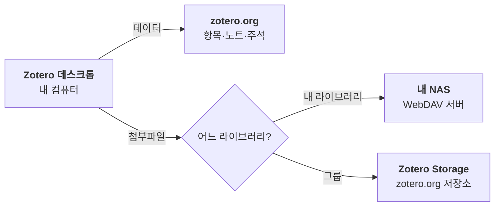
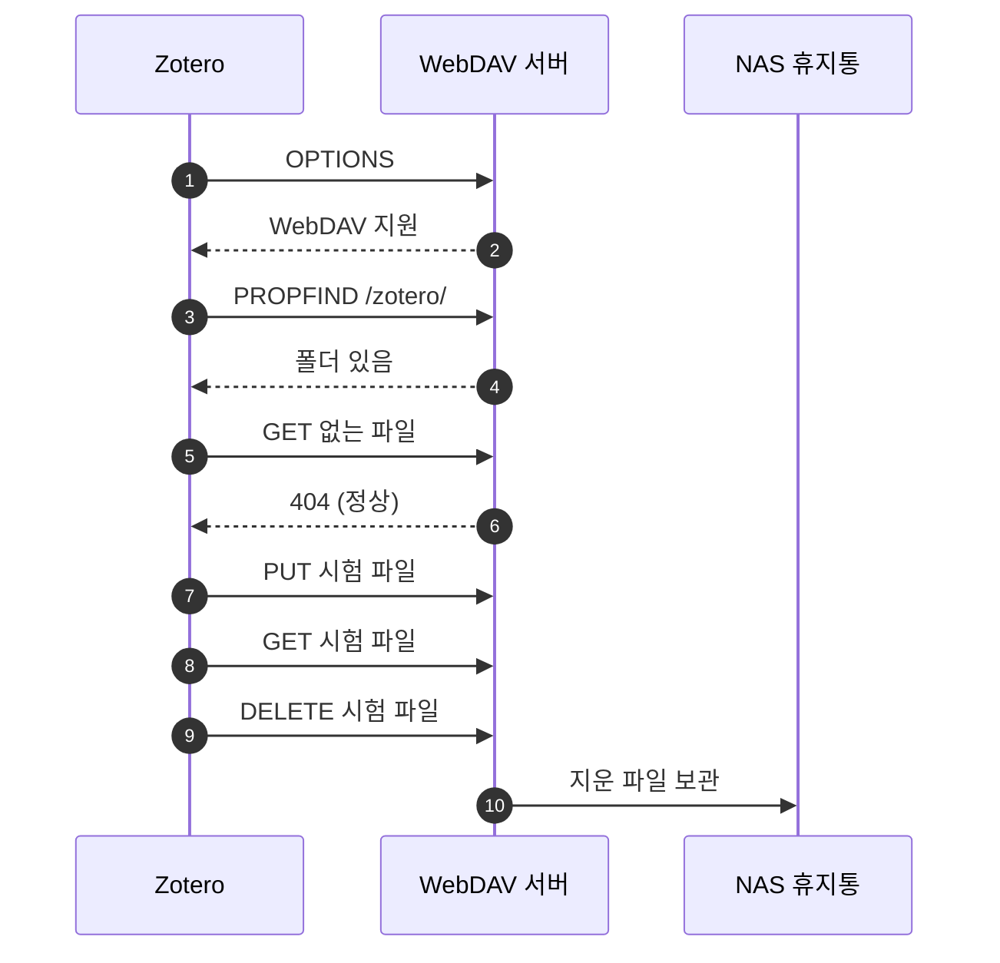
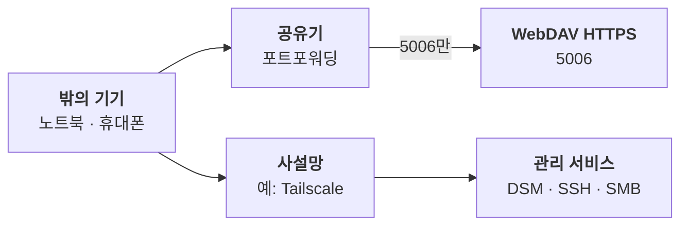

논문 PDF가 쌓이면 Zotero 동기화에서 먼저 막히는 것은 파일이다. 항목과 메모를 맞추는 데이터 동기화는 무료이고 한도가 없지만, PDF를 올리는 Zotero Storage의 무료 용량은 300MB다. 그래서 "조테로를 셀프호스팅한다"는 말은 대개 한 가지 일을 가리킨다. **첨부파일만 내 서버로 돌리는 것**이다.

나는 2025년 7월부터 시놀로지 NAS의 WebDAV로 PDF를 동기화해 왔다. 1년 넘게 탈 없이 돌았다. 그런데 무엇이 어디로 가는지, 설정 창의 Verify Server 버튼이 무엇을 하는지는 정작 설명하지 못했다. 이번에 설정 창, 설치된 Zotero 10.0.6의 소스, NAS에 실제로 쌓인 파일을 하나씩 대조했다. 이 글은 그 점검을 정리한 설정 가이드다. 점검하는 동안 설정은 하나도 바꾸지 않았다.

## 무엇이 내 서버로 가는가
Zotero 동기화는 두 갈래다. **데이터 동기화**는 첨부파일을 뺀 전부, 곧 항목과 서지 정보, 노트, 컬렉션, 태그, PDF 위에 남긴 주석을 맞춘다. **파일 동기화**는 PDF 같은 첨부파일만 옮긴다. 셀프호스팅으로 옮길 수 있는 것은 이 가운데 한 갈래뿐이다.


*코드로 렌더링한 도식. 내 서버로 옮길 수 있는 것은 내 라이브러리의 첨부파일 한 갈래뿐이고, 데이터와 그룹 첨부는 zotero.org에 남는다.*

- **데이터는 옮길 수 없다.** Zotero 공식 문서는 데이터 동기화 서버를 바꾸는 방법을 두지 않는다. 대안으로 데이터 폴더를 손으로 옮기는 방법만 소개하고, 데이터 폴더를 클라우드 동기화 폴더에 두면 데이터베이스가 깨질 가능성이 매우 높다고 경고한다.
- **주석도 데이터다.** PDF에 그은 하이라이트와 메모는 파일이 아니라 데이터로 동기화된다. NAS를 써도 주석은 zotero.org를 거친다.
- **그룹 라이브러리는 WebDAV를 못 쓴다.** 문서에 "Group libraries cannot use WebDAV."라고 적혀 있다. Zotero 10.0.6 소스에서도 라이브러리 종류가 그룹이면 저장 방식이 무조건 Zotero Storage로 정해진다.
- **연결 파일은 동기화 대상이 아니다.** 파일 동기화는 Zotero의 `storage` 폴더에 든 저장 파일만 다룬다. 첨부를 연결 파일로 바꾸는 플러그인을 쓰면 PDF가 다른 기기로 넘어가지 않는다.
- **웹 라이브러리에서는 열리지 않는다.** zotero.org 서버가 내 WebDAV 비밀번호를 모르기 때문이다.

데이터 서버까지 직접 띄우는 비공식 방법도 있다. 다만 Zotero 프로그램을 고쳐야 하고 모바일 앱은 쓸 수 없다. 나는 쓰지 않는다. 데이터 동기화는 무료이고 한도가 없으니, 무게가 나가는 PDF만 내 디스크로 옮기면 충분하다.

## NAS에는 PDF 대신 상자가 쌓인다
NAS의 Zotero 폴더를 열어 보면 PDF가 보이지 않는다. 첨부 하나가 파일 두 개가 된다. `항목키.zip`은 첨부파일을 압축한 것이고, `항목키.prop`은 수정 시각과 MD5 해시를 적은 작은 XML이다. Zotero는 `.prop`을 보고 파일이 바뀌었는지 판단한다.


*코드로 렌더링한 도식. 항목키는 예시다. 첨부 하나가 zip과 prop 한 쌍이 되고, 시놀로지가 만든 폴더가 그 옆에 함께 놓인다.*

주소를 적는 방식도 이 구조에서 나온다. 설정 칸에는 `nas.example.com:5006`처럼 주소와 포트만 쓴다. Zotero가 뒤에 `/zotero/`를 붙인다. 시놀로지 WebDAV는 주소의 첫 경로를 공유폴더 이름으로 읽으므로, 공유폴더 이름을 `zotero`로 만들면 그 최상위가 곧 저장 위치가 된다.

시놀로지가 만드는 `#recycle`, `@eaDir` 폴더가 섞여도 괜찮다. Zotero가 서버의 남는 파일을 지우는 정리 작업은 점으로 시작하는 이름과 `.zip`, `.prop`가 아닌 이름을 건너뛴다. 소스에서 확인한 동작이다.

내 NAS에는 점검한 날 `.zip`과 `.prop`이 237개씩 있었다. 압축본이라 451MB로, Mac의 `storage` 폴더(570MB)보다 작다. 두 쪽의 항목키 237개는 하나도 어긋나지 않았다.

## 설정하기
### NAS 쪽 (시놀로지 DSM 7 기준)
1. 패키지 센터에서 **WebDAV Server**를 설치하고 **HTTPS(기본 5006)만** 켠다. HTTP(5005)와 익명 접속은 끈다.
2. 공유폴더 `zotero`를 만들고 휴지통을 켠다.
3. Zotero 전용 사용자(예: `zotero-sync`)를 만든다. `zotero` 공유폴더에만 읽기·쓰기를 주고, 애플리케이션 권한은 WebDAV만 허용한다. 관리자 계정을 쓰지 않는다.
4. 제어판 → 보안 → 인증서의 설정에서 DDNS 주소의 인증서를 WebDAV Server 서비스에 할당한다.
5. 공유기 포트포워딩은 **5006 하나만** 연다.
6. 제어판 → 보안 → 보호에 있는 자동 차단의 허용 목록에 집 네트워크와 원격 접속용 사설망 대역을 넣는다(아래 "문은 하나만 연다" 참고).

### Zotero 쪽
1. 설정 → Account에서 zotero.org 계정으로 로그인한다. 데이터가 먼저 내려온다.
2. File Syncing의 "Sync attachment files in My Library using"을 **WebDAV**로 바꾼다.
3. URL에 `https`를 고르고 `nas.example.com:5006`을 적는다. `/zotero/`는 자동으로 붙는다.
4. 사용자 이름과 비밀번호를 넣고 **Verify Server**를 누른다.
5. Download files는 주로 쓰는 컴퓨터라면 **at sync time**으로 둔다. 용량이 작은 기기는 as needed도 괜찮다.
6. "Sync attachment files in group libraries using Zotero Storage"는 그대로 둔다. 그룹 첨부는 이 길밖에 없다.


옵시디언에서 PDF를 읽는 플러그인(내가 만든 [CMDS Zotero](https://zotero.cmdspace.work)도 그렇다)을 쓴다면 PDF가 로컬에 있어야 한다. 그 컴퓨터는 at sync time을 유지한다. 주석은 데이터로 오므로 PDF가 없어도 가져올 수 있다.

### 모바일
iOS와 Android의 Zotero 앱 모두 WebDAV를 지원한다. Android 앱은 2025년 6월에 정식으로 나왔다. 앱의 설정 → 계정 → 파일 동기화에서 같은 주소와 계정을 넣는다.

## Verify Server는 무엇을 확인하나
이 버튼은 읽기만 하지 않는다. Zotero 10.0.6 소스를 보면, 서버가 WebDAV를 지원하는지와 폴더가 있는지 묻고, 없는 파일을 요청해 404가 오는지 보고, 시험 파일을 직접 써서 읽은 다음 지운다. 서버가 쓰기와 지우기를 제대로 처리하는지까지 확인하는 셈이다.


*코드로 렌더링한 도식. 서버 확인은 시험 파일을 쓰고 읽고 지운다. 시놀로지는 WebDAV로 지운 파일도 휴지통에 남긴다.*

그래서 시놀로지 휴지통에는 `zotero-test-file.prop`이 남는다. 내 NAS 휴지통에도 2025년 9월, 2026년 9월, 2026년 10월에 확인한 흔적이 하나씩 있었다. 지워도 되는 파일이다.

확인 결과는 설정에 "확인됨" 표시로 남는다. 이 표시는 영원하지 않다.

- 인증 오류가 나면 Zotero가 표시를 지운다. 비밀번호를 바꿨을 때가 대표적이다.
- 표시가 없으면 다음 파일 동기화 때 스스로 다시 확인한다. 이번 점검 중에도 그 장면을 봤다. 점검을 시작할 때는 표시가 꺼져 있었는데, 몇 분 뒤 자동 동기화가 돌면서 표시가 돌아오고 새 첨부가 하나 올라갔다.
- **함정은 as needed다.** 표시가 없는 동안 as needed 모드는 PDF 내려받기를 아무 말 없이 건너뛴다. 소스에도 "skipping download"라는 기록만 남는다. 새 기기를 붙였거나 비밀번호를 바꾼 직후 PDF가 열리지 않으면 Verify Server를 한 번 누른다.

## 동기화는 백업이 아니다
NAS에 사본이 있으니 백업도 된 것 같지만, 동기화는 지운 것도 맞춘다. Mac에서 첨부를 지우면 다음 동기화 때 NAS에서도 지운다. 서버에만 남은 파일을 정리하는 작업도 내려받기에 성공한 동기화 뒤에 최대 7일에 한 번씩 돈다.

시놀로지 휴지통이 WebDAV로 지운 파일까지 받아 주는 것은 다행이지만, 휴지통은 백업이 아니다. 공유폴더 스냅샷을 걸어 둔다. Btrfs 볼륨이면 스냅샷 복제(Snapshot Replication)로 `zotero` 공유폴더에 매일 스냅샷을 찍고 한 달쯤 보관하면 된다. 데이터 쪽(`zotero.sqlite`)은 zotero.org와 동기화되지만, 그 컴퓨터의 백업은 따로 챙긴다.

나도 점검하기 전까지 이 공유폴더에 스냅샷을 걸어 두지 않았다. 1년 넘게 아무 일이 없었다는 것은 복구할 일이 아직 없었다는 뜻일 뿐이다.

## 문은 하나만 연다
밖에서도 동기화하려면 NAS의 문을 하나 열어야 한다. 그 문은 하나면 된다. Zotero에 필요한 것은 WebDAV HTTPS 포트 하나다.


*코드로 렌더링한 도식. 공유기로는 WebDAV HTTPS 하나만 들이고, NAS 관리와 파일 공유는 사설망으로 들어온다.*

인터넷에 열린 NAS는 쉬지 않고 두드려진다. 내 NAS의 자동 차단 목록에는 이미 IP 9천여 개가 쌓여 있었다. 문을 하나로 줄이고, 그 문 하나를 단단하게 지킨다.

- **공유기에서 5006 하나만 연다.** DSM 관리 화면(5000, 5001), SSH(22), 파일 공유(SMB, 445 등)는 열 이유가 없다. DSM 제어판 → 외부 액세스 → 라우터 구성에 예전에 켠 규칙이 남아 있지 않은지도 본다.
- **HTTP(5005)는 끈다.** WebDAV는 Basic 인증이라, 암호화하지 않은 HTTP로는 비밀번호가 그대로 오간다.
- **익명 접속은 끈다.** 게스트 계정이 꺼져 있으면 당장은 영향이 없지만, 게스트를 켜는 순간 게스트 권한이 있는 공유폴더가 인증 없이 열린다.
- **전용 계정을 쓴다.** WebDAV 계정이 관리자면, 그 비밀번호 하나로 NAS 전체가 열린다.
- **자동 차단의 허용 목록을 챙긴다.** 차단 만료를 "없음"으로 두면, 옛 비밀번호를 가진 기기 하나가 집 IP를 영영 막을 수 있다. 집 네트워크와 사설망 대역을 허용 목록에 넣는다. 허용 목록에 모르는 IP가 있으면 지운다.
- **방화벽 기본 동작을 확인한다.** 제어판 → 보안 → 방화벽 → 규칙 편집에서 "규칙에 맞지 않으면"이 거부인지 본다. 허용이면 규칙을 아무리 적어도 막히는 것이 없다.
- **관리는 사설망으로 한다.** Tailscale 같은 사설망을 NAS와 내 기기에 깔면 DSM과 SSH를 공유기 밖에 열지 않아도 된다. 다만 인증서는 DDNS 이름으로 발급된 것이라, 사설망 이름으로 WebDAV에 접속하면 인증서 경고가 난다. Zotero는 DDNS 주소를 그대로 쓴다.

## 잘 돌고 있는지 확인하기
설정 창은 마지막으로 언제 동기화했는지 자세히 보여 주지 않는다. 터미널에서 세 가지를 본다.

```bash
# 1. 서버가 살아 있고 인증서가 유효한가 (자격증명 없이 401이면 정상)
curl -s -o /dev/null -w 'HTTP %{http_code} tls=%{ssl_verify_result}\n' \
  https://nas.example.com:5006/zotero/

# 2. Zotero가 서버를 확인한 상태인가 (true가 나오면 확인됨)
grep 'sync.storage.verified' ~/Library/Application\ Support/Zotero/Profiles/*/prefs.js

# 3. 로컬 첨부와 NAS 파일의 항목키가 같은가 (NAS에 SSH로 들어갈 수 있을 때)
ls ~/Zotero/storage | sort > local.txt
ssh nas 'ls /volume1/zotero | grep "\.zip$" | sed "s/\.zip$//"' | sort > nas.txt
comm -3 local.txt nas.txt   # 아무것도 안 나오면 일치
```

`tls=0`은 인증서 검증이 통과했다는 뜻이다. 세 번째 비교에서 그룹 라이브러리 첨부는 로컬에만 있는 키로 나온다. 그룹 첨부는 Zotero Storage로 가기 때문이다. NAS 경로의 `volume1`은 공유폴더가 있는 볼륨에 맞춰 바꾼다.

## 문제가 생기면

| 증상 | 원인 | 해결 |
|---|---|---|
| Verify Server에서 zotero 폴더를 찾지 못함 | 공유폴더 이름이 다르거나 권한이 없음 | 공유폴더 `zotero`가 있는지, 계정에 읽기·쓰기 권한이 있는지 확인 |
| 상위 폴더를 찾지 못함 | URL에 경로를 더 붙임 | URL은 `주소:5006`까지만 적는다 |
| 401이 반복되다가 아예 접속이 안 됨 | 비밀번호 오류로 자동 차단 | DSM 자동 차단의 차단 목록에서 그 IP를 지우고 비밀번호를 고친다 |
| 인증서 경고 | IP나 사설망 이름으로 접속, 인증서 만료 | DDNS 주소로 접속하고 인증서 갱신 상태를 본다 |
| 새 기기에서 PDF가 열리지 않음 | as needed인데 서버 확인 전 | Verify Server를 누르거나 at sync time으로 바꾼다 |
| 모바일에서 일부 PDF만 보임 | 그 파일이 NAS에 없거나 연결 파일임 | 데스크톱 동기화를 끝내고, 연결 파일은 저장 파일로 바꾼다 |
| 그룹 라이브러리 PDF가 안 올라감 | Zotero Storage 용량 초과 | zotero.org에서 저장 공간을 확인한다 |

## 맺으며
셀프호스팅이라는 말은 "전부 내 손에"처럼 들린다. Zotero에서 내 손에 오는 것은 PDF를 보관하는 한 갈래뿐이다. 그래도 그 한 갈래가 무겁다. 논문 PDF는 해마다 늘고, 이제 그 무게를 남의 요금제가 아니라 내 디스크가 진다.

대신 지키는 일도 내 몫이 된다. 문은 하나만 열고, 동기화와 백업을 구분하고, 확인 버튼이 무엇을 하는지 알고 누른다. 1년 넘게 잘 돌던 구성도 한 번 뜯어보니 고칠 곳이 있었다. 잘 돌아간다는 것과 잘 지켜지고 있다는 것은 다른 이야기다.

## 참고 자료
- Zotero Documentation. [Sync](https://www.zotero.org/support/sync).
- Zotero. [Zotero Storage](https://www.zotero.org/storage).
- Zotero Forums. [zotero for android](https://forums.zotero.org/discussion/124651/zotero-for-android).
- Zotero Forums. [Android connected to Synology WebDAV, but won't open the files](https://forums.zotero.org/discussion/comment/510716).
- Zotero 소스 코드. [zotero/zotero](https://github.com/zotero/zotero)의 `chrome/content/zotero/xpcom/storage/webdav.js`, `storageEngine.js`, `storageLocal.js`, `xpcom/sync/syncRunner.js`. 이 글은 macOS용 Zotero 10.0.6 앱에 든 같은 파일을 읽었다.
