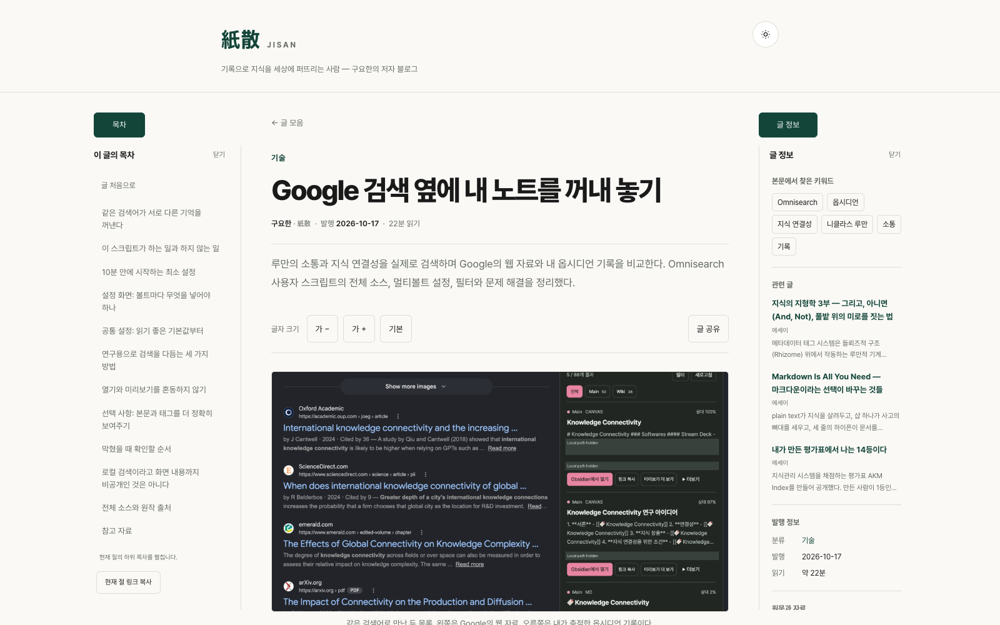
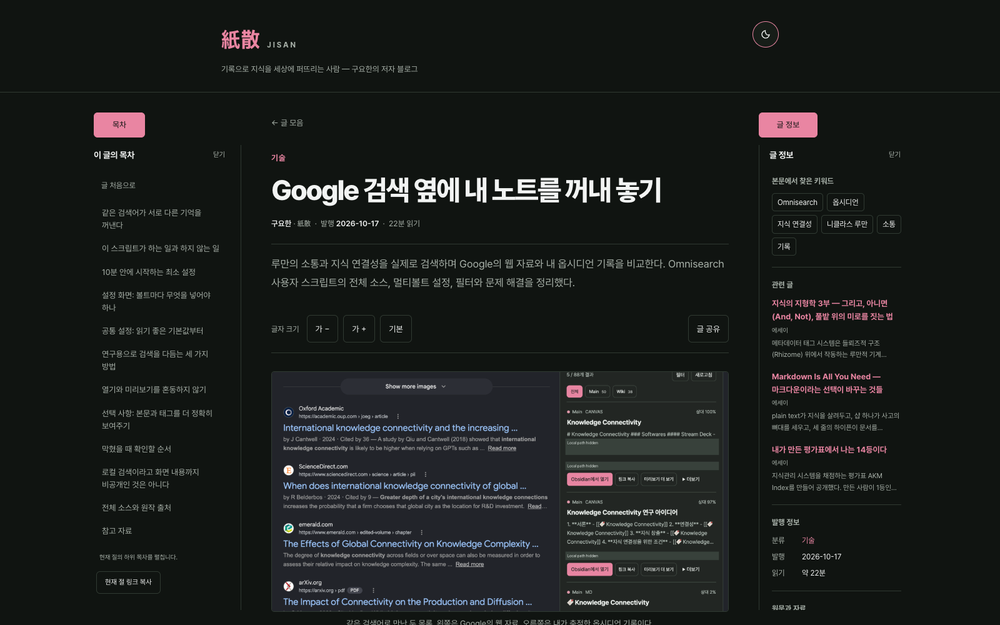
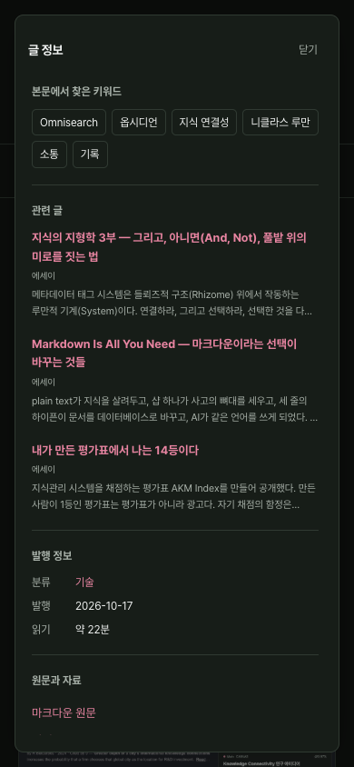
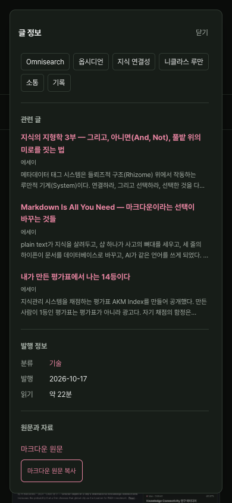

# Shared reader sidebars
Release state: deployed and verified in production on 2026-10-17. All 29 live article HTML/Markdown endpoints matched the local build/source; live desktop panels, keyword search and a second article's mobile drawer were exercised without production engagement writes.

## Scope and content contract
Both panels are generated by the common `build.mjs` article template for every current and future post. No per-post HTML patch is needed. Existing article Markdown, prose, slugs, dates, canonical URLs and the engagement API are preserved.

| Surface | Content | Source |
|---|---|---|
| Left | Heading hierarchy, active section, current-section link copy | The same H2–H4 sequence that generates article anchors |
| Right | Keywords | Author `keywords` first; otherwise deterministic matching against public title, summary, headings and body |
| Right | Related articles | Author `relatedPosts` first, then existing build-time similarity; maximum three |
| Right | Publication metadata | Existing kind, published/updated dates and reading-time estimate |
| Right | Source and resources | The existing public Markdown endpoint with a full-source clipboard button, plus already-linked attachments from this post's own `/images/{slug}/` directory |
| Right | Citation and canonical URL copy | Existing citation and canonical URL |

Automatic keyword labels are explicitly described as “본문에서 찾은 키워드”, not author-validated tags or semantic classifications. The fixed vocabulary is in `lib/reader-metadata.mjs`; Latin aliases match token boundaries, Korean aliases allow suffixes. Title/summary/headings/body weights are 12/7/5/1, with at most six matches. No LLM/API request is made. No evidence means no keyword section.

## Optional author metadata
Use hyphen lists in a post's frontmatter. Maintain the same author choices in the vault master and carry them through publication; do not edit only the derivative.
```yaml
keywords:
  - 옵시디언
  - 지식 연결성
  - Omnisearch
relatedPosts:
  - cmds-llm-wiki
  - topology-of-knowledge-2
```
`keywords` has up to eight distinct labels, each at most 64 characters. `relatedPosts` contains existing immutable post slugs, not titles or URLs. Missing slugs fail the build, self-links are omitted, and duplicates collapse. Existing posts need no metadata backfill to use the panels.

## Layout and accessibility
- At 1360px and wider, panels occupy the side margins and never change the main article's width or center. Default: left open, right closed. Desktop open/closed choices persist in guarded browser storage.
- Below 1360px, both start closed. Opening one creates a single modal drawer with a backdrop, focus containment, inert background and scroll lock. Escape, Close and backdrop click dismiss it; close returns focus to its trigger. Heading navigation closes the drawer and focuses the destination instead.
- Heading groups expand for the active section. A keyboard-focused child group stays available even if the reader manually scrolls elsewhere.
- Copy status is announced inside an open mobile drawer, not in the inert article behind it. The Markdown-copy button reads the same public `index.md` as the source link, including its public frontmatter, without HTML conversion. Loading disables repeat clicks; failures retain the source link and allow retry. A promised clipboard item preserves click activation while the source loads, with a text-only fallback.
- `[` toggles contents, `]` toggles information. Input fields, IME composition and modifier shortcuts are protected. Existing `/` and Cmd/Ctrl+K search shortcuts remain.
- Keyword links use `/?q=...`; the archive preloads that query and includes keyword labels in its search index.
- With JavaScript disabled, the existing inline TOC, article metadata, footer recommendations and citation stay usable. Older cached HTML without panels retains existing reader tools.
- Print hides the panels/controls/backdrop. Light/dark tokens and reduced motion remain shared with the reader.

## Files
- `lib/reader-metadata.mjs`: deterministic metadata helpers.
- `build.mjs`: shared panels and enriched search index.
- `assets/reader.css`, `assets/reader.js`: layout, toggles, scroll tracking and accessible interactions.
- `assets/search.js`: keyword query entry and ranking support.
- `scripts/seo_audit.mjs`: resolves linked `.md` endpoints as files rather than directories.

## Validation
```sh
npm ci
npm run build
npm test
npm run test:reader
node scripts/seo_audit.mjs
```
Browser tests use Playwright with installed Chrome and a loopback fixture server. Real production engagement requests are not made. `TEST_OUTPUT_DIR` optionally saves screenshots. The browser and local test server close after the run.

Verified: 26 build/API/metadata/audit tests; 21 browser scenarios covering all 29 posts; 320/390/768/1024/1280/1360/1440/1600/1920px, stable article geometry, TOC and section-copy behavior, modal focus, copy feedback, storage denial, legacy/no-JS fallback, keyword search, themes and print. All 29 source Markdown hashes were unchanged. SEO audit: zero failures, three pre-existing warnings.

## Screenshots
Both desktop panels are opened for comparison; the initial default keeps the right one closed.





## Changelog
- 2026-10-17: Implemented the shared reader-panel system and documented optional author metadata, accessibility and validation contracts.

### 2026-10-17 Markdown clipboard follow-up
Added full Markdown source copying below the source link. All 29 posts were copied and compared byte-for-byte; HTTP failure/retry, permission denial and the text-only fallback were tested.


