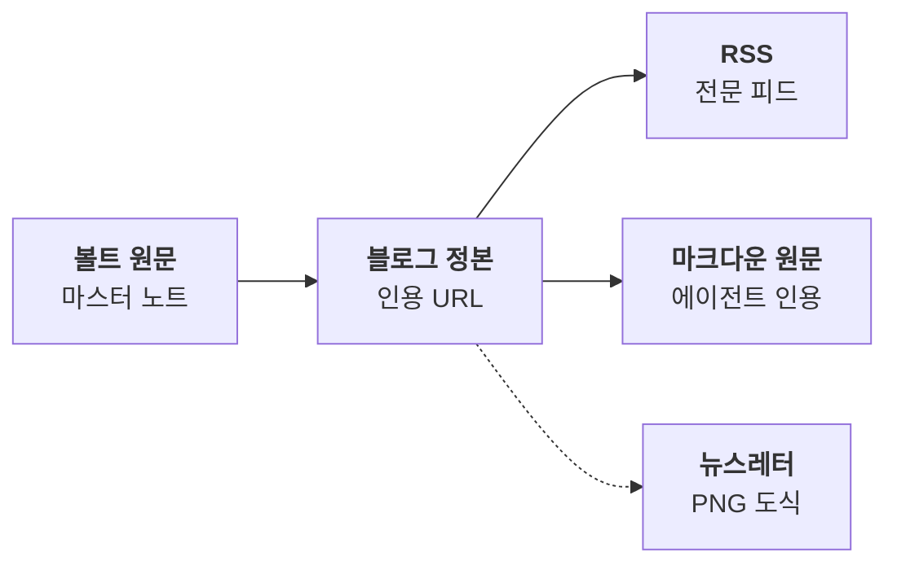
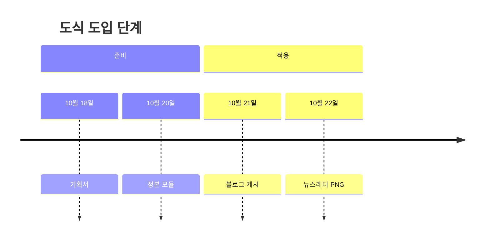
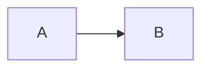

이 글은 시험용 픽스처다. 실제 발행 글이 아니다.

## 흐름 도식

볼트 원문은 블로그 정본을 거쳐 여러 채널로 퍼진다.


*코드로 렌더링한 도식. 볼트 원문이 블로그 정본 URL을 거쳐 RSS, 마크다운 원문, 뉴스레터로 퍼지는 흐름이다.*

## 시간 도식


*코드로 렌더링한 도식. 도식 도입을 준비와 적용 두 구간의 날짜순 단계로 정리했다.*

## 예시 코드 안의 도식

아래는 작성 예시다. 긴 펜스 안의 mermaid는 도식으로 렌더하지 않는다.

````markdown

*코드로 렌더링한 도식. 예시.*
````

끝.
